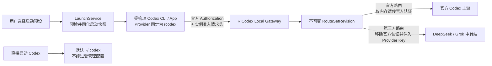

# R Codex 产品原理：独立工作区与多渠道模型

> 当前合同：2026-10-04 独立工作区，schema v20。默认 App 兼容投影、原配置快照与原地会话修复全部取消；安全白名单偏好种子化仍保留。
> [本次改造与验收](designs/2026-09-21-isolated-only-product-plan.md) 优先于下文历史设计中已取消的默认 App / 双入口条款；官方账户与订阅路由仍未开放。

## 1. 产品目标

R Codex 只管理自己的 Codex 环境。主界面只有 R Codex 工作区：配置多个模型渠道，选择模型和一个 API 登录渠道，点击图标启动（hover「启动」）；可启动 App 或 CLI，不暴露默认/隔离双入口。

模型渠道是全局资源，工作区引用一个或多个渠道及其模型，选择列表第一项为默认模型。一次启动固化配置与路由，运行期间不热改依赖。用户直接打开的 Codex 使用其原有配置，R Codex 不读取或接管。

Codex 的进程级 Provider 身份统一为 rcodex，真实渠道由 Gateway 按模型 ID 精确选择。登录渠道只用于 R Codex 环境的客户端 API 登录，不决定其他模型的请求凭据。

官方账户、订阅模型混合路由仍属于未开放的扩展设计；历史对象不自动恢复。

## 2. 不可妥协的产品承诺

1. 不读取或修改原 Codex 的 config.toml、auth.json、Cookie、Electron 登录数据；只复制或同步明确白名单内的安全偏好、插件开关和指导文件，不复制认证、会话、MCP 或运行时数据；不提供清理或恢复向导。
2. App/CLI 使用 R Codex 自有目录。App 重启复用稳定工作区，模型/目录/认证变化只作用于 R Codex。
3. API 登录密钥来源于系统凭据库，仅可投影到 R Codex 自有 auth.json，原子更新和私有权限；不复制原账户令牌。
4. 每次启动固定路由与凭据修订，活动依赖锁定；第三方请求按精确渠道认证，原官方认证不得转发。
5. 只提供显式、按项目、停机后的「我的 Codex → R Codex」单向复制；源不写入，不自动双向同步。
6. 能力如实声明，失败明确，不自动改历史、换渠道、换模型或重试 POST。
7. 网关仅监听本机回环。完整请求档案与普通诊断分离，正文不进入普通日志或全局状态。
8. 真实桌面与 Windows 合同未验收时明确标注，不能由自动化夹具推定通过。

## 3. 产品对象与边界

API Key Provider 与官方账户不是同一种资源。它们可以在一个启动预设中组合，但不得合并存储、状态或操作语义。

| 对象 | 产品含义 | 拥有的状态 | 不拥有的状态 |
| --- | --- | --- | --- |
| `OfficialAccount` | 由官方 Codex 完成登录的逻辑账户 | 本地备注、脱敏身份、套餐投影、认证状态、可选官方限额、凭据目录引用 | API Key、Provider Endpoint、第三方模型余额 |
| `ApiProvider` | 一个 API 接口服务及其凭据 | 名称、Base URL、协议适配、API Key 修订、模型发现、余额、连通性和本地用量 | ChatGPT 套餐、官方登录状态、官方账户身份 |
| `ModelRoute` | 一个对 Codex 可见的模型到一个上游模型的精确映射 | 公共路由 ID、显示名、来源修订、上游模型 ID、能力和转换策略 | 凭据原文、动态账户池、自动回退目标 |
| `RouteSetRevision` | 一次启动可使用的不可变模型集合 | 可选官方账户修订、一个或多个 Provider 修订、模型路由和能力摘要 | 运行期自动发现结果、后来修改的 Provider |
| `LaunchPreset` | 用户命名、可复用的启动草稿 | 可选官方账户、Provider、选中模型、工作区、启动目标和界面偏好 | 当前活动状态、运行时凭据原文 |
| `LaunchConfigurationRevision` | 启动预检后生成的不可变快照 | RouteSet、Profile、Gateway、Codex 版本、目录和配置摘要 | 对逻辑资源的运行期重新解析 |
| `RuntimeInstance` | 由 R Codex 启动并监督的 CLI 或 App 实例 | 启动配置修订、进程身份、状态、回执和活动资源锁 | “当前全局账号”、可热切换模型来源 |

账户与 Provider 在 UI 中可以统一放在“账户与密钥”控制面，但必须使用差异化卡片、详情字段和操作。统一发生在启动预设与模型路由层，不发生在凭据数据模型层。

一个启动预设选择零个或一个官方账户，可以选择一个或多个 API Provider，并从每个来源选择零个或多个模型。零个官方账户表示纯 API Key 预设；选择一个官方账户后，可以形成纯官方或“官方 + API Provider”的混合预设。三种预设共用同一启动快照与资源锁契约。

### 3.1 官方账户的套餐边界

R Codex 不把“普通账户、Plus、Pro”实现成不同认证类型，也不维护允许登录的套餐白名单。凡是能够通过官方 Codex `app-server` 完成 ChatGPT 登录并被官方确认可使用 Codex 的个人账户或受管工作区账户，都可以作为 `OfficialAccount` 添加。普通个人账户在产品文案中应明确显示为官方返回的实际套餐，例如 Free；未知的新套餐保留官方值并以“未知套餐”兼容展示，不阻止登录。

套餐仅影响官方实际授予的模型、功能、额度、速率限制、积分和工作区策略，不影响 R Codex 的账户隔离、启动、锁定或路由机制。R Codex 只读取官方返回的 `planType` 和非敏感权限投影用于展示、预检与诊断，不根据套餐名称推断固定模型清单，也不承诺 Free、Plus 或 Pro 永久包含某个模型。

如果账户登录成功但目标官方模型不可用、额度耗尽或工作区策略禁止访问，R Codex 必须呈现官方错误；不得自动改用另一个官方账户、第三方模型或 API Key。

| UI 维度 | 官方账户卡片 | API Provider 卡片 |
| --- | --- | --- |
| 身份 | 脱敏官方身份、本地备注、套餐 | Provider 名称、主机、传输和适配器 |
| 状态 | 授权状态、最近官方检查、可选官方限额 | Key 是否存在、连通性、模型发现、上游余额 |
| 统计 | 官方明确返回的限额，不混入本地 Token 估算 | 本地请求/Token 观测及 Provider 公开余额 |
| 操作 | 连接、重新授权、刷新、断开、删除 | 测试、刷新模型、替换 Key、编辑、删除 |

## 4. 总体原理

Codex 一次只选择一个 `model_provider`，而用户希望同时选择来自多个来源的模型。因此 R Codex 必须把所有受管理模型呈现为同一个专用 Provider，并由本地 Gateway 根据公共模型 ID 再选择真正的上游。

这是刻意的产品下注，不是误把多渠道当成多份 Codex Provider。CC Switch / Cockpit 一类工具通常一个活动 Provider 对一个上游，所以改显示名就能整段切换本地压缩或远程压缩。R Codex 把多个 `ApiProvider` 的模型合成一份目录，换来的是「同一实例内点选、不重启」；付出的是：凡是 Codex 绑在 Provider 名/ID 上的能力，都不能再按当前转发模型拆开。Gateway 只能分流**已经发出的请求**（URL、Key、协议、能力预检、远程压缩触发后的透传/摘要/失败关闭），不能把进程级合同改成「Grok 本地压缩、官方 GPT 远程压缩」。

| 能按模型（RouteSet）拆开 | 不能按模型拆开，整份目录同一套 |
| --- | --- |
| 上游 URL、API Key、官方 vs 第三方认证通道 | 活动 `model_provider` 身份（统一 `rcodex`） |
| `wire_api`、工具/图像/推理档位预检 | 远程压缩 vs 本地压缩（**当前**看 Provider 显示名是否 `OpenAI`；若目标 Codex 日后提供官方本地压缩配置则跟随该键，见下） |
| 公共 ID ↔ 上游 ID、失败不换路 | `requires_openai_auth`、会话里的 `model_provider_id` |
| 目录 overlay 身份句、审核跟随当前模型 | 官方 MCP / ChatGPT 专属能力是否按官方会话存在 |

产品承诺「同时可选」只覆盖选择器与请求级路由，不覆盖「每个模型都表现得像自己的原生 Codex Provider」。跨来源历史、压缩信封、官方 compact blob 仍按第 8 节和第 13 节失败关闭，不靠合成目录假装兼容。不要为了压缩把隔离门面改名为 `OpenAI`，那会放弃混合目录下唯一的客户端本地压缩信号。

独立启动固定使用 rcodex / R Codex Gateway，沿用已探针的 LocalClient 合同。没有默认 App 入口、本地压缩开关或历史 Provider 原地修复。显示名与会话 Provider ID 是不同字段；不通过改 ID 修复压缩，不在失败时自动换压缩路径。2026-09-18 的版本探针只说明该版独立入口不会发送 compaction_trigger，后续版本仍应验证。

#### 跟随 Codex 官方本地压缩配置

R Codex 把「这次进程走本地还是远程」当成 **Codex 客户端合同的投影**，不是 R Codex 私有的永久开关。今天投影的是显示名；明天若目标 Codex 版本提供真正生效的官方配置（公开讨论与 issue 里出现过的名字包括 `supports_local_compact`、`compact_mode = "local"`、恢复后的 feature 旗标等，**以该版本实际文档与可执行文件为准**），R Codex 必须跟随兼容，而不是继续只靠改名：

1. **先探针，后写入。** 只对本次启动的 Codex 可执行文件验证：该键被解析、能改变压缩路径，并且不会把 OpenAI 名 Provider 打到已退役的 V1 `/responses/compact`。未发布、被忽略或行为等于 V1 404 的键（今天的 `compact_mode = "local"`、`features.remote_compaction_v2 = false`）**不得**写入用户配置。
2. **启动时物化官方键。** 用户仍用现有双入口表达意图（隔离 = 希望本地；默认 App = 在必须保留 `OpenAI` 名时接受远程）。若探针证明官方键能让名为 `OpenAI` 的 Provider 走本地，默认 App 的 `compactMode` 可以变成 `local_client` 而不改名、不修历史。若官方键只作用于非 OpenAI 名，隔离路径继续写它作为显式声明，默认 App 仍是 `remote_v2`。
3. **Gateway 仍看这次启动实际会不会发 `compaction_trigger`。** 官方键改变的是 Codex 选哪条路径；R Codex 的 `compactMode` 必须与探针结果一致。看见 trigger 仍等于远程路径，Summarizer 仍不是本地失败的运行时后备。
4. **一次只认一套生效合同。** 不得同时写互相打架的名称门补丁和官方键；不得在 compact 回合内探测「这个版本支不支持本地」再换路。
5. **文档与目录随版本字典更新。** 新键进入 `CodexCatalogCompatibility.compact_contract` / 启动物化器后，同步产品原理、详细设计 §8.2.1 和本执行计划的配置表。跟随对象是**当前安装的 Codex**，不是历史版本清单；未探针的版本保持今天的名称门行为。

这条跟随义务不授权提前伪造键，也不改变「同一次压缩不换路、伪造 `gpt-*` fail-closed、隔离不做 Summarizer」的硬边界。



这形成两条彼此隔离的链路：

- **控制面**：管理账户、Provider、模型、预设、修订、锁和实例状态；
- **数据面**：Gateway 只按已固化路由处理当前模型请求，不决定用户账户、不修改配置、不创建新修订。

## 5. 显式启动与环境隔离

R Codex 启动 App 时设置独立 CODEX_HOME、与该 home 相同的 CODEX_SQLITE_HOME、Electron 用户数据与真实可监督进程；CLI 使用自己的实例目录、Profile 和模型选择。隔离 App 不得再把活动对话库放到独立的 `managed-app-sqlite/<preset>`。生成配置只使用工作区事实与 R Codex 环境内偏好。版本/目录探针也使用独立临时目录。

工作区保存 loginProviderId，单渠道默认选择该渠道，多渠道需指定。所选 Key 只写 R Codex 自有 auth.json，配置使用文件凭据存储。登录失败必须撤销本次绑定与运行锁。原 Codex 的登录与配置不参与流程。

拒绝旧 compat_app/compat_cli 启动。schema v18 停用 R Codex 自有库中的历史兼容绑定、运行锁和运行记录，并增加模型选择的推理档位字段；不读取旧回执、不停止用户进程、不还原旧默认配置。关闭 R Codex 窗口不必然停止有活动绑定的 Gateway。

独立环境压缩沿用 LocalClient、显示名 R Codex Gateway；没有用户可切换的本地压缩开关。版本合同变化时先探针，不能将显示名改为 OpenAI 来恢复默认 App 语义。

## 6. 混合模型 Provider

受管理实例始终使用专用 Provider ID `rcodex`，不通过根级 `openai_base_url` 把第三方模型伪装成内建 `openai` Provider。

混合或纯官方启动的概念配置如下：

```toml
model_provider = "rcodex"
model_catalog_json = "/managed/revisions/<revision>/models.json"

[model_providers.rcodex]
name = "R Codex Gateway"
base_url = "http://127.0.0.1:<port>/v1"
wire_api = "responses"
requires_openai_auth = true
env_http_headers = { "X-RCodex-Instance-Key" = "RCODEX_INSTANCE_KEY" }
```

OpenAI Docs 当前说明：自定义 Provider 可以设置 `requires_openai_auth = true`，让 Codex 使用 ChatGPT 登录或 OpenAI API Key 访问大模型代理；`env_http_headers` 可以从环境变量填充额外请求头；`model_catalog_json` 可以指定启动时加载的模型目录。以上是产品可行性的官方配置基础，但不等于 OpenAI 对“ChatGPT 订阅访问第三方模型”的功能或条款背书。

纯 API Key 启动仍使用同一个专用 `rcodex` Provider 和实例请求头，但必须设置 `requires_openai_auth = false`，不要求用户登录官方账户，也不产生官方 `Authorization`。无论哪一种预设，Provider ID、公共路由格式和会话恢复规则保持一致。

### 6.1 两条认证通道

`Authorization` 只承担 Codex 官方认证。`X-RCodex-Instance-Key` 只承担本机实例准入和 RouteSet 选择。二者不能复用同一个请求头，也不能使用 OpenCodex 当前依赖的“`env_key` 覆盖 Authorization 后由代理再找回官方凭据”策略，因为 OpenAI Docs 明确说明 `requires_openai_auth = true` 时会忽略 `env_key`。

### 6.2 官方登录、API Key 模型模式

保留 Cockpit 所提供的“客户端使用官方账户登录，但实际模型请求走 API Key Provider”产品能力。在 R Codex 中，它不是一种新的账户类型，而是混合启动预设的一种明确组合：

当前已实现其中的安全子集：官方账户只作为 Codex 客户端身份前置，所有实际可选模型必须来自 API Provider；这种组合可经 Gateway 启动。官方模型本身经自定义 Gateway 转发仍保持关闭，直到认证代理合同完成验证。

- 预设选择一个可选官方账户，供受管理 Codex 完成官方登录、呈现账户状态并满足目标客户端版本的身份前置要求；
- 预设同时选择一个或多个 API Provider 及其模型；
- 用户选中第三方模型后，Gateway 必须删除该请求携带的官方 `Authorization`，仅向模型绑定的 Provider 注入对应 API Key；
- 该第三方推理请求不发往官方模型上游，因此不把该次推理计入官方模型额度；Codex 自身可能存在的独立账户状态或控制面请求不在此承诺范围内；
- 用户在同一实例中改选官方模型时，Gateway 才使用当前请求携带的官方认证并转发至允许的官方上游。

因此，这个模式比“给 API Key 账户绑定一个 OAuth 账户”更精确：官方账户和 API Provider 始终是两个独立资源，只有不可变的启动配置把它们组合起来。不得复制官方凭据到 API Provider、把官方账户变成 Provider 账户池，或在任一路由失败时自动改用另一条认证通道。

如果官方认证失效，Codex 可能在第三方请求到达 Gateway 前就拒绝当前混合实例。R Codex 必须呈现该官方失败并要求用户停止实例后重新授权或改用纯 API Key 预设，不能在运行期把混合实例静默降级为纯 API Key。

### 6.3 精确模型路由

Gateway 不使用模糊前缀、Provider 声明顺序或“默认 Provider”猜测路由。处理顺序固定为：

1. 验证回环来源和实例密钥；
2. 解析实例密钥绑定的 `RouteSetRevision`；
3. 用请求中的公共模型 ID 做精确查找；
4. 校验该模型允许的协议、工具、图像、推理和上下文能力；
5. 按路由类型选择官方或 API Provider 凭据通道；
6. 转换请求并转发；
7. 把响应中的模型身份恢复为公共路由 ID，保持会话身份稳定。

公共路由 ID 使用稳定、无斜杠、无凭据信息的内部标识；模型选择器依靠 `display_name` 展示人类可读名称。这样可以避免 `provider/model` 斜杠命名在 Codex 恢复与官方模型校验中的歧义，也不会因为用户重命名 Provider 而改变已有会话的模型 ID。

### 6.4 官方路由

官方模型请求只能：

- 使用当前受管理 Codex 请求携带的官方认证；
- 在 Gateway 内存中完成最小检查和透传；
- 发往版本门和发布策略允许的官方目标；
- 不落 SQLite、不进日志、不进崩溃报告、不进入 UI 状态。

R Codex 仍然不能读取官方认证目录来提取 token，也不能把官方账户放入账户池。官方认证失效、套餐限制、模型不可用和限额耗尽必须保持官方失败语义，不得用 API Key 路由兜底。

### 6.5 第三方路由

第三方模型请求必须在选择上游之前删除官方认证请求头，再从系统凭据库读取该路由固定引用的 API Key 修订。第三方 API Key 只存在于 R Codex 受信任后端和当前上游请求中，不进入 Codex 环境、命令行、模型目录或实例回执。

Gateway 可以为明确支持的 Provider 执行 Chat Completions 到 Responses 的受限转换，但模型目录必须反映转换后的真实能力。首版 Chat 转换只声明文本能力，因而会在上游请求形成前移除 Codex 自动附带的工具定义；这不是删除对话内容。遇到无法表达的图像、实际工具回合或服务端历史引用时，返回稳定兼容性错误，不删除用户内容后继续，也不自动切换模型。

## 7. 模型目录原理

模型目录是一次启动的能力快照，不是运行期实时注册表。

模型目录交互分为“发现”和“暴露”两步：连通性检测读取并规范化上游完整目录；用户在启动预设中明确勾选本次要暴露的模型，并可分别填写 Codex 公共 ID 与显示名称。只有勾选项进入该启动配置的不可变 RouteSet，未勾选项不会出现在受管理 Codex 的选择器中。

目录生成采用以下优先级：

1. 用户在启动预设中明确选择并映射的模型；
2. 最近一次成功并经过规范化的同一 Provider 修订模型发现结果；
3. 用户为该 Provider 手工声明的模型；
4. 经目标 Codex 版本验证的官方模型模板。

模型发现失败时可以使用同一 Provider 修订的最后一次成功缓存，但必须标记陈旧时间；不得凭空恢复已删除的模型，也不得把一个 Provider 的模型归给另一个 Provider。

每个目录项至少包含：

- 稳定公共路由 ID 与显示名称；
- 来源类型和非敏感来源标签；
- 上下文窗口与最大输入限制；
- 支持的输入模态；
- 推理档位；
- 工具、搜索、图像和 WebSocket 能力；
- 对应转换器版本和兼容状态。

推理档位不得从 Provider `GET /v1/models` 推断，也不得在 overlay 为空时继承 GPT 模板的 `max`/`ultra` 与错误默认档。第三方 `base_instructions` 和 `model_messages.instructions_template` 开场不得保留 GPT-6 自称；未验证的 GPT 子 agent 推理档、速度档与 Node REPL 能力也不得随骨架泄漏。Codex 通用多 agent 合同与本地代码工具继续保留。发现接口只负责模型 ID；Codex 目录的身份、档位合同来自用户勾选或模型族 profile。完整合同见[第三方模型目录 overlay](third-party-model-reasoning-levels.md)。

本代工作区的 compactMode 为 local_client，客户端摘要作为普通模型请求转发。GatewaySummarizer 和 NativeRemote 的历史实现不参与新工作区选择；不从模型名或目录字段推断官方压缩能力。若 Codex 的官方配置合同改变，先验证再调整物化规则，不能恢复旧默认 App 兼容入口。

运行中的 Codex 和 app-server 可能缓存模型目录，因此修改 Provider 模型列表只影响下一次显式启动。R Codex 不对活动实例热刷新目录。

Codex 的审核、子代理或其他特殊任务模型不视为普通上游目录项。当前本机 bundled Codex 暴露的隐藏审核模型是 `codex-auto-review`；公开讨论中的 `gpt-code-review` 未作为稳定公开模型确认。API Key 受管理 Profile 会移除继承的 `review_model`、`agents.default_subagent_model` 和其推理档位。对第三方 Responses 路由，每个目录条目的 `auto_review_model_override` 仍指向自身公共模型 ID，供该版本在真正进入自动审核时使用。隔离 Profile 写入 `approval_policy = "on-request"`，并且不写 `approvals_reviewer`。合并进 `config.toml` 时会删掉以前的 `auto_review`。Codex 0.162 的终端界面在策略缺省时使用 `granular` 且 `sandbox_approval = false`，沙箱提权会被直接拒绝；`on-request` 保持工作区沙箱，离开沙箱前询问用户。Chat-only 路由不启用审核覆盖。

运行方案通过普通 Responses API 模型的目录条目提供角色替代路由。它是对普通公共路由的角色引用，不是新增模型：Codex 通过目标版本要求的角色覆盖字段（自动审核当前为 `auto_review_model_override`）请求该条目的自身公共 ID，Gateway 按原有 Provider 与凭据精确转发。特殊模型始终隐藏，只在控制面显示“由自动审核/子代理调用”等说明。前端不提供第二个审核模型选择；用户切换当前对话模型时，审核随同系列条目自动变化。角色请求失败时失败关闭并记录诊断，不自动回退。

最终产品模型目录采用“普通模型选择器 + 特殊角色信息”双表面：普通选择器只显示通过 Provider 白名单、用户黑名单和能力校验的普通路由；特殊角色不出现在 `/models` 或普通勾选列表中。控制面为每个已探测角色展示调用说明、原生可用性和自动跟随状态。角色定义、能力合同和失败策略由后端版本化维护，前端不根据字符串猜测内部模型。

实现约束：启动方案编辑器会从模型渠道的 `/models` 结果中隐藏 `codex-auto-review`、`gpt-code-review` 及同类 Codex/GPT 审核角色 ID，不提供这些模型的勾选入口；即使历史方案中已有这类路由，受管理 App 目录也会将其标记为隐藏且不可用于 API。这样由 Codex 自己决定何时调用内部角色，R Codex 不把它们当作普通模型供用户选择。工作区勾选和探测结果在隐藏数量大于 0 时说明：已隐藏 N 个 Codex 系统角色模型，它们用于自动审核或子代理等特殊调用，不会出现在 Codex 模型目录，也不能作为普通模型加入工作区。 工作区勾选只列出对话模型。图像生成模型（ID 含 imagine、dall-e、gpt-image、imagen，或以 image 加版本结尾，例如 grok-imagine-image-2.0）走单独的生图接口，不进入 Codex 对话目录，也不出现在工作区勾选中。模型目录抽屉列出探测到的全部模型，并给每条写明用途。

当前实现补充：后端通过 `get_codex_special_model_roles`（特殊角色控制面 IPC，负责读取当前 bundled Codex 模型目录并返回角色状态）向启动方案编辑器提供“系统角色”只读面板。面板说明自动审核、子代理编排等角色的调用方，并显示原生能力状态；第三方 Responses 条目自动绑定自身审核覆盖，子代理角色仍只读，避免把未经验证的字符串猜测写入配置。

## 8. 会话、恢复与模型切换

R Codex 新会话的 model_provider 固定为 rcodex。跨渠道切换只在请求边界发生；历史推理密文、工具关联、图片及私有状态必须符合目标模型合同，不得静默删历史或自动换回原渠道。

用户主动扫描并选择项目后，可以只读复制源会话到 R Codex。预览仅展示元数据；确认双方 Codex 已退出后再次停机检查。只改目标副本首条 session_meta 的 Provider 与目标索引路径；同 ID 跳过，写入失败回滚，源 config/auth/数据库/日志/正文保持原样。

目标必须先由 Codex 初始化，与源 threads 列结构一致。外部附件不搬运，保留原路径。导入成功不保证跨模型无损续聊；不支持热同步、反向导出或原地 Provider 修复。详见[导入合同](designs/2026-09-21-isolated-only-product-plan.md#4-项目会话导入)。

## 9. 实例监督与配置锁

### 9.1 状态机

```text
draft -> preflighting -> launching -> running -> stopping -> exited
                    \-> failed
                    \-> orphaned
running / orphaned -> degraded
```

- `launching`、`running`、`stopping`、`orphaned` 和无法证明退出的 `degraded` 都持有资源锁；
- 只有确认真实 Codex 进程退出后才释放锁；
- PID 存活但进程启动身份、可执行文件、`CODEX_HOME` 或 App 用户目录不匹配时，不得误认成原实例；
- 派发结果不确定时保持 `orphaned`，不提供无证据的强制解锁。

### 9.2 监督方式

CLI 使用轻量 launcher 获取真实 CLI PID、启动身份和退出回执。实例密钥在启动时由主进程生成，哈希写入 SQLite，明文只存在内存和实例私有目录的一次性命名管道里，交给 Terminal 派生的 launcher；不写入钥匙串，launcher 也不再回退钥匙串。渠道 API Key 仍以系统凭据库为真源。App 启动需要解析真正的 Codex/ChatGPT App 进程，不能保存一次性系统启动器 PID。

R Codex 不为每个实例运行高频心跳。状态核验发生在：

- 应用启动和恢复；
- 实例列表读取；
- 启动、停止和聚焦操作；
- 对可能被锁资源执行修改、重新授权、断开或删除之前；
- 操作系统提供可靠退出事件时的事件回调。

该方式借鉴 Cockpit 的“持久化最近 PID + 按实例目录解析实时进程”思路，并保留 R Codex 的启动身份和回执校验。内存开销主要来自每个活动 CLI 的轻量等待进程和一个共享 Gateway，不需要为每个实例常驻 app-server 或轮询线程。

启动失败诊断同样按实例隔离：Tauri 派发和 `codex-launcher` 追加有上限的 `startup.log`，记录启动阶段、凭据读取结果、进程创建、回执写入和退出码。运行实例界面可展开查看失败、未确认或降级实例的脱敏日志；API Key、实例密钥、Authorization 原文和完整敏感 URL 不进入日志。Codex 自身的交互输出仍保留在它实际打开的 Terminal 中，避免 R Codex 通过额外日志管道改变 CLI 的终端行为。

失败或已退出的实例记录可以显式删除；删除不会停止任何进程，只在后端确认实例已终止且配置锁已释放后移除实例记录、已撤销的 binding 和实例专属数据。受管理 App 删除其专属 `CODEX_HOME`（含已对齐的对话索引），并 best-effort 删除旧的 `managed-app-sqlite/<preset>` 残留。Electron 桌面数据放在该实例的生命周期目录中，不再在隔离实例之间共用。CLI 只删除自己的生命周期目录。模型渠道/API Key、启动方案、工作区级请求档案和用户默认 Codex 不受影响。活动或未核验状态不提供删除入口。

### 9.3 锁定范围

一个活动实例锁定：

- `LaunchPreset` 当前版本；
- `LaunchConfigurationRevision`；
- `RouteSetRevision` 和全部 `ModelRoute`；
- 官方账户及其凭据修订；
- 所有被引用的 API Provider 与 API Key 修订；
- 命名 Profile、模型目录和 Gateway 修订；
- 影响请求语义的工作区和启动参数。

存在锁时，R Codex 必须拒绝修改、重新授权、断开、替换或删除，不得像 Cockpit 的部分冲突转移流程那样自动停止其他实例、回收 token 后继续操作。用户必须显式停止实例，再重新提交修改。

渠道显示名是例外。改名只更新渠道记录上的名称，不新建 API Key 修订，也不改写正在运行的路由快照。已经启动的实例继续使用启动时写入模型目录的名称，下次启动才使用新名称。

## 10. Gateway 生命周期与多实例

Gateway 是共享的本机数据面，不再全局绑定单个 Provider。每个受管理实例获得独立实例密钥，实例密钥只解析到一个不可变 RouteSet。这样可以同时支持：

- 一个实例：官方 GPT + 中转站 DeepSeek/Grok；
- 另一个实例：另一个官方账户 + 另一个中转站；
- API-key-only 实例；
- official-only 实例，但仍通过同一专用 Provider 保持会话身份一致。

多个受管理 Codex App 可以同时运行；同一条实例未退出时不能再次启动。所有隔离空间共用一个 Gateway。R Codex 启动时就调用 `ensure_serving()`，在 `127.0.0.1:43123` 等待绑定；每个正在运行的隔离 CLI 或 App 各登记一条绑定。控制令牌文件丢失但端口仍被 `codex-gateway` 占用时，窗口仍打开，并使用系统标题栏。失联时，页面里的「R Codex」右侧显示「重启」。平时不显示 Gateway 空闲或转发。关闭窗口只隐藏控制面。菜单栏「退出」以及其他非重启退出会先停止全部活动隔离实例，再 `stop_if_unused()`。只有 Tauri 重启退出码保留实例和 sidecar；开发热更新从外部结束控制面进程，独立 sidecar 留下并由下次启动复用。5 秒没有启动回执返回 `launch_unconfirmed`，不拆绑定。sidecar 源码或二进制更新只在显式停止旧 Gateway 后重新启动时生效。Gateway 崩溃时实例进入 `degraded` 并保留锁，重启 Gateway 只能恢复同一修订和同一实例密钥，不得重新解析最新逻辑配置。

## 11. 从参考项目借鉴什么

| 参考项目 | 借鉴 | 不采用 |
| --- | --- | --- |
| OpenCodex（`lidge-jun/opencodex`） | 一个 Gateway 汇聚多 Provider；模型目录合并；显式 `provider/model` 路由；Responses 透传与受限转换；公开 ID 与显示名分离；能力元数据；外部 Provider 管理器所有权保护；非原生模型以 `tool_mode: "code_mode_only"` 保留 Codex 本地 `exec` 和嵌套 MCP | 修改默认 `~/.codex`；默认回环 `openai_base_url` 注入；模糊前缀和默认 Provider 猜测；账号池、自动轮换、失败回退；LAN 服务；由代理持久化官方 Codex token；把 MCP 认证或 MCP 生命周期隐式归属给模型 Provider |
| Cockpit Tools | 账户卡片与实例分离；每实例目录和启动参数；真实运行 PID/目录核验；多实例状态视图；启动冲突保护；本地 sidecar 生命周期经验 | token/JSON/浏览器会话导入；全局切号；修改默认 Codex；自动唤醒；冲突时自动关闭实例；把敏感 token 暴露给前端类型或导出；非公开配额/认证接口 |

参考实现用于验证产品形态和失败模式，不是代码复制来源。Cockpit Tools 的默认许可证为 CC BY-NC-SA 4.0，R Codex 不复制其受该许可证约束的代码；OpenCodex 的具体实现也不能覆盖 OpenAI Docs 和 R Codex 自身安全边界。

### 11.1 OpenCodex 的 Provider / MCP 边界（核对日期：2026-08-26）

这里的 OpenCodex 特指 [lidge-jun/opencodex](https://github.com/lidge-jun/opencodex)，不是同名的 OpenCode 项目。它的接入方式对本项目的 MCP 设计有一个容易误读但重要的结论：

- OpenCodex 的核心写入路径是 Codex 的 `config.toml` 和模型目录；它把请求按明确的 `provider/model` 选择路由到代理上游，Provider 自己持有 adapter、base URL 和认证模式。[Codex Integration](https://opencodex.me/guides/codex-integration/) [Model Routing](https://opencodex.me/guides/model-routing/)
- OpenCodex 支持 Codex CLI；其默认本地注入保留 Codex 内置 `openai` Provider 和已有的官方登录态（保留是为了不破坏原生 OpenAI/sidecar 能力，并不要求用户登录官方账号才能使用第三方模型），只写入 `openai_base_url` 指向本地代理。使用 Grok API Key 时，OpenCodex 将 Key 保存在自己的 Provider 配置中，由代理在上游请求边界注入；选中的 Grok 模型请求进入 OpenCodex，而 Codex 自己发起的 MCP 请求仍使用 Codex 原生配置和认证，不会被代理改写成 Grok 请求。[Codex Integration：Config injection](https://opencodex.me/guides/codex-integration/#config-injection) [Quickstart](https://opencodex.me/getting-started/quickstart/)
- 对非原生模型，OpenCodex 生成 `tool_mode: "code_mode_only"`，让 Codex 继续提供本地 `exec` 入口和其下的 Browser/Computer Use 等嵌套 MCP；OpenCodex 只转换模型的普通工具调用，不接管本地工具执行。[Routed local tools](https://opencodex.me/guides/codex-integration/#routed-local-tools)
- 因此，OpenCodex 并没有“选择 Grok 后自动关闭 OpenAI 专用 MCP”的通用规则，也没有把 `openaiDeveloperDocs` 的认证自动替换成 Grok API Key；有官方登录时它会保留并继续使用，没有官方登录时第三方 Grok 模型仍可工作，但需要关闭或单独认证依赖官方身份的 MCP。MCP 的 URL、认证、启用状态和客户端启动仍属于 Codex 配置边界；模型 Provider 路由与 MCP 连接是两条独立路径。若 Codex 自己仍报告 MCP 启动失败并等待，OpenCodex 代理无法拦截该启动阶段。
- OpenCodex 的能力元数据会影响工具是否展示。工具调用能力不足、错误的搜索工具能力标记或过大的 MCP 工具目录，都可能导致 routed model 看不到或无法使用客户端 MCP；这类问题应在模型目录和工具能力层诊断，而不是把 MCP 403 伪装成上游模型错误。

对 R Codex 的直接约束是：受管理 Grok Profile 不能无条件复制 ChatGPT 环境的 MCP。由于 R Codex 的安全边界明确禁止把官方 Authorization 带入第三方 Grok 请求，不能简单照搬 OpenCodex 的“保留官方登录态”方案；应为 MCP 增加独立的来源、认证模式、启用状态和启动/请求超时，默认关闭需要官方会话的 `openaiDeveloperDocs` 以及 ChatGPT 专用 `node_repl` 等服务。用户显式启用后，MCP 失败应以非阻塞警告呈现，并继续尝试首个模型请求；只有模型请求本身才进入对应 Grok RouteSet。需要文档工具时，应配置具有独立认证合同的目标 Provider 文档 MCP，而不是把 OpenAI MCP 的身份交给 Grok 路由。

### 11.2 Codex App 接入决策（核对日期：2026-08-27）

“打开 Codex App”与“运行实例以 Codex App 为启动目标”是两个不同的产品能力：前者只是启动原生桌面应用并进入工作区，后者还必须注入隔离状态、启动配置、模型目录、账户引用和实例准入，同时监督真实桌面进程。当前 `open_codex_app` 继续使用 App 自身默认登录和配置；受管理 App 已有独立启动骨架，但仍由兼容性门控制。产品目标不是 Codex App 多开，而是让一个运行实例在 CLI 与 App 两种启动目标之间复用同一套 Provider、RouteSet、Gateway 和最小请求账本合同。

- Cockpit Tools 可作为桌面实例生命周期的参考：每实例用户数据目录、`CODEX_HOME`/Electron 数据隔离、真实 Codex 进程 PID/目录核验、启停确认和账户占用保护。其实现依赖客户端运行时和进程特征，必须按平台与 Codex 版本设置兼容门，不能复制其代码或未经验证的凭据操作。
- OpenCodex 可作为 Provider、模型目录和可逆配置注入的参考：Codex CLI/TUI/App/SDK 共享 Codex home，长驻 `app-server` 可能缓存模型目录，配置同步后需要重启相关进程。它是本地代理与配置管理器，不替代桌面 App 的多实例进程监督；其修改默认 `config.toml`/`openai_base_url` 的路径不适用于 R Codex 的默认环境保护。
- 受管理 App 启动目标使用目标专用适配器，而不是把 CLI 参数直接扩展到 App：运行实例准备隔离 `CODEX_HOME`、`CODEX_ELECTRON_USER_DATA_PATH` 与 `--user-data-dir`，由启动监督器解析真实桌面进程，完成启动回执、停止核验、崩溃/PID 复用处理和资源锁；多个受管理 App 可以同时运行，各自使用自己的 Electron 桌面数据目录。默认 `open_codex_app` 仍不带管理参数。
- 首期只允许在已验证的平台、Codex 版本和单运行实例条件下开放实验开关；探针失败时禁用 App 启动目标，不回退为“看似成功”的默认 App。原生 App 入口始终保留，Codex App 多开不进入产品验收范围，官方 app-server 内置客户端属于另一个长期产品方向。
- 系统直接点击 Dock/Finder 中的 Codex App 仍使用默认 `CODEX_HOME`；运行实例中的“打开/聚焦 App”才使用实例专属目录。若目标版本的 Electron 单实例锁不允许两者并存，受管理 App 启动必须明确失败，不能隐式劫持系统默认入口。

该决策记录边界和借鉴来源；受管理 App 启动骨架已实现，但仍由兼容性门控制，不改变默认 CLI/App 行为。进入发布阶段前，必须完成 renderer 模型选择器、Gateway 请求、退出回执和失败禁用的兼容性验收。

## 12. 数据与隐私边界

| 数据 | 允许位置 | 禁止位置 |
| --- | --- | --- |
| API Provider Key | 系统凭据库、当前请求内存；明确选择的登录 Key 可投影到 R Codex 自有 auth.json | SQLite、日志、前端、模型目录、命令行、原 Codex 环境 |
| 官方认证文件 | 官方账户受管理 `CODEX_HOME`，仅由官方 Codex 读写 | R Codex 数据库、备份、导出、诊断、Gateway 持久化 |
| 当前官方 Authorization | Codex 到 Gateway、Gateway 到允许的官方上游的当前请求内存 | 第三方请求、SQLite、日志、崩溃报告、指标标签 |
| 实例密钥 | 启动进程内存、一次性命名管道、Codex 子进程环境；SQLite 只保存哈希 | 钥匙串、命令行、SQLite 明文、日志、UI |
| 模型与路由元数据 | SQLite、不可变目录文件、UI | 任何凭据原文 |
| 请求与响应正文 | 当前请求内存；用户显式开启后另存本机独立请求档案 | 默认日志、用量表、普通诊断表、遥测 |

普通审计只记录非敏感事实：实例、路由 ID、来源逻辑 ID、时间、状态码、耗时、错误分类、配置摘要和修订 ID。不得记录完整 Header、URL 查询 secret、完整认证错误正文或模型内容；异常摘要必须限长并脱敏。后续完整请求档案是独立的显式模式，不改变普通审计边界。

### 12.1 独立 App 的数据连续性边界

R Codex 与原 Codex 不共享配置、登录、桌面偏好或历史目录，也不复制默认桌面数据。R Codex App 的会话根在重启间稳定复用。

唯一迁入入口是用户显式选择的项目导入：源只读，目标副本独立；后续双方修改不互相同步。导入不包含认证、配置、Cookies 或外部附件文件。原项目工作文件按用户选择的同一路径使用，不表示共用 Codex 私有运行状态。

## 13. 失败原则

| 失败 | 产品行为 |
| --- | --- |
| 官方认证失效 | 呈现官方认证/授权错误；不自动重授权，不回退到 API Key GPT |
| 第三方 Key 失效 | 呈现该 Provider 错误；不把官方凭据发往中转站，不切换 Provider |
| 模型不存在 | 返回 `route_not_found`，提示重新生成下一次启动配置 |
| 模型能力不兼容 | 返回稳定兼容性错误并说明缺少的能力；不删减历史继续 |
| Gateway 退出 | 实例标为 `degraded` 并保持锁；只允许恢复同一快照或由用户停止实例 |
| Codex 版本不兼容 | 启动预检失败；直接启动的原生 Codex 不受影响 |
| 模型目录陈旧 | 启动前显示来源与时间；用户确认后可使用最后成功快照，运行中不热更新 |
| 官方上游合同不明确 | 保持实验功能关闭或仅开发开关，不降级到未公开私有接口 |

## 14. 兼容与发布门

OpenAI Docs 为自定义 Provider、OpenAI 认证、额外环境请求头和外部模型目录提供了配置基础，但没有承诺第三方模型在所有 Codex App/CLI 版本、恢复路径、工具和 ChatGPT 套餐上均可工作。官方 ChatGPT 上游代理路径、订阅用途和客户端内部校验也必须在发布前重新核实。

混合路由解除实验标记前，至少通过：

1. 真实官方账户浏览器登录和设备码登录；
2. 官方 GPT、DeepSeek、Grok 分别新建任务并连续对话；
3. 同一实例内模型切换和不兼容历史失败路径；
4. CLI 新建、恢复、回滚和重启恢复；
5. App 新建、恢复、回滚和真实进程识别；
6. 每次请求的 `model_provider_id` 都保持 `rcodex`；
7. 官方认证失效后不回退，第三方路由不接收官方 Header；
8. 第三方 Key 失效后官方路由不受污染；
9. 两个不同官方账户和两个不同 Provider 的并行隔离；
10. 直接 CLI、直接 App 和默认 `~/.codex` 文件摘要不变；
11. 活动实例依赖的修改、删除、重新授权和 Gateway 停止均被拒绝；
12. Gateway 重启只恢复原不可变快照；
13. Codex 升级后的配置、目录、app-server 和恢复协议兼容门；
14. 日志、数据库、UI、崩溃报告和导出包的敏感信息扫描；
15. OpenAI 与相关第三方服务条款/发布策略审查。

若专用 Provider 在目标 Codex 版本中仍被客户端提前当成官方模型校验，则该版本的“官方账户 + 第三方模型同实例”必须关闭；产品只能提供分离实例，不能通过修改会话数据库、伪造官方模型或私有接口绕过校验。

## 15. 当前基线与后续验收

schema v20、单一 R Codex 工作区、独立 API 登录、多渠道模型、稳定 App 会话根、单向项目导入、请求档案与旧兼容绑定退休已经实施。默认配置投影和原地修复已移除。自动化、浏览器验证及构建结果见[执行记录](codex-hybrid-routing-execution-plan.md)。

剩余发布验收：真实桌面登录和系统凭据库授权；多模型新建、连续、恢复及回滚；导入后的原生列表可见性与续聊；Windows 打包、目录/凭据权限及启动合同；签名/公证。网关重启中途续流、外部附件搬运、源自定义数据库发现仍不在首版能力中。

官方账户、订阅模型路由和未验证的目录能力继续关闭。历史默认 App 的压缩或模型实测不能替代新工作区验收。

## 16. 参考依据

- [OpenAI Docs：Authentication](https://learn.chatgpt.com/docs/auth)
- [OpenAI Docs：Configuration Reference](https://learn.chatgpt.com/docs/config-file/config-reference)
- [OpenAI Docs：Environment Variables](https://learn.chatgpt.com/docs/config-file/environment-variables)
- [OpenCodex：Codex Integration](https://github.com/lidge-jun/opencodex/blob/main/docs-site/src/content/docs/guides/codex-integration.md)
- [OpenCodex：Providers](https://github.com/lidge-jun/opencodex/blob/main/docs-site/src/content/docs/guides/providers.md)
- [OpenCodex：Model Routing](https://github.com/lidge-jun/opencodex/blob/main/docs-site/src/content/docs/guides/model-routing.md)
- [OpenCodex issue #1229：恢复后命名模型被官方校验提前拒绝](https://github.com/lidge-jun/opencodex/issues/1229)
- [Cockpit Tools README](https://github.com/jlcodes99/cockpit-tools)
- [Cockpit Tools：Codex instance command](https://github.com/jlcodes99/cockpit-tools/blob/main/src-tauri/src/commands/codex_instance.rs)
- [R Codex：Codex 多账户、API Key 与启动隔离方案](codex-official-auth-authorization-design.md)
- [R Codex：Codex 多账户与受管理启动执行计划](codex-auth-launch-execution-plan.md)

## 历史：显式会话 Provider 修复（2026-09-16，已移除）

> 以下仅保留历史决策；当前使用单向项目导入，不提供源历史写入。

用户主动进入会话修复工具后，允许对选定默认环境或已有隔离 App 环境进行 Provider 名称扫描、预览及停机修复。此权限独立于默认 App 的路由配置投影，不意味着启动/配置流程可以改历史。只写 JSONL `session_meta.payload.model_provider`、SQLite `threads.model_provider` 和已识别本机的 `local_thread_catalog.model_provider`。支持用户输入该环境已定义的自定义名称；不会凭空写入未定义的 ID。

写入前创建私有会话备份和 SQLite 行级日志；支持重启后的恢复，冲突时保留外部修改。为精确保留历史，允许在修复边界流式读取记录并备份受影响文件，消息内容不进入日志、控制数据库或前端。配置、认证、模型、工具和推理内容不变。该工具只解决身份引用，第三方旧会话协议兼容仍属独立待办。默认 App ↔ 隔离 App 的会话同步暂缓，详见[会话修复设计](designs/codex-history-provider-migration-design.md)。

## 显式完整请求档案（2026-09-17；首版已接入）

用户可以按环境启用完整请求记录，在 R Codex 中按原生 Codex 会话查看每次请求的入口、实际出站、上游响应和实际下游响应，以及差异和统计。正文保留未知字段、工具和推理项目，但认证凭据始终排除；普通诊断继续只存摘要。完整内容是本机私有数据，不进入遥测或普通日志，具备明确的容量、保留期、清理与导出入口。

会话关联使用受控历史环境和已验证的原生会话 ID；默认 App 不依赖受管理实例外键。原生历史只读元数据验证，正文档案独立存入 R Codex 目录；无法确定归属的请求显示待关联，不按时间猜测。未采集的过去请求和未经过 Gateway 的直连请求不承诺补齐。

转发可用性优先：记录通过有界队列交给独立工作线程，队满、磁盘故障或进程中断须明确显示部分缺失，不能声称绝对完整。上游生成结果、网络结束、下游输出与采集完整性分别记录；用量缺失为未知，不填零。该功能不等于历史修复或跨 App 同步，也不自动重放真实请求。范围、写入所有权、现有代码缺陷及分片验收见[完整请求档案设计](designs/conversation-request-archive-design.md)。
