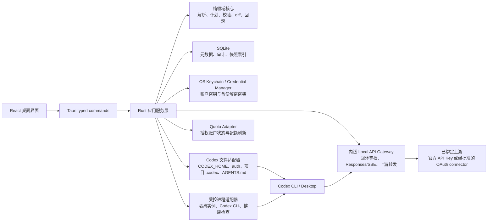

# 3R Codex：技术选型与首版方案（审查稿）

> 项目名：3R Codex  
> 平台：macOS、Windows  
> 阶段：v0.1 API-key Provider、回环 Gateway、官方账户与受管理启动隔离已实现；Profile/工作区治理仍待后续  
> 2026-08-12 修订：同步官方账户差异化读模型、浏览器/设备码授权与 V3.1 验收状态
>
> 2026-08-25 产品方向更新：官方账户与多个 API Provider 在同一个受管理 Codex 中形成统一模型目录的目标，以[产品原理：显式启动、多账户与混合模型路由](3rcodex-product-principles.md)为准。本文中的单 Provider Gateway 与“官方账户不进入 Gateway”只描述历史 V3.1；纯 API Key 多 Provider 已按[混合模型路由详细设计](codex-hybrid-routing-design.md)实现，官方订阅路由仍保持门禁。

## 1. 结论

建议把产品定位为 **面向 Codex 的本地控制面（local control plane）**：以本地 Codex API Gateway 为核心，统一管理已授权账户、受管理实例、运行 Profile、API/中转配置、MCP、技能、项目规则与安全预检。

首版按 Cockpit 的 Codex 面板实现“多账户、配置选择、配额卡片、受管理多实例与一键启动”，并提供**回环本地 API Gateway**：Codex 使用本地 Base URL 与本地 API Key；网关使用用户明确绑定的 API Key 上游。官方账户只在隔离 `CODEX_HOME` 中经官方 app-server 登录，3R Codex 不导入、复制或保存 OAuth 凭据，绝不上传、打印或在日志中记录。

Gateway 的 v0.1 采用 **单用户、仅 `127.0.0.1`、单 profile 绑定单上游账户、默认不记录请求正文** 的边界。账户池轮换、LAN 暴露、转售/多人分发和规避用量限制均不在范围内。公开发布前，任何以 ChatGPT/Codex OAuth 作为网关上游的模式必须通过 OpenAI 书面授权/条款审查；官方 API Key 上游模式不受此发布门槛影响。

产品的核心承诺是：**不破坏原有 Codex 环境；受管理账户、API Key 与 Profile 只有在用户从 3R Codex 显式启动新 CLI 时才生效；直接启动 Codex 仍使用原始默认配置。受管理实例运行期间，其启动配置及运行依赖禁止变更或删除；官方认证失效由 Codex 直接报错。每次持久化变更可预览、原子写入、自动备份、一键回滚。**

## 2. 参考项目的可取之处与边界

| 参考 | 已验证的主要能力 | 应借鉴 | 不作为首版核心 |
| --- | --- | --- | --- |
| [CC Switch](https://github.com/farion1231/cc-switch) | 服务商预设、切换、MCP/Skills/Prompts、系统托盘、配置备份、代理与故障转移 | 声明式配置、导入/导出、托盘快捷切换、原子写入与备份 | 一开始支持多 agent；自建协议转换代理；大量第三方预设 |
| [Cockpit Tools](https://github.com/jlcodes99/cockpit-tools) | 多账号、配额面板、多实例、Codex 本地 API sidecar、状态同步 | 账户与运行实例分离的产品心智、可视化状态总览、卡片化操作面板 | 未经用户确认的凭据操作、默认开启的请求代理/内容采集 |

CC Switch 已将“服务商/配置治理”做得很完整；Cockpit Tools 则覆盖了“账户/配额/实例”的需求。新产品不应简单复刻二者，而应在 Codex 的公开配置契约上做深：官方 Codex 已支持独立 profile 文件、用户级 provider 设置、受信任项目的 `.codex/config.toml`、MCP、AGENTS.md 与 hooks。见 [Codex Advanced Configuration](https://learn.chatgpt.com/docs/config-file/config-advanced) 与 [Codex Customization](https://learn.chatgpt.com/docs/customization/overview)。

## 3. 产品范围

### 3.1 MVP（v0.1）必须交付

1. **本地 Codex API Gateway（产品核心）**
   - 每个启用的网关生成独立 Base URL 与随机本地 Client API Key；只监听 `127.0.0.1`，不提供 LAN/公网绑定选项。
   - 首批实现 `GET /health`、`GET /v1/models`、`POST /v1/responses` 与 SSE 流式透传；所有非受支持路径明确返回结构化错误，绝不伪造 OpenAI 响应。
   - 每个 Gateway 只能绑定一个 API Key `Provider` 上游；官方 Codex `Account` 不可绑定 Gateway。Codex profile 通过官方的 custom model provider 配置和命令式凭据 helper 获取本地 Client API Key。
   - Gateway 自己验证本地 key、超时、取消与上游错误；UI 显示脱敏请求元数据及限长错误摘要（时间、模型、状态、延迟、账户 ID）。请求正文、响应正文和 token 不进入日志。

2. **账户卡片与多账户库（与图中面板对齐）**
   - 卡片展示：勾选状态、脱敏邮箱/用户 ID、登录方式、个人/团队名称、套餐标签、备注、创建/导入时间、到期日、当前运行模式。
   - 支持由官方 app-server 登录后的账户投影、加备注/标签、启动隔离实例、断开与删除；不导入本机 Codex 认证数据，也不导出认证材料。
   - 支持设为“常用启动配置”、按账户筛选/批量选择；该设置只初始化 3R Codex 的启动草稿，不修改 Codex 默认账户，也不影响运行中实例。

3. **配额、到期与状态面板**
   - 每张账户卡显示官方返回的主/次限额窗口、重置倒计时/精确时间、订阅状态和到期时间；只有窗口时长可验证时才标为 Hourly/Weekly。支持手动刷新与可配置的后台刷新/阈值通知。
   - 采用可插拔 `QuotaAdapter`：只有认证成功且字段可验证时才更新卡片；失败保留上次成功数据并标示“更新时间/错误原因”，不将失败解释为 0 配额。
   - “重置”是重置本地刷新状态/通知，不改变上游套餐或配额。

4. **受管理实例与快捷操作**
   - 每个实例固定绑定一个不可变启动配置修订，其中包含账户或 API Key 修订、profile、隔离 `CODEX_HOME`、工作目录与启动参数；可并行运行不同项目。实例退出前，所有运行依赖均持有配置锁，禁止编辑、重新授权、断开或删除。
   - 账户卡底部操作固定映射为：`打开终端/复制启动命令`、`添加标签或备注`、`复制脱敏账户信息`、`启动实例`、`刷新配额`、`加密导出`、`删除`。
   - 停止、重启、聚焦和批量关闭只操作由本应用登记的子进程，不接管其他 Codex 进程。

5. **Codex 环境、Profile 与 Provider 中心**
   - 发现 Codex CLI、`CODEX_HOME`、用户 `config.toml`、命名 profile、受信任项目的 `.codex/config.toml`、`AGENTS.md` 和 MCP 配置；展示有效配置来源和覆盖顺序。
   - 新建、克隆、编辑、排序和激活 profile；提供 `开发`、`只读审查`、`高权限维护`模板，并生成 `codex --profile <name>` 启动命令。
   - 管理官方 OpenAI、用户自建网关和明确兼容 Codex Responses 协议的 Provider；API key/令牌仅存系统凭据库，应用配置时展示 TOML diff、写后验证与快照。

6. **MCP、Skills、项目规则与回滚**
   - 从 Codex 配置和项目目录读取 MCP、Skills、`AGENTS.md`，按“全局 / 账户实例 / profile / 项目”归类并展示差异。
   - 变更日志记录时间、操作者、脱敏 diff、成功/失败、备份 ID；所有文件操作均为临时文件 + fsync + 原子替换 + 解析校验。
   - 每个受管理配置文件保留最近 20 个快照，可一键回滚；`auth.json` 不进入任何 3R Codex 快照或导出包，只由官方 Codex 进程在隔离目录管理。

### 3.2 v0.2 候选项（MVP 验证后）

- 系统托盘：选择常用启动草稿、显式启动/打开最近实例、查看配额预警；不切换 Codex 系统默认账户或 Profile。
- 可选的定时账户健康检查与配额刷新；仅刷新用户已授权的账户状态，不执行“自动唤醒”模型任务。
- 费用与用量：优先对接用户自有网关公开的统计 API。
- 端到端加密的跨设备同步：先实现加密导出包，再评估 WebDAV/iCloud/OneDrive。
- WebSocket、图片生成与更多 OpenAI-compatible API 路径；每条路径先以 mock upstream 和真实 API-key upstream 验证协议兼容性。

### 3.3 明确不做（至少 v1.0 前）

- 未经用户显式点击启动就自动应用账户、API Key 或 Profile；以及认证文件读取/写入、浏览器 Cookie 或刷新令牌导入。
- 自动“唤醒”以影响配额周期，或绕过上游限制；只有用户手动启动的 Codex 任务才会消耗配额。
- 默认启用 LAN/公网网关、请求内容捕获、账号池路由、自动轮换或配额规避。
- 将项目 `.codex/config.toml` 的 provider/认证设置作为可写目标。Codex 会限制项目配置修改 provider、凭据重定向及 profile 选择等敏感项，因此这些设置只能位于用户级配置中。

### 3.4 当前实现基线（2026-08-12）

**目标**：交付能在 macOS/Windows 构建的本地桌面应用，包含 API-key Provider、官方账户、显式启动隔离、仅回环监听的 Gateway、诊断、用量和安全存储边界。

**已实现范围**：API-key Provider 多账户元数据、系统凭据库存储、直连 Responses/Gateway 透传/受限 Chat 转换、官方 app-server 浏览器/设备码登录、每账户隔离 `CODEX_HOME`、不可变启动修订、运行实例锁、可选官方限额快照、随机 Client API Key、固定 `127.0.0.1` 监听、Provider 连通性检测、脱敏 Gateway 诊断、本地用量统计、统一 SQLite 迁移/WAL/busy timeout、诊断/用量保留清理、分层超时与客户端取消分类。

**尚未实现**：官方账户后台定时限额刷新/阈值通知、完整配置发现/接管/恢复中心、MCP/Skills 工作区治理、真实双账户发布前人工验收和签名/公证安装包。官方账户只在 3R Codex 显式启动的新 CLI 中生效；直接启动 Codex 或打开默认 Codex App 继续使用原始默认环境。受管理 App 启动骨架已实现，但仍受单实例兼容性门控制。

**明确排除**：复用 Cockpit/Codex OAuth client ID、模拟 `originator`、读取非公开配额接口、OAuth token relay、账户池、轮换、LAN/公网暴露。

**验收**：无效 Client API Key 得到 401；未受支持路径得到 404；应用无法配置非回环 bind host；成功和取消的 SSE 转发均有自动化测试；secret 不出现在状态序列化和日志对象中。

## 4. 选定技术栈

| 层 | 选择 | 原因 |
| --- | --- | --- |
| 桌面壳 | **Tauri 2 + Rust** | macOS/Windows 原生分发、体积和资源占用低；两个参考项目也验证了这一路线。 |
| 前端 | **React 19 + TypeScript + Vite** | 表单、diff、虚拟化列表和复杂状态成熟，招聘/维护成本适中。 |
| UI | **Tailwind CSS + Radix UI + Lucide** | 可访问性基础好、跨平台视觉一致、无需引入重量级设计系统。 |
| 前端状态 | **Zustand + TanStack Query** | 将页面临时状态与后端查询/失效策略分开，避免全局状态膨胀。 |
| 核心领域 | **纯 Rust crate：`core`** | 配置合并、策略校验、diff、状态机、备份与回滚可脱离 UI 单测。 |
| 本地数据 | **SQLite（rusqlite，WAL）** | 保存非敏感注册表、审计索引、快照元数据；单进程写入，事务可靠。 |
| Secret | **OS Keychain/Credential Manager（Rust `keyring` 适配层）** | 密钥不入 SQLite、不出现在备份和日志；利用 macOS/Windows 现有安全边界。 |
| 配置处理 | **`toml_edit` + `serde` + `schemars`** | 保持 TOML 注释/格式，且用类型/Schema 校验输入。 |
| 进程与文件 | **Tokio + Tauri commands + capability permissions** | 所有受影响的文件/子进程都通过最小权限的 Rust 后端；前端不直接访问文件系统。 |
| 本地网关 | **Axum + Hyper + reqwest（独立 Rust sidecar）** | 提供回环 HTTP/SSE 网关、严格的本地实例密钥验证和可取消的上游流；与 3R Codex 控制面解耦，避免 UI 退出直接中断活动 CLI。 |
| 测试 | Rust 单元/集成测试 + Vitest/Testing Library + Playwright | 覆盖配置合并、崩溃恢复、Windows/macOS 路径与关键 UI 流程。 |
| CI/发布 | GitHub Actions、macOS/Windows 签名与自动更新 | 首个公开版必须从可验证的签名和更新链路开始，而不是让用户绕过系统安全提示。 |

**不选 Electron**：此产品不需要 Node 主进程生态带来的大量原生扩展，Tauri 更适合“本地配置控制台 + 少量受控系统调用”。  
**不选 Flutter/.NET MAUI**：团队若无既有积累，配置解析、桌面安全存储与前端开发效率都不如 Rust + React 的组合。  
**sidecar 语言决策**：首版 Gateway 数据面先以内嵌 Rust 模块实现最小的 Responses/SSE 契约，随后在 P1 将同一模块编译为独立 `codex-gateway` Rust sidecar；不额外引入 Go 运行时或第二套路由实现。

## 5. 总体架构与边界



### 5.1 模块责任和依赖方向

| 模块 | 负责 | 不负责 |
| --- | --- | --- |
| `core` | 账户/实例/Profile 模型、配置合并、变更计划、校验、状态迁移 | Tauri、SQL、文件系统、HTTP、UI |
| `adapters/codex_fs` | 发现并原子读写官方配置、受管理实例的临时认证投影、备份 | 业务规则或 UI 格式 |
| `adapters/secrets` | 保存/读取加密账户凭据和 secret handle | 把 secret 写入日志、普通快照或前端状态 |
| `adapters/quota` | 在已授权边界内刷新账户套餐/配额、规范错误 | 修改账户认证或伪造配额 |
| `adapters/gateway` | 回环监听、Client API key 校验、Responses/SSE 转发、上游错误映射 | 账户池调度、LAN/公网服务或正文采集 |
| `adapters/upstream` | 官方 API-key 上游与经批准 OAuth connector 的请求/刷新契约 | 让 UI、CLI 或数据库直接操作 token |
| `adapters/process` | 创建/停止隔离的 Codex 实例、取消、超时、收集结构化结果 | shell 拼接或任意命令执行 |
| `app` | 用例编排、授权检查、事务与审计 | 解析 TOML 实现细节 |
| `ui` | 展示、编辑草稿、请求确认 | 直接访问磁盘/Keychain 或决定安全策略 |

### 5.2 唯一写入路径

任何配置、账户和实例修改都走同一条命令：

```text
草稿 -> Schema 校验 -> 生成 ChangePlan -> 用户确认 diff
-> 创建快照 -> 原子写入 -> 重新解析/验证 -> 提交审计记录
-> 成功 | 自动恢复旧快照并报告失败
```

- `core` 是配置合并与合法性的唯一裁判；UI、托盘、导入器都不能绕过它。
- 单机 SQLite 事务保存“计划/执行/回滚”状态；同一文件由进程内互斥锁串行写入。
- 外部修改导致基准版本变化时，执行中止并要求重新读取/比较，绝不静默覆盖。
- 账户或 API Key 选择只修改启动草稿。用户点击“启动 Codex”后才固定凭据与 Profile 修订，并仅对子进程注入隔离 `CODEX_HOME`、环境变量和启动参数；不得停止、重绑或改变已有实例，也不得改变 Codex 默认环境。
- 启动服务在同一 SQLite 事务中创建实例与配置锁；Provider、账户、Profile、Gateway 和删除服务在任何外部写入前检查该锁。存在活动实例时统一返回 `configuration_in_use`，不创建替代修订、不排队更新、不隐式停止实例。
- Gateway 的启动、绑定、停止也走同一计划：先验证回环端口、账户/Provider 绑定和 key handle，再启动监听；配置 profile 失败时停止网关并恢复原 profile。
- 凭据库与 SQLite 不能参与同一个事务。Provider 更新或删除必须保留旧凭据，以补偿 SQLite 写入失败；外部 Codex 启动成功派发后才提交最近使用标记。普通状态刷新只读取本地缓存，显式检测才读取凭据并访问上游。
- Provider 列表的 `configured` 是非敏感、最后一次成功写入凭据库的状态，不是钥匙串实时探测结果。只有需要 API Key 的显式操作读取钥匙串；发现条目不存在时由 `ProviderStore` 将该状态降为未配置。macOS 正式发布必须以同一稳定签名身份签署主程序和 sidecar，避免系统把版本更新识别为新的凭据访问者。
- 批量修改按文件分别提交；任一文件失败时补偿回滚已经写入的文件，并保留可诊断的审计事件。

### 5.3 状态机

配置变更：`Draft → Validated → AwaitingConfirmation → Applying → Verified → Completed`。  
受管理启动：`Draft → Preflight → AwaitingConfirmation → MaterializingRevision → Launching → Running`。  
配置锁：`Unlocked → Locked(Launching/Running/Stopping/Orphaned) → Releasing → Unlocked`。  
网关：`Stopped → Validating → Starting → Listening → Bound → Serving`；配置/上游失败进入 `Degraded`，只返回可诊断错误而不重试切换账户。  
失败分支：`Applying/Materializing/Launching → Restoring → Failed`；仅 `Completed` 或 `Running` 可成为新的活动状态。  
`Cancelled` 与 `StaleBaseline` 不会写入 Codex 文件。

### 5.4 与 Codex 的适配策略

1. **Profile 是显式启动的第一公民。** 管理工具只在用户从 3R Codex 启动 CLI 时通过隔离 `CODEX_HOME`、命名 Profile 或单次命令行覆盖应用配置；直接执行 `codex` 不自动复用上一次受管理 Profile。
2. **Provider 只写用户级配置。** Base URL、model provider 和认证配置不写入项目层；项目层只管理 Codex 允许的项目设置。
3. **项目只读优先。** 对任何受信任项目的变更都需逐项目确认；默认只生成补丁/PR 可复制内容。
4. **账户库不替代官方登录或全局默认。** API Key Provider 可由用户显式输入；官方 Codex 账户只能在账户专属 `CODEX_HOME` 中由官方 app-server 完成登录。两者只通过不可变启动配置修订应用到新 CLI；3R Codex 不修改默认 `~/.codex`、Codex App 登录或运行实例。详见[多账户、API Key 与启动隔离方案](codex-official-auth-authorization-design.md)。
5. **Gateway 使用 profile 的 custom provider。** 生成的 profile 指向回环 Base URL；凭据 helper 只从系统凭据库取回本地 Client API Key。上游凭据不透出给 Codex 进程或前端。

## 6. 最小数据模型

```text
Account   { id, identity_hmac?, masked_identity, login_method="official_app_server", plan?, team_name?, note?, auth_state, quota_state, expires_at? }
CredentialRevision { id, kind, account_id?, provider_id?, secret_ref?, managed_codex_home?, state, created_at, retired_at? }
LaunchConfigurationRevision { id, credential_revision_id, profile_snapshot_hash, gateway_revision_id?, config_snapshot, created_at }
Instance  { id, launch_configuration_revision_id, workspace_path, managed_codex_home?, pid?, state, launched_at? }
RuntimeConfigurationLock { instance_id, launch_configuration_revision_id, acquired_at, released_at? }
Gateway   { id, bind_host="127.0.0.1", port, client_key_ref, provider_id, enabled, protocol_set, state, revision }
Provider { id, name, kind, base_url, wire_api, secret_ref?, health_policy, created_at }
Profile  { id, name, parent?, managed_toml, provider_id?, mcp_set_id?, revision }
Project  { canonical_path, trust_observed, discovered_layers, last_scan_at }
ChangePlan { id, baseline_hashes, operations[], state, created_at, applied_at? }
Snapshot { id, target_path, content_hash, encrypted_blob_path?, created_at, plan_id }
AuditEvent { id, plan_id, action, outcome, redacted_details, at }
```

`secret_ref` 是 API Key 或本地 Gateway Key 的系统凭据库项目标识，SQLite 不含 secret 本体。官方 Codex 账户的认证文件只由官方 app-server 写入凭据修订专属目录；3R Codex 只保存脱敏账户元数据和目录引用。`Snapshot` 与导出包都不收录 `auth.json`。详见[多账户、API Key 与启动隔离方案](codex-official-auth-authorization-design.md)。

## 7. 关键 UX：六个主界面

1. **Gateway（首屏核心）**：显示回环 Base URL、运行状态、已绑定账户/Provider、协议、最近请求元数据和“复制 Base URL/Client API Key”操作；Key 默认遮掩并支持轮换。
2. **账户总览（Cockpit 对齐）**：卡片首屏展示脱敏身份、套餐、团队/个人、登录方式、备注、Weekly/Hourly 进度条、下次重置、有效期、上次刷新时间和运行模式。
3. **账户卡片操作条（Cockpit 对齐）**：打开终端/复制命令、标签或备注、复制脱敏信息、启动实例、刷新配额、加密导出、删除；危险操作必须二次确认，被活动实例锁定时编辑、重新授权、断开与删除必须禁用并显示持锁实例。
4. **实例（Instances）**：按账户 + profile + 工作目录创建并行实例，显示 PID、运行时长、退出码、日志位置，支持停止/重启/聚焦/批量关闭。
5. **Profiles 与 Providers**：模板向导、TOML/可视化双向编辑、继承/覆盖说明、网关 URL/协议校验、密钥库状态、模拟有效配置。
6. **Workspace**：发现当前项目中的 `AGENTS.md`、`.codex/config.toml`、MCP/Skills；显示来源层级、diff、备份和回滚。

## 8. 风险、对策与被拒绝的方案

| 风险 | 对策 |
| --- | --- |
| Codex 配置格式或功能随版本演进 | 建立版本化 `CodexAdapter`；每个支持版本有 fixture；未知字段保留，不做破坏性重写。 |
| 用户配置被其他程序/编辑器修改 | 写前检查内容 hash；冲突即中止，重新扫描后由用户处理。 |
| 中转服务不真正兼容 Codex Responses/流式协议 | Provider 采用显式兼容声明，健康检查只验证基础连通；不宣称“全兼容”，另建兼容测试矩阵。 |
| Secret 泄露 | OS 凭据库、严格脱敏、前端 never-return secret、导出默认不含 secret、审计只存引用。 |
| 运行期间配置被修改或删除 | 实例启动时事务化获取配置锁；存在活动锁时，凭据替换、重新授权、Provider/Profile/Gateway 编辑、断开和删除统一返回 `configuration_in_use`。 |
| 官方认证在运行期间失效 | 保留 Codex 官方异常，不换号、不重授权、不重启实例，也不改写为产品内部错误。 |
| 上游配额/账户接口变化或不可访问 | `QuotaAdapter` 版本化、记录最后成功值和错误；卡片显示“未知/过期”，禁用依赖实时配额的自动策略。 |
| Gateway 误暴露给局域网或进程外用户 | bind host 硬编码为 `127.0.0.1`；不提供 UI 开关；Client API Key 只允许通过本机 helper 获取并可立即轮换。 |
| OAuth 上游模式不被公开条款/接口支持 | API-key gateway 可独立发布；OAuth connector 仅在得到书面授权后启用，未获授权时保留为不实现的设计接口。 |
| 配置写坏导致 Codex 不可用 | 快照 + 原子替换 + 写后解析 + 自动恢复 + `恢复到原始发现状态` 操作。 |
| macOS/Windows 差异 | 以 Rust adapter 隔离路径、Keychain、进程和签名；CI 运行两套测试矩阵。 |

被拒绝的方案：

- **直接 Fork Cockpit Tools**：其许可证为 CC BY-NC-SA 4.0，且产品边界和本方案不同；不适合做可商业化/独立演进的基础。
- **直接 Fork CC Switch**：许可较宽松，但多 agent 和本地代理的复杂度会掩盖 Codex 专属价值；可参考其公开设计，首版从零做最小核心。
- **复制 Cockpit 的 OAuth relay**：不复制其 OAuth client、非公开配额接口、凭据存储和账户池实现；仅参考隔离、回滚与本地服务的产品形态。
- **浏览器 Cookie/认证导入**：账户管理只接受官方 app-server 登录后的非敏感账户投影，避免不透明的身份接管。

## 9. 交付分期与验收标准

### Phase 0：Gateway 契约验证（1–2 周）

- 建立 Tauri/Rust/React 空壳、macOS 和 Windows 构建。
- 实现回环 `health/models/responses` mock gateway、Client API Key 验证、SSE 取消和结构化错误；用 API-key mock upstream 验证协议，不接入 OAuth。
- 验收：错误 key 返回 401、错误路径返回 404、客户端断流能取消上游；请求正文不会落盘；macOS/Windows 的端口释放与应用退出行为可重复验证。

### Phase 1：账户卡片、Gateway 与隔离实例（3–4 周）

- 账户 CRUD、备注/标签、常用启动配置、API-key 上游绑定、Gateway 启停/Client key 轮换、账户卡片操作条、实例创建/启停/日志。
- 验收：一个 profile 经 custom provider 成功调用回环 Gateway，再经 API-key 上游得到流式响应；运行实例持锁期间，编辑或删除其账户/API Key、Provider、Profile 与 Gateway 均被拒绝；直接启动 Codex 保持原始默认配置；故意中断未锁定 Gateway 配置后原 profile 与端口状态可恢复。

### Phase 2：配额、Profile、Provider 与可批准 OAuth connector（2–3 周）

- 配额适配器、后台刷新/预警、Profile CRUD、Provider CRUD、用户级配置应用、健康检查；仅在获得授权时实现 OAuth connector。
- 验收：卡片正确显示“成功/过期/不可用”三种配额状态；从 3R Codex 显式启动的 `codex --profile <name>` 能读取预期配置，直接执行 `codex` 不复用该配置；OAuth connector 若启用，必须通过授权流、刷新、撤销、故障恢复和条款审查测试。

### Phase 3：MCP / Skills / Workspace / 托盘（2–3 周）

- 配置发现、分层视图、项目级计划与 diff、托盘入口。
- 验收：未受信任项目不写入；项目 config 中的受限字段不会被生成或写入；回滚后文件 hash 与快照一致。

### 发布门槛

- macOS（Apple Silicon、Intel）与 Windows（x64）安装、升级、卸载路径通过人工验证。
- 所有配置写入用例均有单元/集成测试，关键 UI 有端到端测试。
- 分发包签名、自动更新签名、第三方依赖 SBOM、最小权限说明与隐私说明就绪。

## 10. 审查需要确认的四个决策

1. 是否确认 Gateway 作为 Dashboard 首屏和 v0.1 的第一优先级？
2. 是否确认 v0.1 固定为“仅回环、单用户、单 account + provider 绑定”，不实现账户池/轮换/LAN？
3. 是否接受“官方 API-key 上游先交付；ChatGPT/Codex OAuth gateway 需 OpenAI 书面授权后才实现/发布”的发布门槛？
4. 目标是个人开源、可商业化产品，还是团队内部工具？这会决定许可证、更新服务、遥测和企业身份集成的设计。

## 11. 调研来源

- [CC Switch README](https://github.com/farion1231/cc-switch)：provider/MCP/skills/托盘/本地代理/备份等能力与 Tauri 跨平台实现定位。
- [Cockpit Tools README](https://github.com/jlcodes99/cockpit-tools)：Codex 账号、配额、本地 sidecar、实例与本地数据边界；许可证为 CC BY-NC-SA 4.0。
- [OpenAI Codex Advanced Configuration](https://learn.chatgpt.com/docs/config-file/config-advanced)：profile 层级、`CODEX_HOME`、用户/项目配置边界、provider 定义与认证命令。
- [OpenAI Codex Customization](https://learn.chatgpt.com/docs/customization/overview)：`AGENTS.md`、skills、MCP、subagents 等 Codex 自定义层的职责。
- [OpenAI Terms of Use](https://openai.com/policies/row-terms-of-use/)：个人账户凭据、账户共享、速率限制与规避限制的条款边界。
- [OpenAI API 与 ChatGPT 订阅计费说明](https://help.openai.com/en/articles/8156019-is-api-usage-included-in-chatgpt-subscriptions-even-if-i-have-a-paid-chatgpt-account%2525252525252525252525252525252525252525252525252525252525252525252525252525252525252525252525252525252525252525252525252525252525252525252525252525252525252525252525252525252525252525252525252525252525252525252525252525252525252525252525252525252525252525252525252525252525252525252525252525252525252525252525252525252525252525252525252525252525252525252525252525252525252525252525252523.pls)：ChatGPT 与 API 独立计费/管理的产品边界。

## 12. 内部版决策与执行记录

内部版已确认要覆盖 Codex 多账户、Hourly/Weekly 配额与套餐识别，以及本地 Codex API 服务；开源核心和内部定制层需保持可分离。具体的数据边界、认证策略、分期、验收与当前阻塞见[内部版执行计划](internal-edition-execution-plan.md)。
