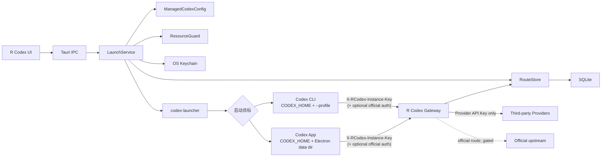

# Codex 混合模型路由详细设计

> 状态：独立工作区合同（2026-10-05），schema v22；官方订阅模型透传保持关闭
> 日期：2026-08-25  
> 产品依据：[R Codex 产品原理](3rcodex-product-principles.md)  
> 当前代码：独立 App/CLI、多渠道 Gateway、独立 API 登录、按项目单向导入、请求档案已实施。默认 App 配置投影/恢复、原配置快照、原地历史修复和默认上游 fallback 已删除。

## 当前生效的独立环境合同

[独立工作区改造与验收](designs/2026-09-21-isolated-only-product-plan.md) 是本代启动和导入的完整合同。以下历史章节中默认 App、双入口、原配置快照、偏好种子化、兼容 fallback 的内容均已作废；RouteSet、精确认证、资源锁、模型能力和错误分层继续有效。

- 配置、认证、SQLite 与 Electron 根都由 R Codex 独立拥有。启动与状态查询不访问原 Codex 配置或登录。
- API 登录选择属于工作区 profile_options，版本化更新；只物化至 R Codex auth.json。所有受管理 Provider 身份为 rcodex。
- import_sessions_from_default 是唯一只读访问原会话的写入入口，目标为已经初始化的 R Codex 数据库；进程内与 launch_codex 互斥，后台线程事务复制，失败撤销新增行和文件。
- schema v22 只更新 R Codex 自有库：停用自有兼容记录并保存每个模型选择的推理档位，同时将精确的系统启动方案名迁移为 `R Codex`，并创建 `provider_credentials` 保存用户重新录入的 Provider API Key；已运行的旧网关仅通过自有控制接口撤销对应兼容绑定，保留独立活动实例。网关恢复仅限独立 cli/managed_app，不接受兼容上游回退，不透传客户端认证头。运行时不访问系统凭据库，实例准入密钥也只保存引用和哈希。
- 独立压缩模式为 LocalClient；旧 §8.2.1 默认 App remote_v2 是历史合同。本次没有本地压缩开关。

## 1. 历史决策与架构背景

- **Change**：把受管理 Codex 的单凭据启动改造成可选官方账户、多个 API Provider、多个模型和不可变 RouteSet 的统一启动。
- **Boundary**：所有新受管理启动目标（Codex CLI 或 Codex App）固定使用实例专属 `model_provider = "rcodex"` 和本机回环 Gateway；直接 CLI、直接 App 与默认 `~/.codex` 不变，除非用户显式启用独立的默认 App 兼容模式。兼容模式只能以可恢复的 marker 接管默认 `config.toml`，不触碰 `auth.json`、Electron 数据或历史。
- **Owner**：LaunchService 是启动快照唯一写入者；RouteStore 是路由集唯一持久化写入者；Gateway 只读取 ready 修订并转发。
- **Consistency**：逻辑预设使用 `expected_version` 乐观并发；实例、binding、依赖和资源锁在 SQLite `BEGIN IMMEDIATE` 事务中提交；凭据数据库与文件系统通过补偿回收。完整 `materializing`/operation lease 恢复协议仍是 sidecar 发布前工作。
- **Failure**：找不到路由、凭据失效、能力不兼容、官方认证失效和 Gateway 降级均显式失败，不自动换账号、Key、模型或历史。
- **Rejected**：受管理实例不修改默认 `~/.codex`；兼容模式不替换默认 `model_provider`，而是保留内建 `openai` 身份，通过根级 `openai_base_url`、内建 Provider 的 Gateway `base_url`、模型目录和实例 Header 接入 Gateway；不读取官方 `auth.json`，也不写死从二进制发现的私有官方 URL。
- **Compatibility file boundary**：兼容模式允许 `model_catalog_json` 指向 R Codex 管理的外部只读目录；默认 App/CLI 无稳定无参数 Profile 选择合同，因此保留原有 `model_provider`（通常为 `openai`），仅将 Gateway 地址、模型目录和可撤销的实例 Header 物化在默认 `config.toml`。完整 `CODEX_HOME`、`auth.json`、会话和 SQLite 不软链。`config.toml` 软链只作目标版本验证后的实验选项；默认使用真实文件、字段级 marker 和原子更新，不备份完整用户配置。
- **Incremental takeover**：API Key 启动会读取当前 `CODEX_HOME/config.toml`（未设置时为 `~/.codex/config.toml`），将常规设置安全快照到实例独立 home，再由不可变 Profile 覆盖模型路由。默认 home、`auth.json` 和原文件内容不会被写入或复制。

### 2026-09-04 默认 App 兼容会话边界

`compat_app` 是默认 Codex App 的用户拥有路由投影，与 `managed_app` 完全分开：它只写入独立的 `compatibility_gateway_bindings`，不创建或更新 `codex_instances`、运行锁、Electron 数据或 SQLite 根目录。该表中的固定 compatibility subject 仅是 Gateway 准入命名空间，不是进程身份。默认 App 的进程由用户和操作系统拥有，R Codex 不强制关闭、重启或管理它，也不把它加入受管理运行实例。兼容启动写入配置投影并派发打开请求；从 R Codex 派发时启动器额外给该进程注入回环 `NO_PROXY`，Finder 直开没有这一步。兼容模型目录以原生/ bundled 目录为基底合并第三方路由，第三方同 slug 路由才覆盖原生条目。系统代理与回环 502 见[默认 App 回环 Gateway 与系统代理](compat-app-loopback-proxy.md)。

### 2026-09-13 Gateway binding 合同收敛

#### Decision

- Gateway 数据面注册的领域对象统一称为 `GatewayBinding`。它只表达三个事实：`binding_id`（请求诊断与注销所需的逻辑绑定标识）、不可变 `RouteSet`、以及 `admission_key_hash`（本机准入密钥摘要）。`binding_id` 不是进程 ID；默认 App 使用固定的 `default-app-compatibility` 命名空间，受管理 CLI/App 使用真实运行实例 ID。
- `compatibility_fallback` 不再作为 `GatewayBinding` 领域字段。它已经包含在 `RouteSet.gateway_service.config_snapshot` 的版本化快照中；sidecar 注册时从同一快照派生内存中的 native fallback。这样控制面不会把两份路由事实交给新代码。为复用仍在运行的旧 sidecar，控制客户端会临时附带同值的顶层 `compatibilityFallback` 过渡字段；新 sidecar 只在快照缺失时读取它，若两份值冲突则拒绝注册。
- Gateway 的控制方法使用 `register_binding`、`unregister_binding` 和 `restore_active_bindings` 语义。旧 JSON 字段 `instanceId`/`instanceKeyHash` 在过渡期保留别名，避免已运行的旧 sidecar 因协议字段改名而失联；新代码内部不再把兼容绑定称为实例。
- `InstanceGatewayKey`、`RCODEX_INSTANCE_KEY` 和 `X-RCodex-Instance-Key` 属于已有启动器线协议；请求头和环境变量名保持不变。2026-10-02 起实例密钥不再写入钥匙串：明文只走内存和一次性 FIFO，SQLite 只保存哈希，sidecar 恢复只比对哈希。它们在 Gateway 领域层按“准入密钥”解释。

#### Boundary and consistency

- `ManagedLaunchStore` 是 RouteSet 和持久化 binding 的唯一写入者；sidecar 只接受已验证的 RouteSet 和准入摘要，并把 fallback 派生为只读运行时状态。
- `compatibility_gateway_bindings` 仍是默认 App 的唯一持久化 binding 表；`instance_gateway_bindings` 仍只服务带 `codex_instances` 外键的真实运行实例。此次收敛不新增 schema、不迁移已有密钥、不改变请求账本的 `instance_id` 字段含义。
- 注册请求缺少绑定标识、准入摘要、RouteSet 或快照格式不正确时拒绝注册；重复 `binding_id` 继续返回冲突。恢复时单个凭据/RouteSet 失败只跳过该 binding，不阻塞其他 binding。

#### Rejected options

- 不把默认 App 伪造为 `codex_instances`，也不为它创建 PID、停止状态或运行锁。
- 不把 fallback 复制到新的数据库列或新的领域注册字段；单一 RouteSet 快照是新代码的路由事实来源，旧 sidecar 过渡字段只为兼容已运行进程保留。
- 不在本次重构中修改已写入用户 `config.toml` 的 Header 名称或 Keychain reference；这需要独立的兼容协议迁移和旧 sidecar 升级策略。

### 2026-09-07 默认 App 进程检测边界

移除默认 App 的跨平台运行检测、重新检测按钮和启动后进程确认。macOS 的应用 Bundle、Windows 的安装目录/进程名以及 Linux 的桌面启动器都可能指向不同宿主或残留辅助进程，无法在不误判当前 Codex 宿主的前提下形成稳定的跨平台身份契约。默认 App 启动因此采用 best-effort（尽力派发）语义：只要配置投影和启动器派发成功，就返回启动结果，不以外部进程采样回滚配置。隔离 App 仍由 `codex_instances` 的实例回执、PID 身份和隔离目录提供可停止、可协调、可删除的生命周期管理。

默认 App 卡片同时提供“应用模型配置”操作。该操作复用同一条兼容投影写入路径，只更新默认 `config.toml` 中的 R Codex 管理字段、模型目录和独立 Gateway binding，不派发或监督 App 进程；成功后提示用户重启默认 App 以加载新目录。这样用户可以在 App 保持关闭、或无法可靠判断其进程状态时先完成配置，启动按钮仍负责需要时的打开/派发。

### 2026-09-08 工作区编辑入口收敛

默认环境与隔离环境是固定的两个工作区，不再把名称、默认工作目录或传输方式作为用户需要理解的启动入口属性。名称由卡片语义提供；工作目录只在启动 CLI 的一次性对话框中填写；新建或更新工作区统一使用本机 Gateway，旧版本的 `gateway_policy`/`transport_mode` 仅为兼容读取而保留。工作区抽屉聚焦于两件事：加入或移除模型渠道，以及按渠道选择可见模型。

每个工作区以模型选择列表的第一项作为默认模型，卡片提供快捷默认模型选择器；选择器提交时只重排现有模型，不改变渠道凭据或上游目录。模型在 UI 中始终以“渠道名/模型名”展示，底层仍使用稳定的公共模型 ID，避免同名模型混淆。

公共模型 ID 在数据库中全局唯一且不可变。保存工作区时，控制面会先按“渠道 + 上游模型”复用已有身份；若新渠道占用了历史 ID，则自动追加稳定的渠道来源后缀，避免因旧工作区或其他渠道的同名模型导致保存失败。

### 2026-09-05 默认 App 兼容投影的字段级管理记录

默认 App 的 `config.toml` 是用户拥有的配置文件，兼容模式只对明确列出的 R Codex 管理字段拥有写入权。每次通过 R Codex 启动默认 App 时，LaunchService 根据当前已选择的第三方模型、Gateway 地址和稳定的兼容准入密钥生成目标字段；目标字段与当前值一致时不写入，变化时才原子更新。

R Codex 不再备份用户 `config.toml`。marker 只保存本次写入的字段路径、R Codex 写入值和该字段原值，以及 R Codex 生成的 Profile/模型目录路径，例如 `model_catalog_json`、`openai_base_url`、内建 OpenAI Provider 下的 Gateway `base_url`、兼容 Header 和 `requires_openai_auth`。用户原有的认证、历史、MCP、审批、沙箱、项目设置等内容不进入 marker，也不会被复制或恢复。

取消第三方模型接入时，R Codex 读取 marker，逐字段比较当前配置：仍等于 marker 中 R Codex 写入值的字段才删除；用户在外部修改过的字段保留，并报告配置冲突，避免覆盖用户新配置。清理同时撤销兼容 Gateway binding 并删除 R Codex 生成的 Profile/模型目录。该流程可重复执行，已删除字段不会再次报错。

兼容 Gateway 使用固定 subject 的可复用本地准入密钥。这样未改变的模型选择、目录和 Gateway 地址不会触发无意义写入。旧版本 marker 不再触发任何备份读取或恢复；下一次接入会用字段级记录覆盖升级。

Codex 的 Provider 配置是进程级的，模型目录本身不能为每个模型声明独立 URL。因此默认 App 的兼容配置统一把当前 Provider 的有效地址指向本机 Gateway：选中的三方模型由 RouteSet 精确转发到各自渠道；原始目录中未被选中的默认模型保留在 Gateway 的兼容回退白名单中，由 Gateway 转发到接入前的 Provider 地址，并转发请求中的官方认证 Header。这样不会让三方模型误用默认地址，也不会因接入配置丢失默认模型认证。

#### 默认模型来源与地址规范化（2026-09-10）

重复应用前，配置读取层在内存中按 marker 逐字段撤去仍匹配的 R Codex 投影，再按 Provider 级 `base_url` 优先、根级 `openai_base_url` 次之的顺序解析原始地址；marker 数组顺序不参与地址选择。原始目录也从这份内存配置解析，只接受用户显式声明的目录和目标版本 bundled catalog；不再使用缺少渠道来源、且可能在取消接入后残留的 `models_cache.json` 推导原生路由。因此只存在于该缓存的额外模型不自动加入默认白名单，需通过显式目录或渠道选择提供来源。上一轮注入的第三方条目不能变成原生回退白名单。已移除或未知的公共模型 ID 返回路由错误，不猜测另一个渠道。

Gateway 和渠道连接入口共享 API Base URL 规范化：裸域名/根路径补 `/v1`，已有版本路径或自定义前缀保持不变，去尾斜杠后追加 `/responses`、`/chat/completions` 或 `/models`。该规范化只处理连接地址，不写回用户默认 `config.toml`，不增加失败后的隐式重试或跨地址转发。第三方渠道 URL 与 Key 始终来自同一已绑定修订；默认配置不得为第三方路由提供 URL 或认证。

应用前以及 Gateway 注册/重启恢复时，原生上游若指向当前 Gateway 的回环端口，则返回 `compat_upstream_points_to_gateway`，避免自转发。marker 损坏时拒绝建立来源快照，不带着未经还原的本机地址继续。允许接管用户显式配置的根级 `openai_base_url`，按字段记录保留它的原值；字段被用户改动后再次应用时，以最新字段值作为新的来源，不恢复为更早版本。此流程不新增用户配置备份或数据库 schema。

#### 兼容回退与 App 旁路短模型（2026-09-21 锁定，F3 已实现）

2026-09-05 段仍描述**已实现**行为：未选中的原生 bundled 模型进入 Gateway 兼容回退白名单，转发到接入前的官方地址并转发官方认证。2026-09-21 commander 锁定例外：**工作区没选 GPT 族时，不得再发布或官方转发 GPT 族 slug**（含 App 写死的 `gpt-5.6-luna`）。只接入 DeepSeek / Grok 等三方的用户不能容忍改会话名时打 luna。残留 ChatGPT 登录不算选了 GPT。

未选 GPT 族时：`merge_compatibility_catalog` 去掉原生 GPT 行（三方生成行已能填选择器）；`compatibility_fallback_from_config` 不得把 GPT slug 写入 `model_ids`；对已知 ephemeral slug（现为 `gpt-5.6-luna`）写入隐藏目录行，并在 Gateway 快照 `ephemeralFamilyAliases` 映射到工作区默认 Responses 站桩；出站换成该站桩 upstream，账本记站桩渠道。没有 Responses 站桩则 `model_not_in_route_set`，仍不得官方转发。选了 GPT 族（官方或三方 GPT slug）时保持 2026-09-05 回退。这不是 401/502 换路，也不是改用户点名的聊天模型。

完整合同与验收见 [F 当前模型族-only](designs/2026-09-21-f-family-only-ephemeral.md)。别名不进 RouteSet 身份表，而走 Gateway 快照 `ephemeralFamilyAliases`。须应用配置后生效。

### 2026-09-05 已迁移 Provider 的空当前修订

`api_key_providers.current_revision_id = NULL` 是渠道被移除或未配置后的合法终态，不代表需要再次回填历史修订。schema v5 前的数据库没有修订表，因此只有该升级路径可以创建 `v4-provider:*:revision:1` 并设置当前修订；schema v5 及之后的数据库启动时只确保结构存在，不得修改已有 Provider 或复活已退役渠道。迁移始终在一个 SQLite `IMMEDIATE` 事务中执行，失败回滚，不读取系统凭据库或 API Key。

## 2. 可行性与发布门

| 能力 | 结论 | 依据 | 发布状态 |
| --- | --- | --- | --- |
| 同一实例聚合多个 API Provider | 可行 | 一个自定义 Provider、外部模型目录和本机精确路由 | 可实施 |
| 官方账户可选，纯 API Key 启动 | 可行 | `requires_openai_auth = false` | 可实施 |
| 官方登录，第三方模型走 API Key | 条件可行 | `requires_openai_auth = true`、独立环境请求头、本机 Gateway 去认证 | 实验，真实登录探针后开放 |
| 官方订阅 GPT 与第三方模型同实例 | 条件可行 | 路由结构可表达，但公开文档未定义官方订阅请求的代理上游合同 | 默认关闭 |
| 受管理 CLI | 可行 | 现有 launcher、隔离 `CODEX_HOME`、PID 回执可复用 | 首要交付 |
| 运行实例的 Codex App 启动目标 | 条件可行 | 还需隔离 App 数据目录和识别真实进程；不规划 Codex App 多开 | 后续发布门 |
| 新建、恢复、回滚与跨来源切换 | 条件可行 | 固定 Provider ID 与公共模型 ID 可解决身份漂移；历史能力仍需实测 | 实验门 |

OpenAI Docs 已公开以下机械合同：

- `model_providers.<id>.requires_openai_auth` 控制自定义 Provider 是否使用 OpenAI 认证；
- `model_providers.<id>.env_http_headers` 可从环境变量填充独立请求头；
- `model_catalog_json` 可在启动时加载外部模型目录；本机验证版本的 `--profile <name>` 会分层加载 `$CODEX_HOME/<name>.config.toml`；
- app-server 的 `model/list` 可读取目标 Codex 版本的模型投影；
- app-server 的账户方法返回认证模式和可选 `planType`。

这些合同不承诺 ChatGPT 订阅 token 可转发到任意自建代理后再访问某个固定官方 URL。官方透传必须由 CompatibilityProbe 对目标 Codex 版本做真实、非提取式验证，未通过时 `official_routes_available = false`。

## 3. 范围

### 3.1 本设计包含

- schema v6：预设组合、模型身份、模型发现快照、RouteSet、实例准入和扩展资源锁；
- 固定 `rcodex` Provider 配置和不可变模型目录；
- 一个共享 Gateway、每实例一个准入密钥、每实例一个 RouteSet；
- 第三方 Responses 透传与现有受限 Chat Completions 转换；
- 官方认证 Header 与实例准入 Header 分离；
- CLI/App 启动目标、按需进程核验、活动依赖锁与失败补偿；App 目标不包含多开管理；
- 默认 App 兼容模式：单个可恢复的默认 `config.toml` 接管、持久兼容 RouteSet、独立当前用户 Gateway 服务和显式停用恢复；
- 前端中可选官方账户、多个 Provider 和按来源选择模型；
- v5 预设兼容投影与显式迁移提示。

### 3.2 非目标

- API Key 轮换池、账号池、自动失败回退、负载均衡；
- LAN、公网、远程转售或共享账户；
- 运行中热更新预设、目录、RouteSet 或 Key；
- 自动编辑会话数据库、删除历史或迁移旧 Provider 身份；
- 受管理 App 与默认 App 之间的历史同步、索引链接或跨模式继续会话；
- 未经探针验证的官方订阅模型代理；
- 首期完整受管理 App。

## 4. 组件与依赖



依赖方向：`routing` 纯领域模块不依赖 Tauri、Axum、SQLite 或 Keychain；`route_store` 适配 SQLite；`gateway` 和 `codex_control` 依赖领域合同，不反向成为规则所有者。

## 5. 领域对象

### 5.0 受管理 CLI 的最终路由合同与安全清理

受管理 CLI 启动时，Profile 保存 `model_provider = "rcodex"`、回环 Gateway 和实例 Header 映射；launcher 在最终 `codex` 命令边界再次显式传入 `-c model_provider="rcodex"` 与本次 RouteSet 的默认公共模型 `--model <public-id>`。这样 Profile 解析漂移、旧配置残留或 Codex 默认 Provider 都不能静默改变本次启动的路由。启动日志只记录 RouteSet、公共/上游模型、Provider revision 和 Gateway 主机等脱敏摘要。

`rcodex` 是 Codex 侧的统一 Provider 门面，不等同于 R Codex 控制面中的 `ApiProvider`。一个 RouteSet 可以包含多个 `ApiProvider` 和多个 `ModelRoute`，但同一个 Codex 进程通常只看到活动的 `model_provider = "rcodex"`；Gateway 再按公共模型 ID 精确选择固定的 Provider revision。因此 URL、Key、协议和普通能力可以按路由隔离，Provider 级的压缩开关不能天然按模型隔离。

运行实例清理只有一个安全写路径：先 reconcile，再允许 `exited`/`failed` 且无活动锁的实例撤销 binding、释放密钥和删除实例专属目录；受管理 App 的对话索引已与 `CODEX_HOME` 对齐，随生命周期目录删除，并 best-effort 清除旧的 `managed-app-sqlite/<preset>` 残留。Electron 桌面数据在该实例的生命周期目录里，随该实例删除，不碰其他实例。`launching`、`running`、`stopping`、`orphaned`、`degraded` 均保留。批量清理逐实例调用同一 helper，单个失败只产生跳过结果，不扩大删除范围。

兼容 App 没有运行实例状态；默认 App 进程由系统拥有，R Codex 不读取或管理它。停用兼容路由时按 marker 逐字段清理 R Codex 接入配置并撤销独立 binding；绝不向 App PID 发送信号。旧版本遗留的 `compat_app` 行在运行实例列表中隐藏，并在清理成功后移除。

`degraded` 表示 R Codex/Gateway 中断后实例尚未完成进程核验；显式停止会优先按 PID/启动身份终止。若降级实例没有任何可核验 PID，停止操作将其标记为 `exited` 并释放锁，之后允许安全删除；`orphaned` 仍需保持未知状态，显式停止后才转为 `failed`。

### 5.0.1 运行实例的 App 启动目标

App 是运行实例的另一种启动目标，不是独立的 Provider 管理域。它复用同一份不可变 RouteSet、实例准入密钥、Gateway binding 和最小请求账本；只在启动边界增加 App 专属的 Electron 用户数据目录与真实桌面进程核验。多个受管理 App 可以同时运行。每个 App 使用自己的 Electron 用户数据目录，因此 Codex 的单实例锁不会把后启动的窗口并回前一个。不修改默认 App 的配置或登录状态。

系统直接点击 Codex App 图标仍然打开默认 `CODEX_HOME`；只有运行实例操作才启动或聚焦受管理 App。受管理 App 与默认 App 是否能并存由目标版本的 Electron 单实例锁探针决定，探针失败时返回明确错误，不把默认 App 当作受管理实例。

App 的实例配置应写入实例专属 `CODEX_HOME`，包括 `model_provider`、Gateway 地址和 App 模型目录。若目标 Codex 版本需要 `CODEX_ELECTRON_USER_DATA_PATH`、`--user-data-dir` 或其他参数，必须由版本探针确认后再由专用 App launcher 传入；不能把 CLI 的 `--profile` 参数直接当作 App 契约。

受管理 App 只从默认 `CODEX_HOME` 种子化白名单内的非敏感偏好和安装版本标记，并从默认 Electron 数据目录种子化非敏感偏好与版本标记；会话、归档会话、附件、线程/目标/记忆索引、认证数据库、Cookies、Provider/API 配置和模型目录均不复用。活动对话库与会话 JSONL 必须在同一隔离 `CODEX_HOME` 下，`CODEX_SQLITE_HOME` 等于启动用 home；旧的方案专属 `managed-app-sqlite/<preset>` 只作一次性迁入源。Electron 用户数据保存在该实例生命周期目录的 `electron-data`。同一条实例再次启动仍用这个目录，所以不会每次都被识别为新安装；不同实例不共用这份数据。历史上的共享 `managed-app-data` 只会被第一个随后启动的实例收养一次。模型与 Gateway Profile 在合并步骤中拥有最终覆盖权。macOS 还为长生命周期目录建立短 `CODEX_HOME` 别名，避免 App 的 Unix socket 路径超限。该别名是符号链接，Profile 必须同时写入 `allow_symlinked_codex_home = true`。隔离历史只能在受管理 App 内继续使用，不提供默认 App 的历史连续性。

App 请求进入 Gateway 后与 CLI 使用同一套精确模型路由。若 App 模型目录使用 `provider/model` 展示别名，Gateway 先将别名解析为 RouteSet 内部身份，再注入对应 Provider 凭据；不改变现有 CLI slash-free 公共模型 ID。

### 5.1 LaunchPresetComposition

当前产品将 `LaunchPreset` 作为唯一主工作区使用：正常创建流程只维护一条启动方案记录，用户增减 Provider 或模型时更新该方案的组合并生成新的不可变路由版本。底层多方案表结构继续保留，供历史数据、迁移和未来多工作区能力使用；受管理 App 的稳定会话根绑定到这条主工作区方案。

逻辑预设包含：

- `official_account_id: Option<AccountId>`；
- 有序 `api_provider_ids: Vec<ProviderId>`；
- 有序 `model_selections: Vec<RouteIdentityId>`；
- 默认工作区、启动目标和界面选项；
- `version`。

合法组合：

- 零官方账户 + 至少一个 API Provider + 至少一个第三方模型；
- 一个官方账户 + 零 API Provider + 至少一个官方模型；
- 一个官方账户 + 至少一个 API Provider + 至少一个模型。

迁移进来的空模型预设和首次启动的空工作区都保留为 `needs_model_selection` 且不能启动。首次启动空工作区只由 `ManagedLaunchStore` 的幂等初始化写入；用户创建 Provider 不会自动加入该工作区。在隔离空间里从「添加渠道」选中后直接写入，并排在现有渠道前面；不会自动勾选模型。除这个初始化路径和移除最后渠道后的编辑状态外，用户新建/更新入口仍不把空模型状态当作可启动配置。

### 5.2 ModelRouteIdentity

模型逻辑身份在多次启动之间稳定：

- `public_model_id` 永久唯一、不含 `/`、不含账户、Key、URL 或可变名称；
- 来源严格为 `official(account_id, upstream_model_id)` 或 `api_provider(provider_id, upstream_model_id)`；
- Provider/账户重命名不改变公共 ID；
- 已被历史 RouteSet 使用的公共 ID 不重用。

### 5.3 RouteSetRevision

启动时生成的不可变路由集包含：

- 可选官方凭据修订；
- 全部 Provider 修订和超时快照；
- 每个公共模型到上游模型的精确映射；
- 适配器、传输协议、能力摘要和目录摘要；
- Gateway 服务协议修订；
- `requires_openai_auth`；
- 状态 `materializing -> ready | failed`。

Gateway 只接受 `ready` RouteSet。逻辑预设或 Provider 后续更新不能改变旧 RouteSet。

## 6. schema v6

当前数据库版本为 schema v16。v7 保留原有请求级诊断表，v8 以可空字段向后兼容地增加 `input_tokens`、`output_tokens`、`total_tokens`，旧记录不会被估算或回填；v9 新增运行方案角色绑定，v10 为启动方案增加逻辑删除时间，v11 新增 `launch_preset_runtime_bindings`，v12 新增启动入口 `entry_kind`，v13 新增不关联 `codex_instances` 的 `compatibility_gateway_bindings`，为默认 App 兼容路由提供独立生命周期；v14 收敛无 Provider 启动方案状态；v15 为请求级诊断增加限长错误摘要；v16 为 `launch_preset_model_selections` 增加可空 `context_window` / `auto_compact_token_limit`（工作区选择覆盖，空 = family 默认）；历史路由快照仍保留。

v6 采用新增规范化覆盖层，保留 v5 的互斥 `credential_kind`、单 Provider 列和旧实例记录，降低迁移风险。新写路径只使用 v6 表；v7 再清理遗留列。

### 6.1 预设组合

- `launch_preset_compositions(launch_preset_id PK, official_account_id NULL, state, created_at, updated_at)`；
- `launch_preset_api_providers(launch_preset_id, provider_id, position, PK(preset, provider), UNIQUE(preset, position))`；
- `launch_preset_model_selections(launch_preset_id, route_identity_id, position, display_name_override, context_window NULL, auto_compact_token_limit NULL, PK(...), UNIQUE(preset, position))`；v16 窗口列是工作区选择属性，不进 `model_route_identities`。
- `launch_preset_role_models(launch_preset_id, role, route_identity_id, PK(preset, role))`；v9 首个角色是 `auto_review`，数据库触发器保证其身份同时存在于同一方案的普通模型选择中。
- `launch_preset_runtime_bindings(launch_preset_id PK, instance_id UNIQUE, created_at, updated_at)`；v11 只用于受管理 App，保证同一方案重开时复用实例 ID、隔离 Home 与会话 SQLite 根，同时保留新的启动配置和 Gateway 密钥修订。

服务层在同一事务验证每个模型来源属于预设所选账户或 Provider，并递增 `launch_presets.version`。

### 6.2 模型身份与发现

- `model_route_identities`：稳定公共模型身份、来源和上游模型 ID；
- `provider_model_catalog_revisions`：Provider 修订的发现时间、规范化版本、摘要和状态；
- `provider_model_catalog_entries`：上游模型 ID、显示名和能力 JSON。

v6 当前交付支持 Provider `/models` 完整目录发现；检测结果按 Provider 修订保存为只读候选快照，只有用户勾选并提交的模型才进入预设和下一次不可变 RouteSet。发现结果不能直接改变已保存预设，未勾选模型不会暴露给受管理 Codex。

Codex 的 `model_catalog_json` 结构不是稳定的跨版本产品协议。物化器必须先对目标 executable 执行 `codex debug models --bundled`，从同版本条目克隆未知必需字段，再替换公共 ID、显示名和受支持能力；不得长期硬编码一份 OpenCodex 或旧 Codex 的 JSON 模板。每次启动还要用同一 executable 验证生成目录和命名 Profile 能被加载。克隆只提供 Codex 未知骨架；`base_instructions` 与 `model_messages.instructions_template` 的身份开场、推理档位、速度档、强制子 agent 推理档、Node REPL 默认值和 GPT-6 专属能力广告由族 profile 与 RouteSet `CapabilitySet` overlay 覆盖。第三方条目还必须删除从 GPT-6 Astra 骨架继承的 `supports_experimental_context`，因为它是 Codex 客户端的实验性上下文资格，不是 Provider 的远程压缩合同。Codex 通用多 agent 合同与本地代码工具继续保留。`GET /v1/models` 不是档位或身份来源。当前实现还把每个第三方 Responses 条目的 `auto_review_model_override` 指向自身，并自动启用审核角色；见[第三方模型目录 overlay](third-party-model-reasoning-levels.md)。

实现维护一份小型、版本化的 `CodexCatalogCompatibility` 能力配置，仅描述字段规则（例如隐藏枚举和可选字段），不维护完整模型目录。已知版本使用对应配置；未知版本从其 bundled catalog 推断可选字段并采用保守默认值。目录生成后仍必须通过同一 executable 的真实解析探针，因此版本字典不是放行凭据，而是生成策略的提示。版本或 schema 指纹变化时重新生成目录；基础探针失败则阻止受管理启动。

### 6.3 不可变运行路由

- `gateway_service_revisions`：Gateway 协议、回环绑定和非敏感配置摘要；
- `route_set_revisions`：预设版本、可选官方凭据修订、目录路径/摘要、认证要求和状态；
- `route_set_provider_revisions`：Provider 逻辑 ID、固定修订、超时和顺序；
- `model_routes`：公共 ID、RouteKind、固定上游修订、模型 ID、协议、适配器和能力；
- `launch_configuration_route_sets`：LaunchConfiguration 到 RouteSet 的一对一映射。

### 6.4 实例准入

- `instance_gateway_bindings(instance_id PK, route_set_revision_id, gateway_service_revision_id, instance_key_ref UNIQUE, instance_key_hash UNIQUE, state, created_at, revoked_at)`。

`provider_credentials` 只保存 Provider API Key；`instance_gateway_bindings` 只保存实例密钥引用和高熵摘要。Provider API Key 仅在后端请求边界读入内存，实例密钥明文仅存在于当前启动进程、一次性 FIFO、Codex 子进程的 `RCODEX_INSTANCE_KEY` 环境和当前本机请求内存。

### 6.5 资源锁扩展

重建 `launch_configuration_dependencies` 与 `resource_operation_leases` 的 `resource_kind` CHECK，新增：

- `route_set_revision`；
- `model_route`；
- `model_route_identity`；
- `gateway_service_revision`；
- `model_catalog_revision`；
- `instance_gateway_binding`。

一个新实例锁定预设、全部 Provider 逻辑/修订、可选官方账户/凭据修订、RouteSet、模型路由、目录、Profile、Gateway 服务修订和实例绑定。无关 Provider 不被全局 Gateway 状态锁定。

### 6.6 迁移

- v5 official preset：回填 composition.official_account_id；
- v5 API preset：回填零官方账户和一个 provider binding；
- v5 未保存模型选择：composition.state = `needs_model_selection`，不得猜测模型；
- v5 活动实例、锁和历史配置保持原样；旧单 Provider Gateway 的运行状态不再作为迁移后的数据面，后续启动统一使用 Managed Gateway；
- 迁移不读写 Keychain；
- 所有 DDL、回填和 `user_version = 6` 在同一事务完成；
- 测试全新库、v4、v5、重复执行、中途失败回滚和 future version 拒绝。

## 7. IPC 合同

### 7.1 快照

当前实现保留 `get_codex_control_snapshot`，并通过 `get_managed_launch_preset_compositions` 返回 v6 composition；前端按 `launchPresetId` 合并。sidecar 控制面使用版本化的 binding 注册合同：

```text
presets[].officialAccount: optional summary
presets[].apiProviders: provider summaries[]
presets[].selectedModels: model selections[]
presets[].readiness: ready | needs_model_selection | incompatible
instances[].routeSetRevisionId: optional for v5 legacy
compatibility.hybridApiRoutesAvailable
compatibility.hybridOfficialRoutesAvailable
compatibility.managedAppAvailable
```

快照不返回实例密钥、Keychain reference、官方 Header、认证目录或第三方 Key。

### 7.2 预设 mutation

当前 `create_managed_launch_preset` 提交完整 composition；编辑只允许名称和工作区等元数据，运行依赖需要新建预设。未来若开放 composition 更新，必须使用 `expected_version`：

```text
name
officialAccountId?: string
apiProviderIds: string[]
selectedModels: [{ sourceKind, sourceId, upstreamModelId, displayName? }]
defaultWorkspacePath?: string
isPreferred: boolean
```

后端事务规范化重复项、验证来源所有权、创建/复用 ModelRouteIdentity 并一次提交。活动依赖或并发冲突分别返回 `configuration_in_use`、`version_conflict`。

### 7.3 启动

`launch_codex({ launchPresetId, expectedVersion, workspacePath? })` 保持无 secret。后端负责 RouteSet、实例密钥、目录、Profile、Gateway 绑定和 launcher 参数。

公开 `start_gateway`/`stop_gateway` 不再拥有 Provider 绑定语义。V6 状态只显示共享服务与活动绑定；存在活动 binding 时拒绝停止。任何实例密钥不得返回 UI。

## 8. Gateway 合同

### 8.1 准入

1. 只接受回环监听；
2. 读取 `X-RCodex-Instance-Key`；
3. 摘要并做常量时间匹配；
4. 查询 active binding 和 ready RouteSet；
5. 无 Key、错误 Key、撤销 binding 均返回稳定 401；
6. 实例 Header 在构造任何上游请求前删除。

`Authorization` 不参与本机准入。

### 8.2 路由

1. 限制请求体大小并解析 JSON；
2. 精确查找公共模型 ID；
3. 检查传输、工具、图像、推理和历史能力；
4. 把请求模型改写为上游模型 ID；
5. 选择第三方或官方 forwarder；
6. 把响应和流事件中的模型身份恢复为公共 ID；
7. 记录不含正文与凭据的路由事件。

`GET /v1/models` 从绑定 RouteSet 的固化目录返回，不能转发给某一个默认上游。

### 8.2.1 压缩路由

第三方压缩的安全基线仍是 fail-closed：目录移除继承的 GPT-6 Astra `supports_experimental_context`；隔离 / `local_client` 见到 `compaction_trigger` 返回 `unsupported_compaction`，不把 Codex 私有项发给上游。默认 App `remote_v2` 按路由 `compaction_support` 分派 NativeRemote / GatewaySummarizer / 伪造 GPT fail-closed。旧 binding 缺 `compactMode` 时保持这条基线。

**当前** Codex 没有独立的 `supports_local_compact?` API。本地压缩 vs 远程 v2 只由活动 Provider **显示名**决定：`name == "OpenAI"`（精确、大小写敏感）走远程 v2，否则走客户端本地压缩。R Codex 把用户选择落在**启动写入**，不在同一次压缩回合里探测或回退。Gateway 看见 `compaction_trigger` 只说明这次启动选了远程路径。

这是今天的客户端合同，不是 R Codex 永久唯一的开关。若目标 Codex 版本日后提供真正生效的官方配置（候选名包括 `supports_local_compact`、`compact_mode`、恢复后且行为确为本地的 feature 旗标；**以该版本文档与可执行文件为准**），启动物化器必须跟随兼容，见下节「跟随官方本地压缩配置」。今天不得把仍被忽略的 `compact_mode = "local"` 或会打到退役 V1 的 `features.remote_compaction_v2 = false` 写入配置。

#### 启动时 CompactMode

`LaunchService` 在物化 Profile / 兼容投影时写入进程级 `compactMode`，并固化进 `RouteSetRevision.gateway_service.config_snapshot`。运行中的 Gateway 只读这份快照，不按模型 ID 改进程模式。

| 用户选择 | 写入身份 | `compactMode` | 长会话时 Codex | Gateway |
| --- | --- | --- | --- | --- |
| 受管理 App / 隔离 CLI | `model_provider = "rcodex"`，`name = "R Codex Gateway"` | `local_client` | 客户端本地摘要；不发 `compaction_trigger`（`codex-cli 0.155.0-alpha.2.6` 已探针） | 当普通 `/v1/responses` 转发。若仍收到 trigger，防御性 `unsupported_compaction`，**不做** Summarizer |
| 默认 App / 兼容 CLI（关，默认） | 保留内建 `openai` id，显示名 `OpenAI` | `remote_v2` | 远程压缩 v2，必发 `compaction_trigger` | 按路由 `compaction_support` 分派：NativeRemote / GatewaySummarizer / fail-closed |
| 默认 App / 兼容 CLI（「开启本地压缩」，**初版冻结**） | id 仍是 builtin `openai`；显示名保持 `OpenAI` | `remote_v2` | 与上一行相同 | UI 隐藏；`COMPAT_LOCAL_COMPACT_OPT_IN_ENABLED=false` 忽略 `profile_options.localCompact`。解冻后才写 `R Codex Compat Local` / `local_client` |
| 单渠道直连（无 Gateway） | `R Codex Direct Provider`（非 OpenAI 名） | 不经 Gateway | 与隔离相同，走本地压缩 | 无 Summarizer 可做 |

隔离实例的本地检查点由 Codex 自己组包。压缩后续跑若拿起更早的用户要求，R Codex 只做既有的协议形状适配，不重排用户消息，也不做任务兜底。记录见 [隔离实例的上下文压缩](designs/2026-10-08-isolated-context-checkpoint.md)。

默认 App 开关字段 `launch_presets.profile_options.localCompact` 仍可被命令 `set_compat_local_compact` 写入，但初版 `COMPAT_LOCAL_COMPACT_OPT_IN_ENABLED=false`：UI 不展示，物化忽略该字段，显示名保持 `OpenAI`。解冻后命令仍只 merge JSON、bump version，不物化 config、不改模型组合。历史仍按 provider **id** 解析，不因显示名改写。这不是第三入口，也不是把默认 App 永久改成本地优先身份（改 id + 历史修复仍是独立票）。

用户决定「这次进程要不要本地压缩」= 选隔离入口。默认 App 初版固定远程 v2。旧快照缺少 `compactMode` 时：若请求含 trigger，保持今天的 fail-closed；用户重新启动或重新应用默认 App 配置后才写入新合同。

禁止：

- 把隔离 / 直连 Provider 显示名改成 `OpenAI` 来打开远程压缩；
- 在 OpenAI 名 Provider 上写 `features.remote_compaction_v2 = false` 或伪造 `compact_mode = "local"`；
- 同一次 `compaction_trigger` 失败后改打本地压缩、换 Provider、换模型或重试计费；
- 用 `upstream_model_id` / 公共 ID 含 `gpt` 当作 `NativeRemote`。

默认 App 改为本地优先（改非 OpenAI 名 + 显式历史修复）是独立票，不在本压缩合同内。现有 `compat_requires_builtin_openai_provider` 继续生效，直到那张票明确放宽。若未来官方键能在保留 `OpenAI` 名的前提下走本地压缩，默认 App 本地优先应优先走该键，而不是改名。

#### 跟随官方本地压缩配置

`compactMode` 是「这次启动的 Codex **将会**走哪条压缩路径」的快照，不是 R Codex 发明的第三种路径。物化器按目标可执行文件的生效合同填写：

```text
目标 Codex 版本探针
  ├─ 尚无官方本地/远程键（今天）
  │     隔离 / 直连：非 OpenAI 名 → compactMode = local_client
  │     默认 App：OpenAI 名 → compactMode = remote_v2
  └─ 探针确认官方键生效（例如 supports_local_compact、已落地的 compact_mode）
        按用户入口意图写入该键
        再按「写入后 Codex 会不会发 compaction_trigger」重算 compactMode
        名为 OpenAI 且官方键使其本地 → 默认 App 也可以是 local_client（不改名、不做 Summarizer）
        官方键无效 / 打到 V1 compact / 仅部分 Provider 生效 → 不写该键，回退名称门
```

跟随规则：

1. 键名、TOML 路径和取值以目标版本的公开配置参考为准，不在 R Codex 里写死某一个未来标识符。产品文档用 `supports_local_compact` 作为这类能力的统称。
2. 写入前必须用本次 Codex 可执行文件证明：配置被解析；自动压缩路径与预期一致；OpenAI 名 Provider 不会因此落到 `/responses/compact`。
3. 官方键与显示名冲突时，以探针观察到的实际路径为准更新 `compactMode` 和路由 `compaction_support`。Gateway 仍然：无 trigger 当普通请求；有 trigger 才 NativeRemote / Summarizer / fail-closed。
4. 版本字典 `CodexCatalogCompatibility.compact_contract` 记录该版本如何选本地/远程。今天只有 `NameGate`（显示名门，Profile 不写额外键）。未知版本与当前 0.15x 核同样保守：只写名称门。日后探针通过的官方键在此增加变体，不以历史 Codex 版本矩阵为准。
5. 用户配置里出现 R Codex 未声明的官方压缩键时，兼容投影按字段级 marker 处理：R Codex 管理的键可更新；用户在 marker 外自写的键不静默删除。

非跟随：把未生效键提前写进所有 Profile；运行中发现 trigger 再补写官方键；用跟随当借口在一次 compact 回合内换路。

#### 路由级 `compaction_support`

`CapabilitySet` 增加 `compaction_support`，随 RouteSet 固化，缺省 `unsupported`。进程级模式与路由级能力正交：

| `compactMode` | 路由来源 | `compaction_support` | 见到 trigger 时 |
| --- | --- | --- | --- |
| `local_client` | 任意 | `unsupported` | `unsupported_compaction`（防御；正常隔离路径不应发 trigger） |
| `remote_v2` | `RouteSource::Official` 且官方 compact 合同已发布 | `native_remote` | 透传 trigger；官方 Authorization 只走官方上游 |
| `remote_v2` | 默认 App `compatibility_fallback` 白名单（用户原 OpenAI 地址上的原生模型） | `native_remote` | 透传到接入前的官方/原地址，保留入站官方认证，不造 R Codex 信封 |
| `remote_v2` | `ApiProvider` 且上游/公共 ID 呈 `gpt-*` 形态、未经 `NativeRemote` 探针 | `unsupported` | `not_native_gpt_compaction`：明确「当前模型不是具备官方远程压缩合同的 GPT」，不透传、不静默 Summarizer |
| `remote_v2` | 其余 `ApiProvider`（Grok / DeepSeek / Claude / 未知族） | `gateway_summarizer` | GatewaySummarizer：当前第三方路由做普通摘要，返回恰好一个 compaction 项 |

官方混合路由发布门仍然关闭时，`RouteSource::Official` 继续 `official_route_unavailable`；不要用 Summarizer 填这条洞。`compatibility_fallback` 今天把原生模型合成 `RouteSource::ApiProvider { compatibility-native }`，实现 Summarizer 时必须把它标成 `native_remote`，否则默认 App 里真正的 GPT 压缩会被误拦。

#### GatewaySummarizer 合同

仅 `compactMode = remote_v2` 且路由为 `gateway_summarizer` 时启用。这是远程路径的实现，不是本地路径的后备。

1. 在凭据注入与上游发送前识别 trailing `compaction_trigger`。
2. 从将要发给上游的副本中删除 trigger；工具列表置空；`stream=true`；若副本 `reasoning.effort` / `reasoning_effort` 为 high / xhigh / max / ultra，降为 medium（只改这一份出站副本）。不把 Codex 私有项发给中继。
3. 出站前扫描 `input`（仅 Summarizer 路径；普通转发不折叠 reasoning 密文）：
   - `type=compaction` 且 `encrypted_content` 以 `3r-compaction-v1:` 开头：还原为纯文本 assistant 历史。
   - `type=compaction` 且无法识别的官方密文或其它代理前缀（如 `openai-compaction-v1:`、`ocx1:`、`cc-switch-compaction-v1:`）：**不得**发给第三方，返回 `incompatible_compaction_envelope`。
   - 非 compaction 项上的密文（典型为 `type=reasoning` 的签发方续接状态，以及 `custom_tool_call_output` 等同类槽）：**折叠**后摘要——删除 `encrypted_content`，保留可见 `summary` / `content`；无可见文本的 reasoning 项丢弃，不编造明文。这不是跨签发方泄密禁令（普通回合已经把本路由 reasoning 密文转给同一上游），而是摘要效用与协议：密文无信息量、撑大请求、Chat 无此槽，且 `content: null` 配密文会被部分上游误报为 compact blob。
   - 折叠后仍残留的非 compaction 密文返回 `incompatible_reasoning_envelope`；用户文案必须说「推理密文」，不得说成「压缩信封」。
   - 官方 compact blob 仍禁止发给三方。不静默改写用户可见 message，不因此开辟第三条历史改写路径。
4. 使用**当前路由**的上游、Key、超时和既有 Responses→Chat 适配；禁止改打官方 ChatGPT、其它 Provider 或「更便宜的摘要模型」。
5. 上游按 SSE 发送，首字节超时打在 `send()`（等响应头）；再用该渠道 `non_stream_total_seconds` 收齐正文。解析 SSE 或 JSON 文本后，给 Codex 一次性写出恰好一个 compaction 项（客户端 stream 真则合成事件，假则 JSON），不得把上游 token delta 转给 Codex。空摘要、截断（如 `finish_reason: length`）、非 2xx、0 个可用文本项 → 失败关闭，不重试、不回退 `stream=false`、不换模型。
6. 成功时返回恰好一个 `{ "type": "compaction", "encrypted_content": "3r-compaction-v1:<urlsafe-base64(utf8)>" }`。信封透明、版本化；不伪造官方密文，不做无验证加密剧场。
7. 诊断只记形状（路径、是否 trigger、tools 数量、信封版本、失败码），不记请求/响应正文或密钥。
8. Chat-only 路由走现有 chat 适配器做摘要，JSON/SSE 出口仍是 Responses compaction 项。

`SessionHandoff`（用户确认后新开响应链）不在本切片。压缩成功不等于跨 Provider 历史兼容。

#### 当前代码锚点

- 隔离 Profile：`managed_codex_config.rs` `render_profile` 写入 `rcodex` / `R Codex Gateway`。
- 兼容投影：`materialize_managed_app_config_for_target` 保留内建 `openai`，只改 Gateway `base_url`、目录和实例头。
- 快照：`managed_launch.rs` 按 `codex_catalog_compatibility(...).compact_contract` 写入 `compactMode`；路由物化时按 `CompactionSupport::for_api_provider` 赋值。控制面 `LaunchPresetSummary.compactMode` 只读，不提供运行中切换。
- 预检：`managed_gateway.rs` `preflight_capabilities` 按 `compactMode` × `compaction_support` 分派；Summarizer 在 `managed_gateway/compaction.rs`。
- 回退路由：`compatibility_fallback_route` 标 `native_remote`，保留入站官方认证透传 trigger。

### 8.3 Header 策略

所有上游请求从空 HeaderMap 构造 allowlist，禁止复制整个入站 HeaderMap。

第三方路由：

- 丢弃入站 `Authorization`、Cookie、实例 Header 和未知 Header；
- 仅注入固定 Provider 修订的 API Key 和必要协议 Header；
- mock upstream 必须证明官方 sentinel 与实例 sentinel 均为零。

官方路由：

- 要求当前请求带官方 `Authorization`；
- 禁止加载或注入任何 Provider Key；
- 仅允许兼容探针批准的 Header 和固定官方 host；
- Header 仅在请求内存存在，不进入日志、数据库、UI、诊断或崩溃报告；
- 未通过官方合同探针时返回 `official_route_unavailable`。

### 8.4 运行实例请求账本（2026-08-28）

运行实例不是“只绑定一个 Provider”的抽象：一个不可变 RouteSet 可以包含多个 Provider，Gateway 每次按公共模型 ID 选择其中一条固定路由。因此，实例诊断必须以**请求**为最小记录单位，而不能只保存实例级或 Provider 级汇总。

每条 `gateway_request_diagnostics` 记录至少包含：

- `instance_id`、`session_id`、`created_at`：所属实例、可脱敏会话标识和记录时间；
- `provider_id`、`provider_revision_id`：本次请求实际使用的模型渠道及其不可变修订；
- `public_model_id`、`upstream_model_id`、`wire_api`、`stream`：用户看到的模型、上游模型、协议和流式形态；
- `http_status`、`outcome`、`error_code`、`error_detail`、`first_byte_ms`、`total_latency_ms`：成功/失败状态、稳定错误分类、限长脱敏错误摘要和时延；
- `input_tokens`、`output_tokens`、`total_tokens`：上游响应明确返回的 Token 消耗，缺失时保持未知（`null`），不把字节数或字符数伪装成 Token。

Gateway 只记录脱敏元数据、上游显式 usage 和限长错误摘要，不保存请求/响应正文、Key 或 Authorization。Responses 非流式、Responses SSE、同步响应降级为 SSE，以及 Chat Completions 转换都必须在成功结束或明确失败时写入一条账本记录；流中断、空闲超时和客户端取消同样写入失败状态。账本写入是 best-effort，不得阻断模型响应。

Provider 用量汇总继续由 `UsageStore` 维护；实例账本负责回答“这一次请求由哪个渠道处理、消耗了多少、何时结束、是否成功”，两者不互相替代。

单 Provider 且支持直连 Responses 的实例不经过本地 Gateway，R Codex 不拦截其 HTTP 请求，因此当前请求账本只覆盖 Gateway-managed 实例；这是保持“直连就是直连”边界的有意取舍。

## 9. 配置物化与启动

### 9.1 Profile

所有 v6 受管理启动生成不可变 `$CODEX_HOME/<launch-name>.config.toml` 分层 Profile：

```toml
model_provider = "rcodex"
model_catalog_json = "/absolute/immutable/models.json"

[model_providers.rcodex]
name = "R Codex Gateway"
base_url = "http://127.0.0.1:<port>/v1"
wire_api = "responses"
requires_openai_auth = <has_official_account>
env_http_headers = { "X-RCodex-Instance-Key" = "RCODEX_INSTANCE_KEY" }
```

API-only home 为实例独立目录；含官方账户的启动在该官方凭据稳定 `CODEX_HOME` 中写入按 LaunchConfiguration 命名且不可变的 Profile 和目录。launcher 必须传 `--profile <revision-name>`。

### 9.1.1 现有配置的增量接管

为了在保留现有 Codex 使用习惯的前提下接入 Grok、DeepSeek 等模型，LaunchService 在 API Key RouteSet 启动前执行以下步骤：

1. 解析当前 `CODEX_HOME`；未设置时只读用户 `~/.codex/config.toml`；
2. 解析并复制常规配置（审批、沙箱、MCP、项目可信目录和功能开关）到实例专属 `$APP_DATA/codex-instances/<instance>/codex-home/config.toml`；
3. 删除根级 `model`、`review_model`、`approvals_reviewer`、`model_provider`、`model_catalog_json`、`openai_base_url`，以及 `[agents]` 下的 `default_subagent_model`、`default_subagent_reasoning_effort` 和应用级 `approvals_reviewer`，再删除 `api_key`、token、`env_key`、`env_http_headers` 等认证/路由字段；
4. 通过 `rcodex` Profile 和版本匹配的模型目录注入本次模型集合。

该快照只以 `sha256` 摘要进入启动审计，不保存原始配置正文。当前配置不存在或为空时仍可创建纯 API Key 启动；配置语法损坏会明确报 `codex_current_config_invalid`，不会带着不确定配置继续启动。直接打开 Codex 不经过此流程，因此仍使用默认配置。

`review_model`、`[agents].default_subagent_model` 等审核/子代理角色不随 API Key 预设继承。当前本机 Codex bundled catalog 中可见的隐藏审核模型为 `codex-auto-review`，不是已确认的公开 `gpt-code-review`；第三方 Responses 目录把每个条目的 `auto_review_model_override` 指向自身公共模型 ID。隔离 Profile 写入 `approval_policy = "on-request"`，不写 `approvals_reviewer`，合并时删掉旧的 `auto_review`。Codex 0.162 终端界面在策略缺省时会直接拒绝沙箱提权，所以这里显式要求询问。Chat-only 路由不启用审核覆盖，受管理 API Key 目录仍只包含用户选择的普通路由。

运行方案自动把每个 Responses API 普通模型绑定到可替代的审核角色。物化器把该条目的自身公共路由 ID 写入目标 Codex 版本要求的 `auto_review_model_override`，但不把 `approvals_reviewer` 写成 `auto_review`。该目录字段只在 Codex 真正进入自动审核时使用。隔离环境写入 `approval_policy = "on-request"`，沙箱提权询问用户。角色模型仍可作为普通主模型选择，但任何内部角色 ID 本身始终不进入用户目录或第三方请求。启用角色时强制使用 Gateway；目标版本不接受角色合同、模型不可用或能力不满足时启动失败，不回退到当前主模型。

### 6.5 特殊模型目录治理与角色替代（最终方案）

R Codex 将模型目录分为三个层次，而不是把所有模型都交给同一个选择器：

1. **普通路由模型**：来自 Provider 发现或静态快照，经过能力验证后进入运行方案模型选择器；运行方案保存的是稳定公共路由 ID。
2. **特殊模型**：由目标 Codex bundled catalog（随目标版本提供的内置目录）和版本探针识别的系统角色模型，例如自动审核、子代理编排等。它们永远不进入普通模型选择器，也不进入受管理实例的公开 `/models`；控制面只展示只读信息“由自动审核/子代理调用”。识别依据优先使用版本目录的显式字段和已验证 ID，名称模式只能作为候选提示，不能单独授权路由。
3. **角色替代路由**：对声明 `overrideable=true` 且已通过能力/配置合同探针的特殊角色，目录条目可自动引用同一运行方案的普通模型。自动审核使用每个 Responses 条目的自身公共 ID，不伪造特殊模型条目，也不把内部 ID 发给 Provider。

目录治理采用 OpenCodex 风格的两级筛选，但收敛到 R Codex 的安全边界：Provider 的非空 `selectedModels` 是普通模型白名单；用户 `disabledModels` 是普通模型黑名单；特殊模型由系统分类器强制隐藏，用户不能通过黑名单把它重新变成普通模型。`/models` 只返回最终普通路由目录，特殊角色状态通过 R Codex 控制面返回。

每个特殊角色都必须有版本化描述：角色 key、用户可读的调用说明、原生模型是否存在、目标配置字段、所需协议/能力、是否允许替代、替代模型是否必须经过 Gateway。角色状态只有三种：`native_available`（目标版本有可用原生角色且未配置替代）、`replacement_configured`（已绑定普通公共路由）和 `unavailable`（无原生角色且未配置替代，或探针/能力不通过）。`unavailable` 只影响该特殊功能，不影响普通模型启动。

替代策略严格绑定：自动审核条目必须来自该运行方案选中的 Responses API Provider 并满足角色合同；角色请求不可达时失败并记录角色与公共模型 ID，不自动改用其他 Provider。这样既能把自动审核路由到当前第三方模型，又能避免把内部实现细节暴露给用户或上游。

非 GPT 的 Responses Provider 保留 Codex 的工具请求；模型声明不支持网页搜索时，Gateway 会在转发前移除 Codex 自动附带但不可用的 `web_search` 工具定义。为兼容会拒绝可选 `metadata` 字段的 OpenAI 兼容中继，非 GPT 转发也会移除该字段；它不参与路由、会话恢复或工具回合，诊断仍记录脱敏元数据。GPT 族 Responses 原样转发请求体，不删 `metadata`、不改可选工具、不改写 `agent_message`。Chat Completions 转换接受真实 Codex 的多消息文本数组并生成完整 Responses SSE 生命周期事件，但首版明确是纯文本能力：Gateway 移除工具声明，不伪装支持 Codex custom grammar、MCP 或工具回合；包含无法表示的图像或服务端历史引用时返回稳定兼容错误。

### 9.2 launcher

- 删除 v6 路径的 Provider `--secret-ref`；
- 使用实例私有目录的一次性 `--secret-file` 命名管道接收主进程生成的实例密钥明文；管道缺失时 launcher 直接失败，不再回退钥匙串；
- 只设置 `RCODEX_INSTANCE_KEY`；
- 显式移除 `OPENAI_API_KEY`、`CODEX_API_KEY`、`CODEX_ACCESS_TOKEN` 和继承的 Provider secret 环境；
- 继续写真实 PID、启动身份和退出回执。

v5 legacy 启动仅在迁移兼容路径保留，不允许新预设创建 direct secret 注入。

### 9.3 提交与补偿

当前安全垂直链路：

1. 启动共享回环 Gateway 并取得本次 base URL；
2. 解析预设版本、Provider 当前修订、超时和模型身份；
3. 从目标 Codex 的 bundled catalog 克隆同版本模型结构，原子写 Profile/目录，并让真实 Codex 做目录与 Profile 机械探针；
4. 写入不可变 ready RouteSet；若后续失败，允许留下无实例引用的非敏感历史修订；
5. 生成高熵实例密钥：明文留在内存，哈希写入 SQLite，不写入钥匙串；
6. SQLite IMMEDIATE 事务创建实例、binding、依赖和运行锁；
7. Gateway 注册 binding，launcher 只读取实例密钥并启动 CLI；
8. 启动失败或确认 `exited/failed` 后撤销 binding，并清理 SQLite 中的 binding 记录；`orphaned/degraded` 保留依赖锁。

完整发布前仍需把步骤 3–6 收敛为显式 `materializing -> ready | failed` 与 operation lease 恢复协议。

## 10. Gateway 生命周期

目标形态为独立 `codex-gateway` sidecar：一个回环 listener 承载多个 active binding。多个受管理 Codex App 可以同时运行，CLI 也可以按自己的入口合同并行。R Codex 启动时就 `ensure_serving()`，此时可以还没有绑定。真正退出时先停止活动隔离实例，再按 `stop_if_unused()` 停止没有 binding 的 Gateway。关闭 UI 窗口只隐藏控制面，不停止 Gateway。sidecar 进程脱离 Tauri 控制面进程会话；控制面热重载或开发重启不自动停止、替换或重启正在服务的 sidecar，只有显式停止 Gateway 或重新启动一个未运行的 sidecar 才应用新二进制。

当前交付使用独立 `codex-gateway` sidecar registry：底层能够服务同一 listener 上的多个 binding，但受管理 Codex App 入口在数据库事务和启动预检两层拒绝第二个活动 App；R Codex 或 sidecar 重启时会从数据库恢复仍有效的 binding。密钥缺失、RouteSet 不可用或实例已进入终态的记录会被安全跳过；没有活动 binding 的残留 Gateway 会在清理路径或正常退出路径停止。开发环境中 Vite/Tauri renderer 热更新只更新控制面界面；Rust 控制面重载会复用 ready 文件指向的现有 sidecar，因此 sidecar 源码修改不会在热重载中生效，需先停止不再使用的 Gateway 后重新运行 `pnpm run tauri:dev`。桌面退出确认/托盘入口仍属于体验加固项。正式发布前 sidecar 还必须支持：

- `ensure_serving()`；
- `register_binding(binding)`；
- `unregister_binding(binding_id)`；
- `restore_active_bindings()`；

### P1 独立 Gateway sidecar 决策（2026-08-28）

#### 目标与用户可见行为

- `codex-gateway` 作为独立伴随进程运行；关闭或退出 R Codex UI 不会因为主进程销毁而直接停止有活动绑定的 Gateway。
- 一个 sidecar 共享一个回环数据监听器，同时承载多个 binding；不是每个 binding 创建一个 Gateway 进程。默认 App 使用固定兼容命名空间，不能从该 binding 反推出 App 进程生命周期。
- 单 Provider `direct_responses` 实例继续直连真实 Provider，不被 sidecar 强制拦截；多 Provider、协议转换和需要公共模型精确路由的实例使用 sidecar。
- sidecar 只处理数据面请求；R Codex 与 sidecar 之间的注册、注销、健康检查和停止属于控制面，不让每个模型请求绕行 UI。

#### 控制协议与密钥边界

- sidecar 在回环地址上提供数据监听器和受保护的本地控制端点；控制端点使用每次进程启动生成的随机控制令牌，令牌文件权限为当前用户可读写。
- `register_binding` 的领域载荷只包含 binding ID、准入密钥摘要和不可变 RouteSet。受管理启动和 sidecar 恢复均从 R Codex 自有 SQLite `provider_credentials` 读取精确 `secret_ref` 的渠道凭据；一次性凭据只在当前请求边界进入内存。旧 sidecar 所需的顶层 `compatibilityFallback` 只作为过渡字段发送，不进入新 binding。
- ready 文件只保存 sidecar PID、数据/控制端口和控制令牌，不保存 Provider API Key、实例密钥或 Authorization 原文；文件以原子替换方式写入并限制为 `0600`。
- 数据面请求仍由 CLI/App 直接访问 `127.0.0.1` sidecar；sidecar 以内存 binding 做准入和精确模型路由，诊断中的 `instance_id` 只在真实实例持久化边界保留旧语义。

#### 生命周期与恢复

- R Codex 启动时优先发现并复用同一应用数据目录中的健康 sidecar；发现失效端点后清理 ready 文件并重新拉起。
- 关闭 R Codex 窗口只隐藏控制面。菜单栏「退出」、程序坞「退出」、Cmd+Q 和其他非重启退出先停止活动隔离实例，注销绑定后再 `stop_if_unused()`。停止失败则阻止退出。只有 Tauri `RESTART_EXIT_CODE` 保留实例和 sidecar。开发热更新从外部结束控制面进程，独立 sidecar 留下并由下次启动健康检查复用。
- sidecar 重启可以恢复新的 binding；已经断开的流式响应不承诺从中间续接，必须记录 `gateway_restarted`/`gateway_unavailable` 诊断。
- R Codex 重启后先 reconcile CLI PID 和启动身份，再按实例数据库状态重新注册仍然有效的 binding；无法确认的实例保持 `orphaned`/`degraded`，不得自动重绑到最新配置。
- 终态实例（`exited`/`failed`）不得继续拥有 Gateway binding。`reconcile_codex_instance` 是这一合同的后端收口：每次核验进入终态都会幂等注销 binding、撤销 SQLite 记录并尝试 `stop_if_unused()`；并发回收时另一实例仍在使用 Gateway 返回的 `configuration_in_use` 只表示 Gateway 应继续服务，不算清理失败。这样自然退出、崩溃回执和显式停止都经过同一条回收路径，前端轮询不再承担生命周期写入。
- 关闭窗口与真正退出区分处理：窗口关闭只隐藏到后台。真正退出不再因为还有活动实例而留下 Gateway；它会先停止这些实例。显式停止 Gateway 的入口仍在，但不能在 `unavailable` 时把失联 sidecar 误报成已停止。

#### 性能与故障隔离

- sidecar 不增加 Provider 网络跳数；请求路径保持 `Codex CLI → localhost Gateway → Provider`。sidecar 会先发布本地 ready 地址，再从 R Codex SQLite 恢复旧 binding；恢复失败只隔离对应 binding，不触发系统授权弹窗。
- Responses/SSE 流式事件不经过 UI、不做无界缓冲；上游取消、客户端断开和背压必须在 sidecar 内闭环处理。
- sidecar 健康状态与 CLI 进程状态分开记录：CLI 仍在运行但 Gateway 不可用时显示 `gateway_unavailable`，不能误报为 `exited`。
- 目标验收：本地 sidecar 引入的额外延迟保持毫秒级；1/5/10 个并发实例下不串路由、不泄露密钥，故障恢复只影响必要的请求。
- `stop_if_unused()`；
- 崩溃后只恢复同一 RouteSet 和 Key 摘要。

## 11. 官方兼容探针

## 12. 当前产品边界：仅 R Codex 路由接入

当前版本仅支持通过 R Codex 本地 Gateway 接入第三方模型。所谓“直接连接”是指把单个第三方 Provider 的地址和认证配置持久写入默认 Codex 配置，使 R Codex 退出后仍可独立请求；该能力暂作为保留设计，不实现、不在 UI 中暴露。

这样可以继续保持 API Key 由 R Codex 私有 SQLite 管理、路由与撤销由 R Codex 控制面负责，并避免把单一 Provider 配置误认为多 Provider 路由能力。未来若实现直接连接，必须单独设计凭据边界、恢复协议和与兼容模式的互斥关系。

R Codex Provider 与用户手动写入 Codex `config.toml` 的外部 Provider 保持独立。本版本不自动识别、导入、去重或合并它们；用户可在 R Codex 中重新配置同一渠道，作为额外的 R Codex 路由来源使用。兼容模式仍只在当前活动 Provider 为内建 `openai` 时接管默认配置。

探针不读取 `auth.json`，不导出 token，也不把私有 URL 写入产品配置。发布门需要受控真实账户完成：

1. custom provider + `requires_openai_auth = true` 时，本机 fake Gateway 是否收到预期官方认证；
2. 第三方模型新建、连续对话、恢复和回滚；
3. 官方模型可否通过经过批准的固定上游合同转发；
4. 官方失败是否原样返回且不回退；
5. 不同账户目录和两个实例是否隔离；
6. 版本升级后重复探针。

只有 `executable canonical path + version + auth schema compatibility + behavior probe` 都通过，才能为该版本启用 `hybridOfficialRoutesAvailable`。二进制字符串、非公开 endpoint 或第三方项目当前写法不能单独放行。

## 11.1 托管实例的 MCP 兼容边界（2026-08-26）

本项目参考 [lidge-jun/opencodex](https://github.com/lidge-jun/opencodex) 的 Provider 与 sidecar 分层：模型请求路由、Codex 本地工具和远程 MCP 是三条独立路径。sidecar（旁路能力服务）可以为非官方模型提供搜索/视觉等替代能力，但不能把 Grok API Key 当成 ChatGPT/OpenAI 专用 MCP 的认证。

- **无官方认证（API Key / Grok）**：托管配置生成器只保留可移植的用户 MCP；明确属于 OpenAI/ChatGPT 环境的 MCP（包括 `openaiDeveloperDocs`、`node_repl`、`computer-use` 及 OpenAI 官方域名端点）在写入实例 `config.toml` 前过滤掉。这样 Codex 不会在首轮对话中尝试以 Grok 凭据访问返回 401/403 的官方 MCP，避免 MCP 启动失败把会话卡在“无响应”。
- **有官方认证**：官方兼容 Profile 可以保留这些 MCP；认证由官方 Codex 登录态提供，不能由第三方 Provider Key 替代。若官方 MCP 因网络或服务端故障仍失败，仍受当前 Codex 版本的 MCP 启动语义约束，诊断日志必须明确指出 MCP 阶段。
- **普通 MCP 与 sidecar**：非 OpenAI 专用 MCP 不因模型切换被静默删除；sidecar 失败只产生有界的工具错误结果，不改变主模型的 Provider/RouteSet。托管启动日志只记录 MCP 名称、分类和动作，不记录 URL、Token、API Key 或 Authorization。

MCP 过滤由 `managed_codex_config` 负责，是唯一的配置写入边界；launcher 不复制或改写默认 `~/.codex`。因此官方登录状态与第三方 API Key 始终隔离，且旧的 FIFO 一次性凭据交接协议不受影响。

## 12. 前端

预设编辑器分成三个区域：

1. 可选官方账户，显示套餐投影与认证状态；
2. 多选 API Provider，显示协议、连通性和模型发现时间；
3. 按来源选择模型，显示公共显示名、上游 ID、能力和陈旧状态。

启动确认必须展示本次不可变来源摘要。活动实例展示 RouteSet 修订和模型数。UI 移除本机 Client Key 的显示、复制和状态存储，不再用全局 Gateway 是否运行锁住无关 Provider。

### 2026-08-29 UI 精简决策

- 主路径不再显示首次使用引导、重复的帮助入口或直接打开默认 Codex App 的按钮；默认 App 仍保留后端能力和独立语义，但不与受管理 App 启动入口并列展示。
- 添加模型渠道只在“账户与密钥”页面提供；Gateway 停止和批量清理移动到“运行实例”的高级操作，避免在首页误触共享服务控制。
- Provider 列表默认只显示状态和基础连接信息，用量/余额折叠到详情；启动方案的手工模型映射折叠为“高级映射”，普通用户优先使用已检测模型。
- 模型目录刷新是显式动作：模型渠道卡片的“刷新模型目录”重新执行连通性检测，并更新模型快照和探针协议；运行中的 RouteSet 不改。启动方案创建器沿用这些快照，不提供独立的方案级目录缓存。添加渠道使用居中弹窗，可在保存前探针测试。模型渠道不再提供编辑，更换时删除后重新添加。
- Codex 特殊角色模型（如 `codex-auto-review`、`gpt-code-review` 及同类审核/编排 ID）在所有普通模型列表、路由摘要和模型数量中隐藏；系统角色面板可以说明其用途和替代路由状态。
- 当前产品只维护一条主工作区；名称、工作目录、组合和模型均通过工作区编辑器更新，并生成新的不可变路由版本。后端兼容更新命令暂保留用于旧客户端和迁移，底层多方案表结构也继续保留。
- 传输方式属于启动方案而非模型渠道：模型渠道只维护 Endpoint、凭据和连通性；历史 CLI 启动方案的 `gatewayPolicy` 仍可表达直连 Responses、Gateway 透传或 Gateway Chat 转换，但默认 App 与新工作区入口统一使用 Gateway 透传。旧 Provider `transport_mode` 字段继续保留供旧数据和 `/models` 探测兼容，新建方案不再从它推导运行策略。
- 启动方案列表与启动确认弹窗只展示凭据、传输策略和工作目录等启动摘要；模型路由、来源和自动审核替代模型统一放入启动方案详情抽屉。

## 13. 验证

### 自动化

- migration：v0/v4/v5/v6、重复运行、中途失败回滚、未来版本拒绝；
- domain：公共 ID、来源归属、重复模型、能力和非法状态；
- admission：缺 Key、错 Key、撤销 Key、两个实例两个 RouteSet；
- security：第三方 upstream 不见 official/instance sentinel，官方 upstream 不见 Provider sentinel；
- routing：精确匹配、无回退、请求/响应 model rewrite、模型不存在；
- config：固定 Provider、两种 auth flag、命名 Profile、目录 JSON、无 secret；
- lifecycle：启动、确认、失败补偿、退出清理、orphaned/degraded 保留、恢复相同修订；
- frontend：可选账户、多 Provider、模型选择、锁、错误和窄屏；
- sensitive scan：SQLite、日志、配置、目录、回执和前端状态 sentinel 为零。

### 真实验收

- 官方浏览器与设备码登录；
- Plus/Pro/普通可用账户按官方实际权限展示；
- GPT、DeepSeek、Grok 新建和连续请求；
- CLI 恢复、回滚、重启和模型切换；
- 两账户、两 Provider、两实例并行；
- 默认 `~/.codex` 摘要不变；
- 官方/第三方凭据分别失效且不串路由；
- App 仅在单独门通过后验收。

## 14. 回滚

- schema v6 为前向兼容迁移，不执行破坏性 down migration；
- 功能开关可阻止创建 v6 mixed preset 和启动 v6 RouteSet；
- v5 历史数据与 legacy 启动记录保留可读；
- 已创建的 v6 RouteSet 不反向转换为 v5 单凭据配置；
- 若 Gateway 或恢复兼容失败，停止新 v6 启动并保留诊断，不能把活动实例重绑到最新配置。

## 15. 参考

- [OpenAI Docs：Authentication](https://learn.chatgpt.com/docs/auth)
- [OpenAI Docs：Configuration Reference](https://learn.chatgpt.com/docs/config-file/config-reference)
- [OpenAI Docs：Codex App Server](https://learn.chatgpt.com/docs/app-server)
- [OpenCodex：Codex Integration](https://github.com/lidge-jun/opencodex/blob/main/docs-site/src/content/docs/guides/codex-integration.md)
- [OpenCodex：Model Routing](https://github.com/lidge-jun/opencodex/blob/main/docs-site/src/content/docs/guides/model-routing.md)
- [Cockpit Tools：OAuth binding announcement](https://github.com/jlcodes99/cockpit-tools/blob/main/announcements.json)

## 2026-09-05：默认 App 字段级配置清理

### Decision

- 活跃 marker 只记录 R Codex 写入的字段路径和值、生成的 profile/catalog 路径，以及是否由 R Codex 创建 `config.toml`；不保存任何用户配置正文、完整配置快照或完整配置哈希。
- 字段与 marker 均先写临时文件并 `fsync` 后原子替换。marker 写入失败时只回滚本次字段更新，避免出现无管理记录的接入状态。
- 停用时按 marker 逐字段比较：当前值仍等于 R Codex 记录值则删除；不同值不覆盖，并保留字段记录供后续重试。清理不会把任何字段差异归因或展示为“用户修改”。
- 旧版 `config.toml.3r-compat-backup`、备份路径、备份校验和及全文件哈希不再读取、写入或恢复。旧 marker 可在下一次接入时由字段记录覆盖升级；在升级前移除会返回“请重新接入以更新记录”的确定性错误。
- 控制面返回 `defaultAppConfigState`：`clean`（未接入）、`active`（存在可用或待升级的接入记录）或 `corrupt`（marker 格式损坏）。状态不再基于整个 `config.toml` 或字段差异推导冲突。

### User flow

默认环境卡片不展示默认 App 路由的外部状态文案。已接入时卡片提供仅图标的“重置默认 App 路由并移除 R Codex 接入配置”操作，完整语义通过 hover 与无障碍标签提供；默认 App 退出后，它会立即清理所有仍匹配的管理字段。不匹配字段保持原样并保留记录，以便后续按同一规则重试。全局操作仅作为兼容入口保留，并在无活动接管时隐藏。

### Acceptance

- 接入、重复接入、更新和 marker 写入失败均不会写入用户配置备份；重复配置不产生文件变化。
- 字段差异只影响对应字段能否被清理，绝不覆盖其它用户文件内容，也不会在默认环境卡片显示冲突归因。
- 默认 App 仍不创建 `codex_instances`，字段记录只属于默认配置投影，不与运行实例锁绑定。

## 2026-09-04：默认 App 模型目录合并与第三方显示名

- 兼容目录生成必须以用户原始/官方 bundled catalog 为基底，再增量合并 R Codex 第三方路由；不能把上一次生成的 route-only catalog 当作下一次基底，否则官方 GPT 条目会逐次丢失。
- 第三方目录条目的 `display_name` 统一为 `渠道名/模型名`，公共 `slug` 和上游模型 ID 保持不变。显示名只改善识别，不参与 Gateway 精确路由匹配。
- 合并规则为同 slug 时第三方条目覆盖、不同 slug 的官方条目全部保留；每次启动重新生成目录，Codex 重启后读取最新结果。
- Codex App 按 `model_catalog_json.models` 数组顺序展示模型，因此生成的第三方条目按渠道名、模型名、公共模型 ID 依次排序；兼容目录仍保留原生模型在前，再追加排序后的 R Codex 路由条目。
- Codex 安装探测（`codex --version`）与 GitHub 最新版本检查只在应用启动时执行；后续本地配置刷新不重复执行外部命令或网络检查，避免阻塞渠道和工作区编辑。
- 默认 App 兼容绑定已删除。sidecar 恢复受管理绑定只使用 SQLite 中的实例密钥哈希，不再回读明文；损坏绑定跳过，不阻塞其他实例。

## 显式历史维护边界（2026-09-16）

`HistoryRepairService` 处理用户主动的 Provider 元数据修复，复用控制数据库登记的隔离 App 目录，但不创建新的路由、凭据或启动方案。Tauri 后台任务承担扫描与文件 I/O；启动、默认配置应用/移除、实例删除/退出清理与修复/恢复共享维护互斥锁，存在未恢复的中断任务时阻止新启动/配置写入；维护期间状态轮询仍可读，跳过有写入副作用的清理。普通扫描只读。默认 App 所有权规则继续适用于路由投影；显式停机维护例外见[专项设计](designs/codex-history-provider-migration-design.md)。跨文件采用持久日志和补偿恢复，不宣称与多 SQLite 数据库构成单事务。

## 按会话记录完整请求（2026-09-17；首版已接入，持续验收）

详见[完整请求档案与转发审查](designs/conversation-request-archive-design.md)。新增稳定历史环境 scope 与经过验证的原生会话映射，默认 App/受管理环境均不以活动 binding 或模型渠道代替会话身份。`RequestTrace` 从入口到下游 body 结束持有同一请求 ID，四阶段保留实际观察到的应用层字节及变换记录；协议终态、传输终态、下游输出与记录完整性独立建模。

Gateway sidecar 内专属工作线程是档案文件、独立 archive SQLite 与保留期清理的唯一写入者；HTTP 路径通过有界非阻塞队列提交。普通诊断/用量以请求 ID 幂等投影，UI 经后端分页读取，不把正文装入全局快照。文件、档案索引和既有控制数据库不构成单事务，采用持久操作日志与可重建索引恢复。队满或磁盘错误降低记录完整性，不拖住模型返回。

现有同步诊断写入、SSE 解析与终态判断存在专项设计列出的缺口；实施先修正确性再接正文采集，不能把本节目标描述为现有保证。原生 Codex 历史、认证和会话修复备份的所有权保持分离，跨 App 同步仍暂缓。
