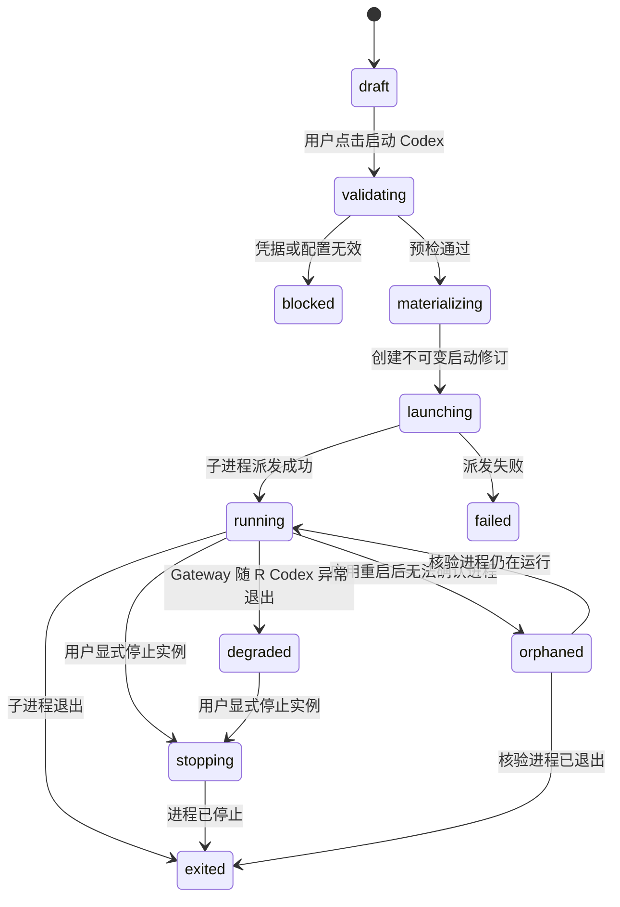
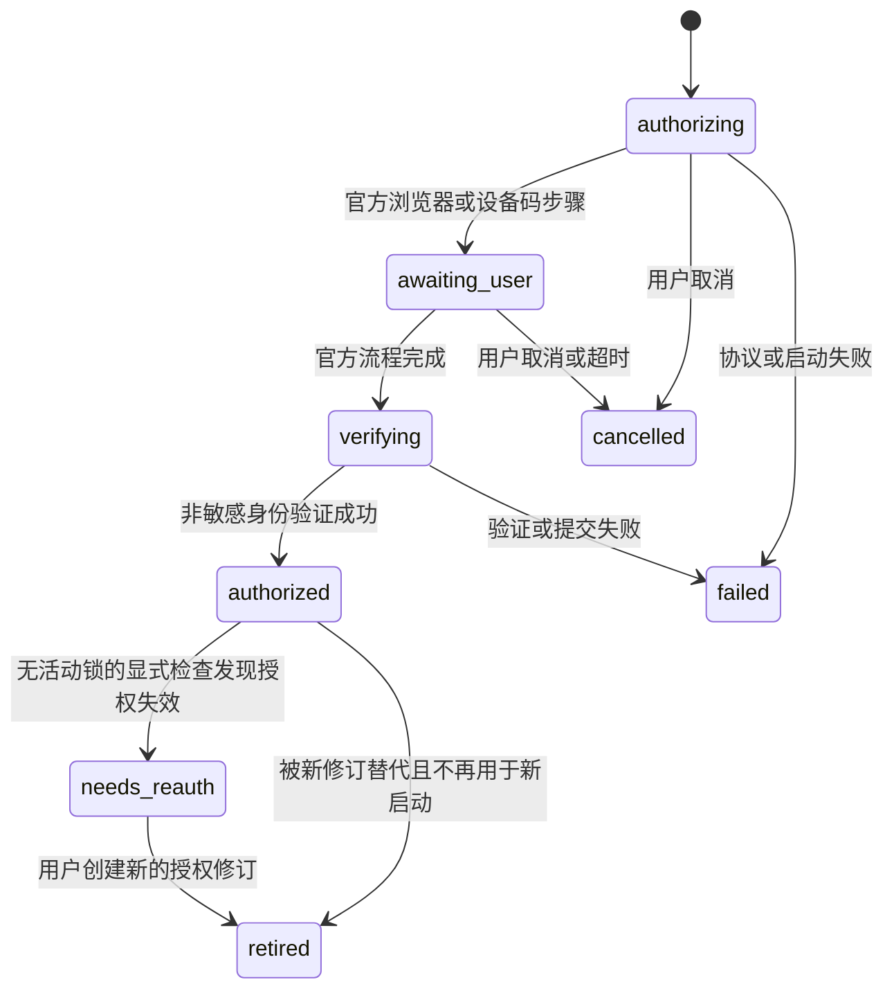

# Codex 多账户、API Key 与启动隔离方案

> 状态：V3.1 信息模型与官方账户交互已实现并完成自动化验收；真实双账户交互待发布前验收  
> 日期：2026-08-12  
> 参考：Cockpit Tools 的多账户、配额卡片和隔离实例产品形态；不复用其 OAuth 客户端、令牌导入、账户池或请求转发实现。
>
> 后续产品决策：本文仍记录 V3.1 历史实现和既有隔离契约；其中“官方账户不能作为 Gateway 上游”“启动预设只能选择单一凭据”“受管理凭据仅支持 CLI”的目标边界，已被[产品原理：显式启动、多账户与混合模型路由](3rcodex-product-principles.md)取代。纯 API Key 多 Provider 路由现已实现；官方订阅模型路由仍由[混合模型路由详细设计](codex-hybrid-routing-design.md)的真实合同探针门禁。

## 目标与用户承诺

R Codex 管理两类可供用户选择的 Codex 凭据来源：

- 用户明确保存的 API Key Provider；
- 通过 Codex 官方客户端完成登录的 ChatGPT/Codex 账户。

两类凭据只在用户从 R Codex 选择配置并点击“启动 Codex”后，对本次新建的 Codex CLI 进程生效。R Codex 不是 Codex 的全局账户切换器，也不存在会接管所有 Codex 进程的“当前活动账户”。

产品与代码中的 **Provider** 专指用户配置的 API 接口服务和 API Key，不包含官方 Codex 账户。官方账户是独立资源，只在启动预设的凭据选择器中与 API Key Provider 汇合；账户列表、详情、错误和统计不得套用 Provider 的字段或语义。

本方案的用户承诺：

1. **显式启动才生效**：选择账户、API Key、Profile 或工作区只修改 R Codex 中的启动草稿；只有点击“启动 Codex”并通过预检后才创建进程。
2. **直接启动保持原样**：用户从终端直接执行 `codex`，或直接打开 Codex App，继续使用 Codex 自己的默认 `CODEX_HOME`、默认配置和默认登录。R Codex 上一次使用的账户或 API Key 不会被复用。
3. **运行实例锁定配置**：每个由 R Codex 启动的实例固定引用创建时的启动配置修订。实例处于 `launching`、`running` 或 `stopping` 时，该配置及其引用的账户/API Key、Provider、Profile 与 Gateway 修订均被锁定，禁止修改、重新授权、断开、替换或删除。
4. **不污染全局环境**：R Codex 不修改用户默认 `~/.codex/config.toml`、`~/.codex/auth.json`、Codex App 登录、Shell 启动文件、系统级环境变量或操作系统中的 Codex 默认账户。
5. **凭据边界不合并**：API Key 只保存在系统凭据库；官方登录凭据只由官方 Codex 进程保存在受管理的隔离目录。二者可以通过统一启动入口选择，但不共用存储、刷新、撤销或失败状态。
6. **官方异常直接呈现**：OpenAI 或 Provider 侧的令牌撤销、账户封禁、套餐变化、限额耗尽和服务故障由运行中的 Codex 按官方行为直接报错。R Codex 不换号、不重授权、不替换密钥、不重启实例，也不把官方异常改写成 R Codex 内部错误。

## 核心概念

- **凭据来源**：API Key Provider 或官方 Codex 账户，是用户在 R Codex 中可选择的逻辑资源。
- **凭据修订**：一次不可变的凭据版本。API Key 修订引用系统凭据库条目；官方账户修订引用一个受管理的 `CODEX_HOME` 版本。
- **启动配置修订**：一次不可变的非敏感启动配置，固定引用凭据修订、Provider/Gateway 策略、Profile、Codex 可执行文件及配置摘要。
- **启动草稿**：用户在界面中尚未启动的选择，可随时修改，不影响任何 Codex 进程。
- **启动预设**：用户可命名和复用的逻辑配置，只保存账户或 Provider 等逻辑引用及非敏感选项；它不是 Codex 的活动配置。启动时才把它解析为不可变修订。
- **运行实例**：用户点击“启动 Codex”后创建的受管理 CLI 子进程，固定引用一份启动配置修订。
- **配置锁**：运行实例对启动配置及其运行依赖持有的排他修改锁。锁存在时可以查看状态、编辑不参与启动的备注或管理其他无关配置，但不能改变或删除被引用的运行配置。
- **Codex 默认环境**：未由 R Codex 启动的 Codex 所使用的原始环境，默认根目录是 `~/.codex`。R Codex 不接管或改写它。

对象关系为：

```text
LaunchPreset --> LaunchConfigurationRevision --> RuntimeInstance
                       ^                    |
ApiKeyProviderRevision-+                    +--> RuntimeConfigurationLock
OfficialCredentialRevision ----------------+
```

API Key 与官方账户只共享启动契约，不合并凭据生命周期。

## 范围与非目标

### 本期范围

- 多个 API Key Provider 与多个官方 Codex 账户并存、展示和选择。
- 官方登录、取消登录、授权状态读取、重新授权和本地断开。
- API Key 的新增、替换、禁用及连通性检测；密钥继续由现有系统凭据库管理。
- 账户卡片：凭据类型、脱敏身份、授权/配置状态、套餐、可验证限额缓存和运行实例数。
- 统一的启动草稿、预检、启动配置修订和 Codex CLI 实例生命周期。
- 手动刷新和低频后台刷新；失败时保留最后一次成功的非敏感读模型。

### 明确不做

- 改写或切换用户默认 `~/.codex`、Codex App 登录或系统默认账户。
- 因为用户在 R Codex 中选中了某个账户，就自动启动、重启、接管或改变任意 Codex 进程。
- 浏览器 Cookie、`auth.json`、session JSON、refresh token 的导入、解析、导出或迁移。
- 使用 ChatGPT/Codex OAuth 令牌驱动 Gateway，或代理、轮换、合并多个官方账户的模型请求。
- 静默登录、自动换号、账户池路由、配额规避、账户共享或自动唤醒任务。
- 向 Codex App 注入 R Codex 管理的 API Key 或官方账户。App 入口保持透传，只打开工作区并使用 App 自身登录；受管理凭据启动首期仅支持 Codex CLI。

## 凭据信息模型与界面契约

API Key Provider 和官方账户共用资源锁、不可变凭据修订及显式启动规则，但使用不同的读模型和操作集合。

| 维度 | API Key Provider | 官方 Codex 账户 |
| --- | --- | --- |
| 主显示 | Provider 名称、Base URL、传输模式 | 脱敏身份、官方套餐、本地账户备注 |
| 凭据状态 | 是否已在系统凭据库配置 | 官方授权状态与最近检查结果 |
| 运行能力 | 直连或 Gateway，可并行启动 | 仅官方直连；首版同一凭据修订单实例 |
| 诊断与统计 | 连通性、上游余额、本地请求和 Token 观测 | 官方认证检查、协议版本；官方限额仅在 app-server 支持并成功读取时显示 |
| 可变操作 | 修改名称、地址、Key、传输与 Gateway | 刷新认证、重新授权、本地断开、删除；运行锁存在时全部禁止 |
| 不得展示 | API Key 原文 | token、认证目录路径、授权 URL、设备码；也不得把本地备注说成官方工作区 |

官方 `account/read` 当前只提供可选 email 和 `planType`，不提供稳定的官方账户或工作区 ID。因此：

- `codex_accounts.id` 是 R Codex 生成的本地标识；email 只可脱敏展示，不能用于去重或授权判断。
- `workspace_label` 是用户填写的 **本地账户备注**。为空时界面显示“未设置本地备注”，不得默认显示“个人工作区”、组织名或其他看似由官方确认的信息。
- `plan_label` 是官方返回的套餐投影；为空时显示“套餐未提供”。
- `auth_checked_at`、`auth_error_code`、`codex_version` 和 `schema_fingerprint` 属于当前官方凭据修订的非敏感诊断投影，由控制面快照返回。
- 官方限额是可选的降级能力。没有成功快照时显示“当前版本暂未获取官方限额”，不得借用 API Key Provider 的余额或本地 Token 统计，也不得因限额读取失败改变 `authorized` 状态。
- 账户授权完成后的投影读取使用 `refreshToken=false`，避免重复刷新刚写入的凭据；用户主动执行“刷新官方账户状态”时使用 `refreshToken=true`，让官方 Codex 先按其凭据存储规则更新令牌，再生成新的账户/套餐投影。刷新失败只记录稳定错误并保留原授权状态，除非官方明确返回账户已失效。登录完成通知中的区域限制映射为 `official_auth_region_unsupported`，前端直接提示网络区域不受支持，不再将它笼统显示为普通授权失败。

连接和重新授权统一使用显式对话框。用户必须选择浏览器授权或设备码授权，并可填写或修改本地账户备注。浏览器授权 URL 由后端交给系统浏览器；设备码的验证 URL 和一次性代码只保存在当前内存对话框中，授权完成、取消、失败、关闭或应用重启后立即丢弃，禁止持久化、日志、自动复制或嵌入 WebView。

官方账户详情至少展示脱敏身份、本地备注、官方套餐、认证状态、最近检查时间、稳定错误码、Codex 版本、协议兼容指纹的短摘要、当前凭据修订短摘要、限额能力状态和运行锁。详情不暴露受管理目录的实际路径。

## 架构决策

### 启动时注入，不写全局默认

`LaunchService` 是应用所管理 Codex 进程的唯一创建入口。它只对子进程设置 `CODEX_HOME`、Provider 所需环境变量、启动参数和工作目录；不得把这些值写入父进程环境、Shell 配置、`launchctl`、Windows 用户环境、用户默认 Codex 配置或 Codex App 设置。

R Codex 可以记住最近使用的启动草稿用于界面回显，但该记录不是“活动配置”，不会在 R Codex 启动时自动应用，也不会被直接启动的 Codex 读取。每次实际启动都必须由用户点击“启动 Codex”。

官方文档说明 `CODEX_HOME` 是 CLI、IDE 扩展和 app-server 的状态根目录，默认值为 `~/.codex`。因此隔离必须通过新建子进程时设置进程级 `CODEX_HOME` 完成，而不是修改默认目录。

### 启动快照与不可变绑定

`LaunchPreset` 是用户可管理的逻辑启动配置；选择“常用”只改变 R Codex 下次打开启动窗口时的初始草稿。`LaunchConfigurationService` 在启动预检通过后，把预设中当前的逻辑引用解析为具体凭据、Provider、Gateway 与 Profile 修订，并创建不可变的 `LaunchConfigurationRevision`。运行实例只使用该修订及其依赖，不通过逻辑账户、“最近选择”或后来修改的预设做运行期查找。

`ConfigurationLockService` 将 `launching`、`running` 和 `stopping` 实例视为活动引用。任何写操作在创建新修订或写入外部凭据前，都必须先检查目标配置及其依赖是否存在活动引用：

- 替换或删除 API Key、修改 Provider Endpoint/协议：存在引用时拒绝。
- 官方账户重新授权、退出、断开或删除认证目录：存在引用时拒绝。
- 修改或删除 Profile、重绑/停止/删除实例所依赖的 Gateway：存在引用时拒绝。
- 禁用或删除逻辑账户、Provider 或启动配置：存在引用时拒绝，不转为后台待删除。
- 修改名称、标签、备注等未进入启动快照的展示元数据可以允许，但不得借此改变任何运行字段。

拒绝统一返回稳定错误 `configuration_in_use`，并附带受影响实例的非敏感 ID 与状态，供 UI 引导用户先停止实例。不得自动停止实例、克隆并替换配置或把更新排队到实例退出后执行。

只有用户显式停止实例且确认子进程已经退出后，配置锁才释放，相关修改或删除才可重新提交。重启视为新启动，必须重新预检并生成新的启动配置修订。

### CLI 监督与进程身份

受管理命令行进程采用直接父子监督链：

```text
R Codex -> Terminal -> codex-launcher -> Codex CLI
```

`codex-launcher` 是轻量监督进程，不解析、不缓存、不改写 Codex 的标准输入、输出和错误流。它使用继承的终端流 `spawn` Codex CLI，取得真实子进程 PID 后原子写入 `started.json`，等待子进程退出，再原子写入 `exited.json`。两个回执只含实例 ID、监督器 PID、CLI PID、进程启动身份、时间和退出状态，不含密钥、环境值、命令输出或认证材料。

`LaunchService` 必须先持久化实例及依赖锁，再派发终端；收到并校验 `started.json` 后才把实例置为 `running`。派发失败且可证明没有创建 CLI 时进入 `failed` 并释放锁；派发结果不确定时进入 `orphaned` 并保持锁。

R Codex 不需要常驻轮询每个进程。应用启动、实例列表读取以及任何受锁资源写操作前按需执行 reconciliation：同时核验监督器 PID、CLI PID、进程启动身份、预期 `CODEX_HOME` 和退出回执，避免 PID 被系统复用后误认。不能证明原进程已经退出时保持 `orphaned`，不得提供强制解锁。每个受管 CLI 只增加一个等待子进程的轻量监督器；没有每实例心跳、日志采集或 app-server 常驻进程，额外内存开销有界。

受管理 API Key/Gateway 实例使用每实例独立、权限为 `0700` 的 `CODEX_HOME`，只物化该次启动的非敏感 `config.toml`。官方账户实例使用其凭据修订的受管理 `CODEX_HOME`，因为官方 Codex 必须在该目录内维护认证；首版同一官方凭据修订最多一个活动实例，直到目标版本的多进程令牌刷新语义通过专项测试。

### API Key 启动边界

API Key 原文只保存在 macOS Keychain 或 Windows Credential Manager。启动时由受信任后端读取指定凭据修订，并只放入新建 Codex CLI 子进程的环境；值不进入命令行参数、SQLite、日志、前端状态、剪贴板或可复制启动命令。

API Key 支持两种明确模式：

- **直连模式**：受管理配置使用 `env_key` 指向进程局部环境变量，Codex CLI 直接请求对应 Provider。
- **Gateway 模式**：Codex CLI 只获得回环 Gateway 的 Base URL 和本地 Client API Key；Gateway 固定绑定一个 API Key Provider 修订。存在活动配置锁时不允许停止、重绑、编辑或创建替代 Gateway 修订；所有相关实例退出并释放锁后才能修改并重新启动。

官方账户不能作为 Gateway 上游。

### 官方账户与凭据目录

`CodexAppServerAdapter` 是唯一能触发官方登录、退出或读取官方账户状态的模块。认证页面、OAuth 回调、令牌刷新和本地登出/缓存清理由官方 Codex app-server 负责；官方契约没有承诺 `account/logout` 会撤销远端令牌，因此 R Codex 不作该声明，也不调用未公开的 ChatGPT 接口。

每个官方凭据修订拥有独立、权限为当前用户专用的 `managed_codex_home`。目录不是用户默认 `~/.codex`，并在登录前写入：

```toml
cli_auth_credentials_store = "file"
forced_login_method = "chatgpt"
```

固定使用文件凭据存储是多账户隔离的必要条件。官方 Codex 的 `auto` 模式可能改用操作系统钥匙串，使不同 `CODEX_HOME` 共享缓存登录；受管理官方账户不得使用 `auto` 或 `keyring`。

R Codex 可以创建目录、写入非敏感的受管理配置并记录目录引用，但不打开、解析、复制、快照、导出或记录 `auth.json`。`auth.json` 及其中令牌只由在该目录下运行的官方 Codex 进程读写。

官方文档说明 ChatGPT 登录会在使用中自动刷新令牌。因此“凭据修订不可变”指账户身份和目录引用不可变，不表示目录内容只读；官方 Codex 可在同一凭据修订内维护令牌。重新授权不得在旧目录中进行，而应创建新的空目录并完成一次新的官方登录。

### 唯一写入路径与一致性

- `AccountAuthorizationService` 是官方账户元数据、授权尝试、配额快照和官方凭据修订的唯一数据库写入者。
- `ProviderStore` 是 API Key Provider 元数据、系统凭据库引用和 API Key 修订状态的唯一写入者。
- `LaunchConfigurationService` 是启动配置修订的唯一写入者。
- `LaunchService` 是运行实例记录和受管理 Codex 子进程的唯一创建者。
- `ConfigurationLockService` 是活动配置锁判断与释放的唯一裁判；Provider、账户、Profile、Gateway 和删除服务必须调用它。
- UI、托盘、导入器、Gateway 与后台刷新任务不得绕过以上服务直接写凭据、配置修订或实例绑定。

启动时必须在同一 SQLite `BEGIN IMMEDIATE` 事务中重新验证预设版本、解析依赖、确认不存在相关操作租约并创建实例锁，然后才读取 secret 和派发子进程；配置写入也必须在事务中确认无活动锁，以消除“检查后启动”和“检查后修改”的竞态。

SQLite 事务不能与系统凭据库、官方认证目录或外部进程组成分布式事务。所有涉及这些外部资源的写操作必须先在 SQLite 获取 `ResourceOperationLease`：启动遇到租约即失败；修改先确认无运行锁，再提交租约，之后才写 Keychain、创建认证目录或启动登录。外部步骤完成后以新事务发布修订并释放租约；失败则补偿并记录可恢复状态。应用启动时核验遗留租约，不能证明补偿完成的资源保持不可启动、不可修改，不允许用超时直接抢占。

官方登录期间，账户和待建凭据目录的租约从创建授权尝试持续到完成、取消或失败清理，避免登录尚未提交时另一个启动或删除越过检查。Provider 与 Gateway 必须由一个后端 mutation 在同一租约协议内更新，UI 不再顺序调用两个独立写命令。

## 官方适配器与版本门

2026-08-11 本机探测的 Codex CLI `0.147.0-alpha.6.5` 提供实验性的 `codex app-server`，并可生成协议 JSON Schema。目标版本的 schema 必须在实现和发布时重新探测，不把本机版本的方法或字段视为永久产品契约。

`CodexAppServerAdapter` 的启动步骤：

1. 解析受支持 Codex 可执行文件，记录版本、平台和 app-server schema 指纹。
2. 使用待操作官方凭据修订的 `CODEX_HOME` 启动 `codex app-server --stdio`，显式把 `CODEX_SQLITE_HOME` 设为同一目录，并清除继承的 `CODEX_ACCESS_TOKEN`、`CODEX_API_KEY`、`OPENAI_API_KEY` 和 Provider secret 环境；不使用 daemon，不监听 TCP/WebSocket。
3. 初始化协议后只允许 `account/read`、`account/login/start`、`account/login/cancel`、`account/logout`、`account/rateLimits/read`，以及 `account/login/completed`、`account/updated` 通知。浏览器登录使用官方 `chatgpt` 类型；设备码使用官方 `chatgptDeviceCode` 类型。明确拒绝 `chatgptAuthTokens`、通过 app-server 注入 API Key 和任何内部令牌方法。
4. 版本门校验认证方法子树的必需方法、判别值和字段，并允许向后兼容的附加字段。不能使用整个 schema 文件的哈希变化作为硬失败，因为无关方法新增也会改变全局指纹；缺少必需结构才返回 `protocol_incompatible`，且不降级到私有 HTTP。
5. 发送 `initialize` 并在响应后发送 `initialized`，核验响应中的规范化 `codexHome` 与目标目录相同。只把 stdout 的逐行 JSON 作为协议；持续 drain stderr 但不保存正文，网络预热警告不能被误判为协议失败。
6. 操作结束后关闭子进程和 stdio；官方认证状态继续由该凭据修订目录中的 Codex 管理。全局 schema 指纹只作审计；兼容状态区分 `compatible_tested`、`compatible_unverified` 和 `incompatible`，新版本结构兼容时不误停稳定子集。

`account/read` 当前只保证可选的 email 和 `planType`，没有稳定的官方账户或工作区 ID。`codex_accounts.id` 因此必须由 R Codex 本地生成；email 只作可空、脱敏的显示属性，不能作为唯一键、授权边界或跨目录合并账户的依据。

## 数据模型

SQLite 只存非敏感投影和不可变引用：

```text
api_key_providers {
  id, name, kind, current_revision_id?, created_at, updated_at
}

api_key_provider_revisions {
  id, provider_id, secret_ref, base_url, wire_api, state,
  created_at, retired_at?
}

launch_presets {
  id, name, credential_kind, api_key_provider_id?, codex_account_id?,
  gateway_policy?, profile_options, default_workspace_path?, version,
  is_preferred, created_at, updated_at
}

codex_accounts {
  id, masked_identity?, workspace_label?, plan_label?,
  current_credential_revision_id?, created_at, updated_at
}

official_credential_revisions {
  id, account_id, managed_codex_home UNIQUE, auth_state,
  auth_checked_at, auth_error_code?, codex_version,
  schema_fingerprint, created_at, retired_at?
}

codex_authorization_attempts {
  id, account_id?, credential_revision_id?, state, started_at,
  completed_at?, error_code?, codex_version, schema_fingerprint
}

launch_configuration_revisions {
  id, launch_preset_id?, launch_preset_version?, credential_kind,
  profile_snapshot_hash, config_snapshot, codex_executable,
  codex_version, created_at
}

launch_configuration_dependencies {
  launch_configuration_revision_id, resource_kind, resource_id,
  resource_revision_id?, PRIMARY KEY(launch_configuration_revision_id,
  resource_kind, resource_id)
}

codex_instances {
  id, launch_configuration_revision_id, credential_kind,
  api_key_provider_revision_id?, official_credential_revision_id?,
  workspace_path, managed_codex_home, lifecycle_dir, state,
  supervisor_pid?, pid?, process_started_at?,
  launched_at?, exited_at?, exit_code?
}

runtime_configuration_locks {
  instance_id UNIQUE, launch_configuration_revision_id,
  acquired_at, released_at?
}

resource_operation_leases {
  resource_kind, resource_id, operation_id, operation_kind, state,
  owner_pid?, acquired_at, recovery_detail?,
  PRIMARY KEY(resource_kind, resource_id)
}

codex_quota_snapshots {
  account_id, official_credential_revision_id,
  source="official_app_server", primary_used_percent?,
  primary_window_minutes?, primary_resets_at?, secondary_used_percent?,
  secondary_window_minutes?, secondary_resets_at?,
  refreshed_at, expires_at, error_code?
}
```

数据库约束必须保证每个启动预设只引用一种逻辑凭据来源，每个启动修订通过 `launch_configuration_dependencies` 固定引用所有运行依赖。活动锁查询必须连接依赖表，不能依赖 JSON 字符串或只检查顶层 Provider。活动锁存在时，预设及其运行依赖不允许更新、创建替代修订、标记 `retired` 或删除。锁只在实例进入 `exited`，或确认从未成功派发进程的 `failed` 后释放；应用崩溃恢复时无法确认 PID 已退出的实例保持锁定并进入 `orphaned`，等待进程核验或用户显式停止。

`config_snapshot` 只能包含非敏感启动配置，不含 API Key、Gateway Client Key、授权 URL、设备码、Cookie 或 token。

## 状态机与流程

### 启动草稿与实例



切换界面选择只产生新的 `draft`。它既不修改 `running` 实例，也不改变 Codex 默认环境；若草稿引用被锁定配置，仍可查看。API Key 预设可以继续创建并行实例，但不能借草稿编辑底层配置；同一官方凭据修订已有活动实例时，首版返回 `official_credential_in_use`。

### 官方凭据修订



重新授权前必须确认该官方账户及其当前凭据修订没有活动配置锁。存在锁时返回 `configuration_in_use`，不得创建 `authorizing` 修订或启动浏览器。无锁时才创建新的 `authorizing` 修订；旧的 `authorized` 修订在新修订验证成功前仍是逻辑账户的当前可启动修订。新授权失败不得覆盖旧修订的状态。切换 `current_credential_revision_id` 必须与新修订提交处于同一 SQLite 事务。

### 统一启动流程

`launch_codex(launch_draft, workspace_path)` 执行：

1. 验证用户确实触发“启动 Codex”，读取 `launch_preset_id + expected_version` 和工作目录；受管理命令不接受 Codex App 目标。
2. 在 `BEGIN IMMEDIATE` 中重新核验预设版本、凭据状态、依赖锁与操作租约。API Key 必须有当前修订和可读凭据句柄；官方账户必须为 `authorized`、目录存在且无同修订活动实例。
3. 解析并写入完整依赖表，生成非敏感 `LaunchConfigurationRevision`、`launching` 实例、生命周期目录和运行锁后提交事务。
4. 在实例专用目录原子物化非敏感配置。随后才读取 API Key，并仅通过受信任启动器的进程环境传给 Codex；官方实例不读取认证文件。
5. 派发终端和启动器，等待有界时间内的 `started.json`。校验实例 ID、监督器 PID、CLI PID、进程启动身份和预期目录后写入 `running`；不得仅把终端成功打开当成 CLI 已启动。
6. 确认未派发 CLI 的失败进入 `failed` 并释放锁；结果不确定进入 `orphaned` 并保持锁。后续按需 reconciliation 读取退出回执和进程身份，确认退出后才进入 `exited` 并释放锁。

不得提供无用户确认的“应用当前账户”“设为系统默认”“同步到 Codex 默认登录”或“下次直接打开自动使用”动作。

`open_codex_app(workspace_path?)` 是与 Provider、账户和启动预设无关的独立命令，不接受任何凭据 ID、不写最近使用项，只执行官方 App 打开行为并明确使用 App 自身登录。启动器在 App 分支显式移除 `CODEX_HOME`、`CODEX_SQLITE_HOME`、`CODEX_ACCESS_TOKEN`、`CODEX_API_KEY` 和 `OPENAI_API_KEY`，既不复用上一次受管理配置，也不把启动 R Codex 时继承的认证环境带入 App。公开 IPC 不再暴露“生成 Profile”或返回可复制 `codex --profile` 命令；Profile 只能由 `LaunchService` 内部物化。

历史首版 Gateway 曾运行在 R Codex 主进程中；当前 P1 已将同一数据面编译为独立、受 loopback 控制端点保护的 `codex-gateway` Rust sidecar。若 sidecar 自身崩溃，活动 CLI 不会被误报为已退出，但其新请求会得到 `managed_gateway_unavailable`，待应用重新建立 binding；正在进行的流式响应不承诺从中间续接。完整的自动 binding 恢复仍属于后续增强，不是 API Key 路径的解锁前提。

### 官方连接与重新授权

1. 用户点击“连接官方账户”或“重新授权”后，服务先检查该逻辑账户和凭据修订没有活动配置锁，再创建权限为 `0700` 的新凭据修订目录和授权尝试。
2. 服务写入受管理的非敏感配置，使用该目录启动官方 app-server，并触发浏览器或设备码登录。
3. app-server 返回可验证的非敏感账户投影后，以 SQLite 事务提交逻辑账户、凭据修订和授权状态。
4. 取消、超时或协议失败时终止子进程；未关联的空目录可清理。若官方流程完成但元数据提交失败，则记录可恢复错误，不读取认证文件补偿。
5. 重新授权始终创建新的凭据修订目录，但只能在相关实例全部退出、配置锁释放后执行。验证成功后将新修订用于未来启动。

### API Key 替换

1. 用户提交新 Key 和 Provider/Gateway 选项后，`ProviderStore` 在同一事务中检查完整依赖锁与操作租约；存在锁时返回 `configuration_in_use`，不得读取或写入系统凭据库。
2. 无锁时创建覆盖 Provider 与 Gateway 资源的操作租约并提交，之后才以新的 `secret_ref` 写入系统凭据库。
3. 以 SQLite 事务创建新的 Provider 修订、需要时创建 Gateway 修订，并将逻辑 Provider 指向最新可启动修订；成功后释放租约。
4. 数据库提交失败时删除新 Key 或保留可恢复租约；不得把新 Key 写进旧 `secret_ref`。后续点击启动的实例使用新修订，旧修订在无活动锁后才能从凭据库回收。

### v5 数据迁移与回滚

- 数据库从现有 schema v4 升级到 v5 时，为每个 `api_key_providers` 行创建一个初始不可变修订，沿用原 `secret_ref`，再回填 `current_revision_id`；迁移不得枚举、读取或搬移 Keychain 内容。
- 现有最近 Provider 只迁移为 R Codex 的 preferred 启动草稿，不写 Codex 默认配置。旧的 `is_default` 保留兼容读取至下一次清理迁移。
- 旧的用户级 Profile 只作为历史文件保留，不再更新或作为新实例输入；发布说明提供人工清理位置，不自动删除用户文件。
- 新表迁移在单个 SQLite 事务内执行；失败保持 user version 4，不发布部分 schema。数据库回滚只允许恢复升级前备份；不得通过降级二进制解释新 schema。

### 断开、删除与回收

- **断开/禁用**：存在活动配置锁时拒绝；无锁时才禁止该凭据来源用于未来启动，不修改 Codex 默认登录。
- **删除逻辑账户、Provider 或启动配置**：存在活动配置锁时拒绝，不标记待删除、不排队、不隐式停止实例；无锁时才进入删除事务。
- **停止实例**：独立的显式生命周期操作，只作用于用户选择的受管理实例。
- **移除官方认证目录**：仅可作用于已验证为 R Codex 创建且无运行引用的精确账户/修订目录；先提交本地 tombstone，再受控删除该目录。该动作清理本地缓存，不声明远端令牌撤销，也不允许把任意外部路径作为删除目标。
- **不提供强制删除**：用户必须先通过独立动作停止所有受影响实例，等待锁释放后再重新发起删除。
- **历史修订保留**：删除逻辑资源时对可启动入口做 tombstone 并回收无锁凭据，但保留被历史实例审计引用的非敏感修订；不得破坏外键或伪造历史配置。

## 操作影响矩阵

| 动作 | 影响未来启动 | 影响 R Codex 运行实例 | 影响直接启动的 Codex | 影响 Gateway |
| --- | --- | --- | --- | --- |
| 在界面选择账户/API Key/Profile | 否，仍需点击启动 | 否 | 否 | 否 |
| 点击“启动 Codex” | 是，仅新实例 | 创建新实例 | 否 | Gateway 模式可创建或引用固定修订 |
| 替换 API Key | 有活动锁时拒绝；无锁时创建新修订 | 否 | 否 | 有活动依赖时拒绝 |
| 官方账户重新授权 | 有活动锁时拒绝；无锁时创建新修订 | 否 | 否 | 否 |
| 编辑 Provider/Profile/Gateway 配置 | 有活动锁时拒绝 | 否 | 否 | 不热切运行 Gateway |
| 设为常用启动配置 | 仅改变草稿初始选择 | 否 | 否 | 否 |
| 断开/禁用/删除凭据来源 | 有活动锁时拒绝 | 否 | 否 | 有活动依赖时拒绝 |
| 显式停止实例 | 锁在进程确认退出后释放 | 是，仅所选实例 | 否 | 无其他依赖后可停止 |
| 直接执行 `codex`/打开 Codex App | 否 | 否 | 使用原始默认环境 | 否 |

## 可选配额刷新与后台任务

授权状态与配额状态分开建模，避免“配额暂不可读”被误判为已登出。后台刷新最多按配置周期查询一次，使用单飞锁合并并发请求；连续失败使用退避。

多账户授权与受管理启动不依赖配额能力。适配器在目标 Codex schema 支持时，于授权完成和用户手动刷新账户状态时附带读取 `account/rateLimits/read`，成功后写入短期快照并在详情中展示；读取失败不覆盖最后一次成功快照，也不改变授权状态。后台定时刷新和阈值通知仍作为后续增强；没有成功快照或上游不支持时统一显示“当前版本暂未获取官方限额”，不得阻止登录、启动、断开或删除。

后台任务不得启动登录、打开浏览器、创建 Codex 实例、改变启动草稿、修改 Codex 默认环境、重绑 Gateway、替换凭据修订或绕过配置锁。对存在活动配置锁的官方凭据修订，R Codex 不启动额外 app-server 读取状态或配额，继续显示最后缓存并标记为 `stale`；只有运行中的官方 Codex 可以按自身机制维护令牌。官方 Codex 的自动令牌刷新属于官方运行行为，不是 R Codex 配置变更。`account/rateLimits/read` 是可选配额能力，缺失时只把配额显示为不支持，不能阻止官方登录与启动。

运行实例遇到官方授权失效时，由 Codex CLI 将官方异常直接输出到其终端或标准错误流。R Codex 不捕获后改写、不自动重试、不创建重新授权修订、不切换备用账户/API Key，也不停止或重启实例；审计最多记录脱敏的“观察到官方认证失败”分类，不保存官方响应正文。存在活动锁时不修改该凭据修订的配置状态；实例退出后，用户显式检查或再次启动的预检可以按官方结果将其标记为 `needs_reauth`。

## UI 与审计

- 账户/Provider 列表明确标注“API Key”或“官方 Codex 登录”，显示脱敏身份、配置/授权状态、可验证套餐/限额、更新时间和运行实例数。
- 所有卡片使用“选择并启动”心智；不展示可能被理解为修改系统 Codex 的“切换全局账户”或“设为 Codex 默认”文案。
- “常用启动配置”只决定 R Codex 新启动草稿的初始选择，并显示“仅通过 R Codex 启动时生效”；预设持久化不等于自动应用。
- 启动确认页显示凭据类型、脱敏名称、Provider/Gateway、Profile、工作目录和“不会修改直接启动的 Codex”提示。
- 实例详情显示固定的启动配置修订、凭据修订、PID、工作目录和启动时间；不得把当前账户卡的新状态冒充为实例启动时状态。
- 被活动实例锁定的账户、API Key、Provider、Profile、Gateway 和启动配置必须显示“运行中，配置已锁定”，禁用编辑、重新授权、断开和删除操作，并链接到持锁实例；后端仍必须独立执行锁检查。
- Codex App 是与凭据卡片分离的独立入口，显示“使用 App 自身登录”；其 IPC 请求不得携带账户、Provider、预设或凭据修订 ID。
- UI 只根据后端快照中的 `locked_by_instances` 禁用实际被引用的资源，其他 Provider 和账户仍可操作；操作中的 pending 状态与运行锁状态分开显示。
- 所有写命令返回结构化错误 `{ code, message, conflicting_instances }`。`configuration_in_use` 必须刷新快照并链接持锁实例，不能依赖字符串匹配。
- `AuditEvent` 只记录内部 ID、修订 ID、动作、结果、稳定错误码、Codex 版本与时间；禁止记录身份原文、API Key、授权 URL、设备码、token、认证文件内容或上游响应正文。

## 失败与安全行为

| 情形 | 行为 |
| --- | --- |
| Codex 不存在或 app-server 不支持 | 不创建可用官方凭据修订；API Key 资源不受影响。 |
| 凭据无效或系统凭据库拒绝访问 | 阻止本次启动；不回退到上一次账户或 Key。 |
| 认证方法子树缺失或关键字段/判别值不兼容 | 停止官方账户操作并标记 `protocol_incompatible`；不因无关 schema 增量或全局指纹变化误停，也不降级为私有接口。 |
| 启动时配置已被更新 | 使用乐观版本检查中止并要求重新确认；不静默改用最新修订。 |
| 子进程派发失败 | 确认没有进程时实例为 `failed` 并释放锁；无法确认时实例为 `orphaned` 并保持锁定；清除进程内 secret，默认 Codex 环境不变。 |
| 启动器无法写入 running 回执 | 启动器先终止并等待刚创建的 CLI；无法确认已停止则由主程序恢复为 `orphaned`，不得留下无记录运行进程。 |
| 尝试替换 API Key、重新授权或编辑运行配置 | 返回 `configuration_in_use` 和非敏感持锁实例列表；不执行部分写入。 |
| 官方授权被上游撤销 | Codex CLI 直接输出官方异常；R Codex 不换号、不自动修复、不改写异常。 |
| 认证目录被外部删除或篡改 | 禁止引用该修订的新启动；不扫描默认 `~/.codex` 寻找替代 token。 |
| 用户直接启动 Codex | R Codex 不发现、不接管、不注入最近配置；Codex 使用自己的默认环境。 |
| 删除仍被实例引用的资源 | 返回 `configuration_in_use`；不进入待删除状态，不隐式停止实例或删除凭据。 |
| 应用崩溃留下操作租约 | 核验外部步骤并完成补偿或提交；核验前相关资源不可启动、修改或删除，不按超时抢锁。 |
| R Codex 崩溃导致 Gateway 消失 | 相关 CLI 实例进入 `degraded` 并保持锁，不自动换端口、重绑或重启；用户显式停止后再释放。 |

## 交付顺序与验收

1. **统一启动契约与配置锁**：先实现启动草稿、凭据修订、启动配置修订、运行实例绑定、事务化配置锁和默认环境保护测试。
2. **API Key 修订接入**：把现有 Provider/Gateway 启动路径接入统一启动服务，补充 Key 替换和 Gateway 固定绑定测试。
3. **官方协议适配器**：实现 app-server 版本/schema 门、官方登录、取消、状态读取和受管理文件凭据存储。
4. **可选配额读模型**：在核心多账户启动验收后，按目标 Codex 能力加入过期缓存、手动刷新和后台单飞/退避；不作为首版认证发布门槛。
5. **重新授权与资源回收**：实现无锁预检、新凭据目录、锁释放、崩溃恢复和独立停止确认。

验收必须覆盖：

- 从 R Codex 分别选择两个 API Key、两个不同官方凭据修订启动四个并行 CLI，实例引用和请求凭据不串用；同一官方凭据修订的第二次并行启动必须被拒绝。
- 直接执行 `codex` 和直接打开 Codex App 均继续使用测试前的默认配置与默认登录；R Codex 不在 `~/.codex`、Shell 配置、系统环境或 App 设置中留下活动账户切换。
- 仅在界面选择另一账户、关闭并重开 R Codex、修改常用启动配置，都不会影响运行实例或直接启动的 Codex。
- 任一实例处于 `launching`、`running`、`stopping` 或未核验的 `orphaned` 时，替换 API Key、官方重新授权、编辑 Provider/Profile/Gateway、断开及删除均返回 `configuration_in_use`，且数据库、凭据库和认证目录没有部分写入。
- 配置修改与实例启动并发发生时，SQLite 事务保证只有一方成功；成功启动必然先持有配置锁，成功修改必然观察不到活动锁。
- 实例退出并确认 PID 不存在后锁才释放；应用崩溃重启后未知进程保持锁定，核验完成前不能修改或删除配置。
- 终端打开但 CLI 未启动时不得标记 `running`；PID 复用、缺少回执和篡改回执均进入 `orphaned` 并保持锁。按需核验不要求每实例心跳或常驻 app-server。
- 官方授权在运行期失效时，终端显示官方异常；R Codex 不自动重试、重新授权、切换账户/API Key、停止或重启实例，也不将异常替换成内部错误。
- 运行实例重启会创建新的启动配置修订并重新确认当前选择，不隐式复用已被禁用或删除的旧配置。
- 官方账户目录固定为文件凭据存储；两个受管理 `CODEX_HOME` 不通过系统钥匙串共享登录。
- 同一官方凭据修订的多实例并发运行和令牌自动刷新必须通过目标 Codex 版本的集成测试；若无法证明安全，首期限制为每个官方凭据修订一个活动实例并在 UI 说明。
- 数据库、日志、快照、导出、可复制命令和持久前端状态中不存在 API Key、Gateway Client Key、`auth.json` 内容、token、Cookie、授权 URL 或设备码。授权 URL/设备码只允许作为一次授权尝试的瞬时 IPC 返回值，消费后不得缓存或写入审计。
- 协议不兼容、凭据缺失、启动取消、SQLite 提交失败、外部删除目录和上游撤销授权都有稳定、可区分的失败结果，且不会回退到上一次配置。
- v4 到 v5 的数据库迁移为 Provider 创建初始修订时不读取 Keychain；迁移失败保持 user version 4，且不改变默认 Codex 环境。
- 前端覆盖单资源锁、锁竞态、官方并发门、App 独立入口和 Profile 逃逸入口移除；桌面与窄屏均无控制重叠、横向滚动、控制台错误或敏感信息。

## 风险、回滚与被拒绝方案

- app-server 是版本化适配能力：通过 Codex 版本和 schema 门限制在 `CodexAppServerAdapter` 中；不兼容时关闭官方连接入口，保留 API Key 启动和既有只读记录。
- 官方文档没有承诺同一文件凭据目录的多进程刷新语义；发布前必须验证，不能用假设替代测试。
- 回滚官方账户功能时，禁用适配器和新官方启动入口，不删除官方认证目录，不改变 API Key Provider、Codex 默认环境或已经运行的 CLI。
- 被拒绝：修改 `~/.codex/auth.json` 实现全局切号；把最近选择写成系统默认；复制官方认证文件生成实例；向 Codex App 注入受管理凭据；运行中热切或创建替代修订绕过配置锁；把更新排队到退出后静默执行；包装、吞掉或自动修复官方认证异常；复制 Cockpit OAuth relay；导入/导出 session JSON；把 OAuth 账户放入 Gateway 账户池；直接请求网页私有 usage 接口。

## 参考依据

- [OpenAI Codex Environment Variables](https://learn.chatgpt.com/docs/config-file/environment-variables)：`CODEX_HOME` 是 CLI、IDE 扩展和 app-server 的状态根目录，默认是 `~/.codex`；Provider API Key 可通过配置指定的 `env_key` 从环境读取。
- [OpenAI Codex Advanced Configuration](https://learn.chatgpt.com/docs/config-file/config-advanced)：支持单次 CLI 配置覆盖，并说明 `CODEX_HOME` 下包含配置、认证、会话、日志和缓存等状态。
- [OpenAI Codex Authentication](https://learn.chatgpt.com/docs/auth)：登录缓存可位于 `CODEX_HOME/auth.json` 或系统凭据库；ChatGPT 登录会在使用中自动刷新令牌。
- [OpenAI Codex App Server](https://learn.chatgpt.com/docs/app-server)：官方富客户端认证方法、通知与协议初始化；命令和 WebSocket 传输目前标记为实验性。
- [OpenAI Codex Configuration Reference](https://learn.chatgpt.com/docs/config-file/config-reference)：`cli_auth_credentials_store` 与 `forced_login_method` 的受支持配置。
- [Cockpit Tools README](https://github.com/jlcodes99/cockpit-tools)：作为多账户、配额卡片和隔离实例的产品参考；其 OAuth 客户端实现也用于核对官方授权码/设备码参数和刷新时序，但 R Codex 仍让目标 Codex app-server 负责回调、令牌交换与凭据落盘，不复制 OAuth relay 或账户池。
- 本机 Codex CLI `0.147.0-alpha.6.5` 的 `app-server --help` 和生成的 V2 schema：实现前必须再次以目标版本生成 schema 验证。

### Cockpit OAuth 对照结论（2026-09-01）

本机对 Cockpit 当前实现和 Codex CLI `0.150.0-alpha.8` 的授权参数做了逐项对照：两者均使用 `auth.openai.com/oauth/authorize`、客户端 ID `app_EMoamEEZ73f0CkXaXp7hrann`、本地回调 `http://localhost:1455/auth/callback`、授权码 + PKCE，以及同一设备码端点。Cockpit 增加的 `User-Agent`/`originator` 请求头不会改变服务端的区域准入判断。

因此本产品继续采用 **官方 app-server 托管认证** 作为唯一生产路径：由官方进程负责回调、授权码交换、令牌刷新和 `CODEX_HOME` 下的凭据落盘，R Codex 只保存脱敏账户投影。直接复制 Cockpit 的 OAuth relay（R Codex 自己交换并持有 token）不会绕过区域限制，只会让 R Codex 承担 token 生命周期、撤销、刷新失败和 `auth.json` 兼容风险，违反本设计的凭据边界。

本机实测中，设备码接口和授权页面均返回 `unsupported_country_region_territory`（HTTP 403）。该结果证明当前网络区域被上游拒绝，不能作为 R Codex 二进制或 app-server 协议实现失败的证据。应用将该原因映射为稳定错误 `official_auth_region_unsupported`，并提示用户切换到受支持的网络区域后重试；在支持区域完成浏览器授权后，验收标准仍是授权尝试进入 `authorized`、官方账户投影可读且不暴露任何 token。
