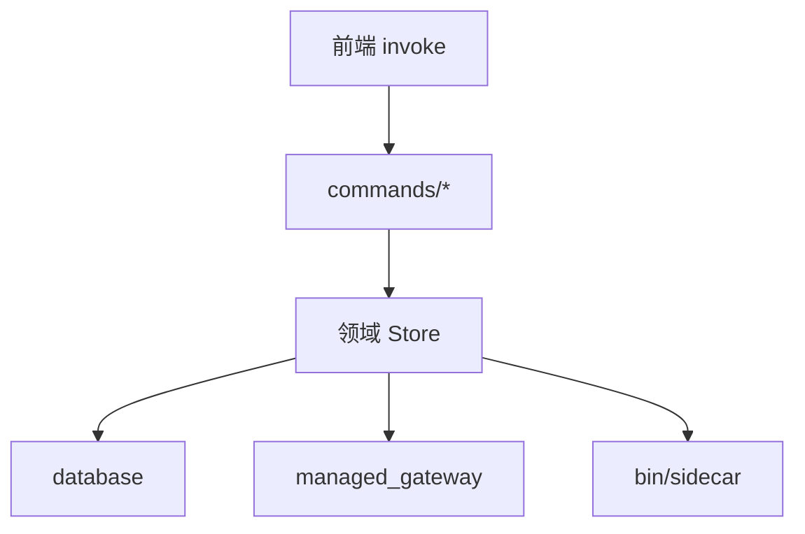

# Tauri Rust 后端模块拆分

> 状态：四批拆分已落地（2026-10-09）。不改产品行为、IPC 命令名、错误码和 SQLite 合同。前端未调用的命令也迁到对应领域，不删除。

## 目标

把 `src-tauri` 从「大文件 + lib.rs 堆 command」收成领域模块。每个领域对外一个 Store/Service，IPC 只做适配。单文件保持可读，重复逻辑抽共用，调用链从 UI → command → Store → SQLite/sidecar 一眼能看完。

非目标：不改路由、Gateway 协议、凭据存储、启动隔离；不把官方账户重新打开；这一轮不拆新的 Cargo crate；不顺便改前端。

## 现在的问题

领域 Store 已经有了（`ProviderStore`、`CodexControlStore`、`ManagedLaunchStore`、`ManagedGatewayClient`），sidecar 也在 `src/bin`。结构方向对，体积不对：

| 文件 | 约行数 | 问题 |
| --- | --- | --- |
| `managed_gateway.rs` | 6700 | 运行时、协议转换、测试挤在一个文件 |
| `managed_launch.rs` | 5200 | 启动、工作区写入、Electron 布局、测试挤在一起 |
| `database.rs` | 2500 | schema、迁移、连接和资源锁 |
| `lib.rs` | 2400 | 五十多个 command、装配、进程手递 |
| `managed_codex_config.rs` | 2600 | 配置投影和目录能力 |
| `official_accounts.rs` / `providers.rs` | 2100+ | Store 与测试未拆开 |

`lib.rs` 同时负责 `run()`、`manage()`、command 和一部分启动编排。子目录（`managed_gateway/`、`managed_launch/` 等）已经开了，但主体仍留在根上的同名大文件。

前端当前会调用的命令大约三十个。仍注册但 UI 很少或从不调用的，包括官方账户授权一组、`create_launch_preset` / `update_launch_preset` / `delete_launch_preset`、`select_default_api_key_provider`、`update_api_key_provider`、`conversation_archive_clear`、超时设置等。这些迁入对应模块后继续 `generate_handler!` 注册。

## 目标结构

```text
src-tauri/src/
  main.rs                      # 一行：r_codex_lib::run()
  lib.rs                       # 模块声明、run()、State、handler 列表
  commands/                    # 薄 IPC，按领域再拆文件
    mod.rs
    gateway.rs
    providers.rs
    launch.rs
    instances.rs
    archive.rs
    official.rs
    system.rs
  providers/
  managed_launch/
  managed_gateway/
  codex_control/
  conversation_archive/
  database/
  official/
  support/                     # 跨领域小工具：时间、路径、脱敏
  bin/                         # 现有 sidecar，不动进程边界
```

一个领域目录固定四类文件，缺了再补，不提前空建：

- `mod.rs`：对外类型和 Store。
- `models.rs`：序列化结构和枚举。
- `commands.rs` 或由顶层 `commands/` 引用：只做参数、State、错误映射。
- 测试：`#[cfg(test)]` 跟着行为走，文件超过约 400 行测试再拆 `tests.rs`。

体积约定：业务文件尽量不超过 800 行；超过 1200 行必须再拆。测试文件可以更长，但一个测试模块只覆盖一个行为面。



Command 典型长度十几行：校验输入、调 Store、把 `Result` 交给现有错误码。事务、锁、探测、快照仍在 Store。

## 领域划分

| 领域 | 现有入口 | 迁入内容 |
| --- | --- | --- |
| providers | `providers.rs`、`channel_probe.rs`、`connectivity.rs`、`usage.rs`、`balance.rs` | 渠道 CRUD、探针、连通性、用量、余额 |
| managed_launch | `managed_launch.rs` 及子目录、`managed_codex_config.rs` | 工作区、登录渠道、隔离 home、偏好同步 |
| instances | `codex_control.rs`、`lib.rs` 里的 launch/stop/reconcile | 实例生命周期、启动编排、FIFO 手递 |
| managed_gateway | `managed_gateway.rs` 及子目录 | sidecar、绑定、转发、压缩 |
| archive | `conversation_archive.rs` | 四阶段档案 |
| diagnostics | `diagnostics.rs` | 事件、请求、会话摘要 |
| official | `official_accounts.rs`、`official_auth.rs` | 官方账户，保持关闭门 |
| system | 安装、更新、打开目录/默认 App | `codex_installation.rs` 和 `lib.rs` 后半 |
| database | `database.rs`、`resource_guard.rs`、`secrets.rs` | schema、迁移、锁、凭据表 |
| routing | `routing.rs`、`route_store.rs`、`model_family_profile.rs`、`special_models.rs` | 路由快照和模型族 |

跨领域的 `now_seconds`、路径归属、脱敏、错误前缀，收到 `support/`，禁止每个大文件复制一份。

## 注释和可读性

- 模块顶写这个文件管什么、不做什么、谁调用它。
- Store 的公开方法写输入约束和副作用（写库、起进程、读凭据）。
- Command 不写业务说明，只写 IPC 名称对应的用户动作。
- 安全边界继续用现有英文注释（PID 校验、FIFO、不记录 Key）。
- 产品规则用中文，和现在 Store 里的写法一致。

## 分批

每一批都是纯移动：命令名、参数、错误字符串、SQLite、sidecar 协议不变。一批做完再开下一批。

### 第 1 批：抽空 lib.rs

把 `#[tauri::command]` 按上表挪到 `commands/`。`lib.rs` 只留模块、`run()`、窗口事件和 `generate_handler!`。启动编排（terminal、FIFO、sidecar 参数）先跟着 instances/system command 走，不要留在 `run()` 里。

验收：`cargo fmt --all -- --check`、`cargo test --all-targets`、`pnpm run check`。前端 invoke 列表不变。

第 1 批已落地（2026-10-09）：`src-tauri/src/lib.rs` 只留模块声明、`run()`、State、窗口/托盘和 `generate_handler!`。56 个 command 按领域迁到 `src-tauri/src/commands/`。`OFFICIAL_ACCOUNT_AUTH_ENABLED` 仍只在 `lib.rs` 一处。启动编排（terminal/FIFO/sidecar）随 `instances` 搬走。`generate_handler!` 名单与顺序与改前一致。顺手把 `managed_launch` 一条过期断言从 `managed-app-data` 改成现用的 `electron-data`（生产代码已用新目录名）。

### 第 2 批：切开最大的两个领域

先 `managed_launch`，再 `managed_gateway`。根上的 `managed_launch.rs` / `managed_gateway.rs` 变成薄 `mod.rs`（或改名为目录入口）。按「写入工作区 / 准备启动 / Electron 数据 / 测试」切开，不按偶然的函数字母序切。

验收：现有 `managed_launch::tests`、`managed_gateway::tests` 全过。启动 CLI/App 的手动路径本批不改语义。

第 2 批已落地（2026-10-09）：根上的 `managed_launch.rs` / `managed_gateway.rs` 改为目录入口 `mod.rs`。`crate::managed_launch::*` 与 `crate::managed_gateway::{ManagedGatewayClient, GatewayBinding, ManagedGatewayCredential, ManagedGatewayStatus, GATEWAY_PORT, run_sidecar}` 对外路径保持。`managed_launch` 按工作区写入、启动准备、binding、home 布局、Electron/sqlite 存储切开；`managed_gateway` 按 helpers、runtime、sidecar 生命周期、HTTP 入口、协议改写、转发、SSE 流切开。测试按行为面放到 `tests_*`。`cargo test --lib managed_launch::` 38 通过。`cargo test --lib managed_gateway::` 在沙箱里 33 通过；失败项全部是 `127.0.0.1` bind / 进程 session 权限（`PermissionDenied`），与拆分无关。`cargo fmt --all -- --check`、`pnpm run check`、`cargo check --bins` 通过。未开始第 3 批。

### 第 3 批：database、providers、codex_control、config

`database.rs` 分成连接、schema/迁移、查询辅助。`resource_guard` 留在 database 领域。`providers.rs` 把探针调用留在 Store，command 已在第 1 批。`codex_control` 把 snapshot/reconcile/lock 从 1900 行文件里拆开。

第 3 批已落地（2026-10-09）：根上的 `database.rs` / `providers.rs` / `codex_control.rs` / `managed_codex_config.rs` 改为目录入口。`crate::database::{Database, resource_guard::*}`、`crate::providers::*`、`crate::codex_control::*`、`crate::managed_codex_config::*` 对外路径保持。`resource_guard.rs` 仍在 `src-tauri/src/`，由 `database/mod.rs` 的 `#[path = "../resource_guard.rs"]` 挂入。业务文件均 ≤800 行。`generate_handler!` 仍是 56 个，从 `stop_gateway` 到 `sync_managed_preferences`。`OFFICIAL_ACCOUNT_AUTH_ENABLED` 仍只在 `lib.rs`。

验证：`cargo fmt --all -- --check` 通过。`cargo test --lib database::` 24 通过；`open_path_ignores_legacy_app_data_and_runtime_sockets` 在沙箱里 `UnixListener` bind `PermissionDenied`，与拆分无关。`cargo test --lib providers::` 21 通过。`cargo test --lib codex_control::` 10 通过。`cargo test --lib managed_codex_config::` 24 通过。`pnpm run check` 通过。


### 第 4 批：去重和官方账户就位

合并重复的时间戳、路径校验、错误包装。官方账户命令整组搬进 `official/`，门控常量仍只在一处。前端不用的命令照样编译和注册。

第 4 批已落地（2026-10-09）：新增 `src-tauri/src/support/`（`unix_now_seconds`、字面相同的 `resolve_workspace` / `set_private_directory` / `sha256_label`）。`official_accounts.rs` / `official_auth.rs` 改为目录入口，`crate::official_accounts::*` 与 `crate::official_auth::*` 对外路径保持。`OFFICIAL_ACCOUNT_AUTH_ENABLED` 仍只在 `lib.rs`。`generate_handler!` 仍是 56 个，从 `stop_gateway` 到 `sync_managed_preferences`。官方账户命令仍在 `commands/official.rs` 并继续注册。`diagnostics` / `usage` 的 `Local::now().timestamp()` 与 `balance` 的 `chrono::Utc::now().timestamp()` 未合并（chrono 时区语义）。

验证：`cargo fmt --all -- --check` 通过。`cargo test --lib official_accounts::` 10 通过。`cargo test --lib official_auth::` 16 通过。`cargo test --lib providers::` 21、`codex_control::` 10、`managed_launch::` 38、`route_store::` 4、`conversation_archive::` 19、`managed_codex_config::` 24 通过。`pnpm run check` 通过。


## 验证

每批最少：

```bash
cargo fmt --all -- --check
cargo test --all-targets
pnpm run check
```

第 1 批之后对比 `generate_handler!` 名单与改前一致。涉及启动或 Gateway 的批次，用现有单测覆盖成功、失败、取消和锁；不拿 mock 冒充真实 Provider 合同。

## 风险和回滚

- `mod foo.rs` 改成 `foo/mod.rs` 时，外部 `crate::foo::` 路径保持不变，避免连锁改名。
- 测试若写死了私有函数路径，随文件移动更新，不断言行为。
- 一批只动一个领域的公开 API 表面；跨领域签名变更放到第 4 批并单独说明。
- 回滚粒度是一整批（一次提交）。不在拆分中夹带产品改动，避免无法回退。

## 不在这一轮做的

- 新建 `rcodex-protocol` crate。sidecar 共享协议可以标为后续，先用 `pub mod`。
- 删除未使用 IPC。
- 改变 command 的 camelCase 或错误码字符串。
