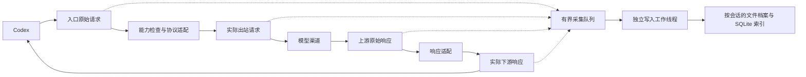

# 按会话归档完整请求：设计与转发链路审查

> 2026-09-17；状态：首版已接入，继续补充验收。这里的 Codex 会话就是原生历史文件所属的每个独立会话；以原生会话 ID 关联，文件移动不会创建新会话。真实用户流量采集保持显式开关。

### 当前实现

- `ConversationArchive` 使用独立 `conversation-history/archive.sqlite` 和按环境/原生会话/请求的私有目录；请求正文由后台有界队列增量写入 `.part` 文件，终态后原子发布。
- `ArchiveCapture` 已接入 `/v1/responses` 的入口、实际出站请求、上游响应（含非 2xx/流式分块）和下游响应；队列 64 MiB、阶段 128 MiB、总档案 2 GiB，超限标记 `partial` 并保持转发可用。
- 身份关联使用 `session-id`、`thread-id` 和 `x-codex-turn-metadata` 候选，并在受控 `CODEX_HOME` 中有界核验 rollout 首条 `session_meta`；未核验请求归入待关联组，不按时间或正文猜测。
- 认证 Header、URL 凭据和结构化认证字段不落盘；已登记的运行时密钥在工作线程跨分块替换，避免响应回显密钥进入正文。提示词中的用户主动秘密仍不能自动识别。
- UI 已在“运行诊断”中提供显式开关、环境/会话/请求分组、四阶段分页查看、阶段对照、部分记录标识和清除操作。清除前必须停止完整记录，Codex 原生历史与普通脱敏诊断不受影响。
- 已覆盖身份冲突、并发会话、软链逃逸、跨分块脱敏、崩溃恢复、队列/容量边界及清理并发测试。默认 App 使用 `default` 环境键，隔离 App 使用受控启动方案和登记的 `CODEX_HOME`；旧 sidecar 不支持归档控制时 UI 应显示需重启。

首版仍有明确边界：归档是 R Codex 观察到的请求记录，不补写原生历史、不自动修复 `model_provider`；默认 App 图形界面与当前 CLI 已验证字段相同仍需随 Codex 版本持续探针验收。普通诊断投影暂保留既有写入路径，完整正文不会进入全局诊断表。

## 目标与范围

- R Codex 中一个会话档案对应某个登记 Codex 环境中的原生会话身份及历史文件；记录经 R Codex 处理的每次请求、转发前后差异、响应与统计。
- 原生会话保持 Codex 所有；R Codex 独立存储观察到的数据，不以排查为由改写原始历史。
- 完整记录模式保留正文和未知字段；认证凭据不落盘。普通诊断摘要继续脱敏；完整档案的可见性、生命周期和导出独立管理。
- 尚未采集的过去请求不能从历史文件精确还原；直连绕过 R Codex 的请求标记为未覆盖。

## 1. 现状与缺口

代码基线为当前工作目录，行号为本次审查定位，后续以函数名为准。

| 现有位置 | 当前行为 | 对新功能的影响 |
| --- | --- | --- |
| `managed_gateway.rs::responses` | 准入后解析正文，过滤工具与 `metadata`，改写模型，再转发 | 必须在这些改动之前采集入口正文 |
| `managed_gateway/diagnostics.rs::request_metadata` | 对重新序列化的 JSON 计算长度/hash；仅取顶层 `session_id` / `conversation_id` 再 hash | 不是入口原始字节，不能还原原生会话 ID；没有 Header/turn 关联 |
| `diagnostics.rs::record_request` | 默认 App 的兼容 binding 不属于 `codex_instances`，持久化时将实例 ID 置空；只给有实例 ID 的请求写会话摘要 | 默认 App 有请求账本但缺少该汇总，不能用实例外键代表所有历史环境 |
| `conversation_summaries` | 实际是逐请求摘要，没有独立会话实体与原文件关联 | 需要会话索引和稳定请求 ID，不能仅在旧表增加 body 列 |
| `usage.rs` | 保存 Provider 级用量事件，与诊断分别写入 | 需要同一请求 ID 去重和一致的统计来源 |
| `database.rs::prune_expired` | 清理 Gateway 事件和 Provider 用量，未清理请求诊断/会话摘要 | 不能把现有“30 天保留”描述直接套给完整档案 |

当前 `/v1/responses` 是主要请求入口；路由器没有 WebSocket 或 `/responses/compact` 处理器。本期覆盖实际经过现有 HTTP 入口的请求，其他传输/直连明确显示不覆盖，未来扩展另做合同验收。

## 2. 产品合同

- “对话历史”按 **环境 → Codex 会话 → 每次请求** 展示；一次用户发言可能触发多次模型请求，不能一问一答合并成一次调用。
- 普通诊断继续只存脱敏摘要；新增按环境显式开启的“完整请求记录”，可进一步限定单个已关联会话。新安装默认摘要模式，启用后持久保存选择并显示正在记录的环境、开始时间及占用量。
- 完整模式保留请求/响应正文、未知字段、工具参数与结果、推理项目、流事件及错误正文。`reasoning.encrypted_content` 是兼容诊断对象，不因名称含 encrypted 而删除。
- Authorization、API Key、Cookie、本地准入密钥、URL 凭据和已识别认证字段不落盘。保留字段名及脱敏原因；这不是“不含敏感内容”的模式，用户在提示词/代码中主动提供的敏感文字无法保证自动识别。
- 原生历史仍由 Codex 写入。R Codex 只读验证关联元数据，不向 rollout 增加代理记录，不双写会话 SQLite，也不借此修复历史字段。现有 Provider 修复工具仍走独立停机维护流程。
- 只展示采集期间、经过 R Codex 的实际请求；不能从 rollout 反推未采集时的真实出站请求/响应。不自动重放，不自动网络重试，不承诺记录即可修复旧会话。
- 模式在请求入口固定；普通开关变更只影响后续请求。用户执行“立即停止记录”时终止活动采集并标记 partial，转发继续；不删除已记录内容，删除使用独立操作。

## 3. 原生会话关联

### 身份与来源

新增稳定的 `scope_id` 表示受控登记的历史环境，同时登记 `CODEX_HOME`、有效 `CODEX_SQLITE_HOME` 和允许的会话根。默认 App 不再依赖虚构实例外键；同一环境的 CLI/App 可以共用 scope，重新启动/换 binding 不产生新的历史环境。隔离环境按其稳定目录身份独立登记，同一原生会话 ID 出现在不同环境也不合并。

`conversation_id` 是 R Codex 内部 UUID；`native_thread_id` 是经验证的 Codex 原生会话 ID。唯一约束为 `(scope_id, native_thread_id)`。`request_id` 在入口生成且整条链路不变；`turn_id` 可空；每个真实上游尝试另有 `attempt_id`（本期仍只有一次，不引入重试）。不要将响应 ID、客户端请求 ID 或任务运行 ID 当成会话 ID。

### 关联流程

1. 控制面根据现有登记目录创建 scope，通过受认证的 sidecar 控制协议随 binding 注册；路径不能来自模型请求。规范化目录并去重别名，目录迁移通过显式登记更新，而不是重新 hash 路径制造新环境。
2. 在修改请求前读取候选 Header/正文元数据，保留来源、Codex 版本和提取器版本。**当前仓库没有证明哪个 Header 就是目标 Codex 版本的原生会话 ID**；第一实施片必须用临时隔离会话和本地模拟上游核实，不预设某个猜测字段。
3. 在登记根内通过版本适配器只读查询原生线程索引，或有界读取 rollout 首条 `session_meta`，核对 `payload.id` 与候选 ID。映射记录相对文件路径、验证时间和元数据指纹；禁止任意路径、越根和软链逃逸。
4. 状态为 `verified`、`pending`、`ambiguous` 或 `unmatched`。原文件尚未创建时允许 pending 后补关联；不同来源冲突时不自动选择。缺少标识时不按时间、最近打开窗口或正文相似度猜测。
5. 会话归档/移动导致文件路径变化时重新定位同一原生 ID，保留历史路径；若存在多个候选文件，记录全部候选与冲突，不假定始终只有一个物理文件。分支/子任务各自按原生 ID 建档，可保存已验证的父子关系。

第一片验收必须证明：默认 App、临时隔离环境中的新建、恢复、重启和两个并发会话都不会串档。若目标版本不暴露稳定标识，本期可以采集“待关联请求”，但不能宣称完成自动一一对应；再单独设计该版本的官方事件桥接，禁止偷改历史来注入关联字段。

## 4. 四阶段采集与生命周期



| 阶段 | 采集位置与内容 |
| --- | --- |
| `ingress` | `responses` 准入通过后、JSON 解析/字段过滤前的 Bytes；HTTP 方法、路径、脱敏 Header；入口模型及流标志另做派生索引 |
| `upstream_request` | 最终实际提交的正文 bytes；Chat 分支改为显式序列化一次，同一份 bytes 用于发送与采集；记录 Provider/修订、RouteSet/修订、公共模型/实际模型、脱敏地址及认证来源类别 |
| `upstream_response` | 收到的状态码、脱敏 Header；在解析、错误摘要提取和模型改写前统一旁路观察响应字节流，非 2xx 也采集 |
| `downstream_response` | 包装最终返回的 Response body，记录交给本机 HTTP 层的实际字节、错误响应与结束状态；不能证明 Codex 已读取或写入原生历史 |

“原始”指应用层观察到的正文（认证值脱敏除外），**不是 TLS/HTTP 报文抓包**；记录 Content-Encoding 和本地解码策略，不承诺还原 TCP 分段。网络 chunk 事件保存阶段、顺序、单调时钟偏移和文件字节范围；分别保存观察长度与存储长度，脱敏造成的偏移变化由映射记录解释。解析后的 SSE 事件另建索引，不能替代原始字节。保留 JSON 的未知字段与数组顺序；解析失败仍可查看实际保留的字节，不标称与脱敏前字节完全相同。

新增 `RequestTrace` 生命周期对象，从准入后的入口一直覆盖发送前、等待响应头、解析、流传输与下游 body Drop。一个稳定 ID，终态最多提交一次；本地模型/能力/转换拒绝也归档，未到上游的阶段标记 `not_attempted`。未认证请求不存正文；请求体超限在 Axum 提取器先返回 413，需外层最小追踪记录拒绝，不提升入口 16 MiB 限额。

分别持有以下状态，禁止用单一 `success` 混淆：

- `upstream_transport`：not_attempted / headers / streaming / eof / timeout / error / cancelled。
- `upstream_protocol`：unknown / completed / failed / incomplete / malformed；按 Responses 终止事件或 Chat 的 finish reason/终止合同判断。
- `downstream_delivery`：not_started / streaming / body_exhausted / cancelled / error。`body_exhausted` 只证明本机输出遍历完成。
- `capture_status`：disabled / recording / complete / partial / failed；附阶段、缺失字节范围及原因。进程异常重启后未完成记录为 interrupted，不补写成功。

计时统一从入口开始，分开记录 `received_at`、`send_started`、`upstream_headers`、`first_upstream_body`、`first_downstream_body`、`protocol_terminal` 和 `body_end`；持续时间用单调时钟，墙钟用于显示/跨请求排序。等待响应头的超时不得称为实际“首正文延迟”。

## 5. 文件、数据库与唯一写入路径

建议放在 R Codex 的私有应用数据目录，不放进 `~/.codex/sessions`：

```text
conversation-history/
  archive.sqlite
  scopes/<scope_id>/conversations/<conversation_id>/
    conversation.json
    requests/<request_id>/
      manifest.json
      ingress.body
      upstream-request.body
      upstream-response.body
      downstream-response.body
      events.jsonl
  scopes/<scope_id>/unmatched/<request_id>/...
```

正文扩展名统一 `.body`，类型由 manifest 决定，JSON/SSE 也能直接查看。manifest 包含格式版本、四阶段 HTTP 元数据、文件长度/摘要、脱敏说明、路由快照、变换记录、时间点、用量、关联依据和上述状态。认证来源只留类别/修订引用，不复制运行时注册结构中的秘密。

新建独立 `archive.sqlite`（独立 schema 版本），避免把大量正文和索引锁竞争扩散到控制数据库。最小表：

| 表 | 主键/关键约束 | 用途 |
| --- | --- | --- |
| `scopes` | scope_id | 环境身份、受控路径和采集策略 |
| `conversations` | conversation_id；scope/native ID 唯一 | 原生会话关联及可用的元数据 |
| `requests` | request_id；conversation 可空 | 请求摘要、时间、四组状态、用量与归档路径 |
| `attempts` | attempt_id；request_id | 实际上游地址/模型/修订和传输结果 |
| `artifacts` | request_id/stage | 长度、摘要、格式、脱敏/截断与路径 |
| `operations` | operation_id | 关联移动、清理等跨文件操作的恢复日志 |
| `projection_outbox` | request_id + projection_kind 唯一 | 向既有诊断/用量表投影，故障后幂等重试 |

单一写入者为 Gateway sidecar 内的专属归档工作线程，负责文件、索引、恢复与清理。转发路径只提交带字节额度的有界消息，不执行同步 SQLite 或文件写入；使用共享 Bytes 避免整段复制，不能用无限线程任务代替有界队列。普通摘要与完整模式共用请求终态模型，摘要模式不排队正文。

现有 `DiagnosticsStore` / `UsageStore` 作为兼容读模型，由工作线程写入；为相关表增加可空 `request_id` 和唯一约束，旧行保留，不推断原生 ID。控制库 schema 迁移必须在实现时按最新版本分配，不能提前固定下一版本号。文件档案与两个数据库不构成单事务：先提交可恢复的源记录和 outbox，再幂等投影；详情与会话统计以 archive 索引为准，旧全局用量只计一次，绝不把两套表相加。

写入采用 `.part`、长度/摘要校验、结束标记和原子 manifest 替换；刷盘在工作线程按周期/终态执行。对转发不等待磁盘，意味着进程崩溃可能丢失尚未落盘的尾部，恢复时明确标记 partial。索引是可从完整 manifest 重建的读模型，活动进度只能视作暂态。

待关联请求在完成后才搬入会话目录；同一文件系统内通过操作日志、原子目录重命名及幂等索引更新恢复，活动流不搬目录。清理先记 tombstone，再删文件和索引；重建跳过 tombstone，防止数据复活。会话修复备份目录与请求档案分离，清理档案不得删除修复备份或原生会话。

sidecar 控制协议新增能力版本、策略设置及状态查询；策略经控制面保存并等待 sidecar 确认后，UI 才显示启用。旧 sidecar 不支持时显示需重启，不能静默假装正在采集。正文不经原有全局快照 IPC 批量返回，前端通过后端按页读取。

### 容量与故障隔离

初始可配置预算建议：全局采集队列 64 MiB 与消息数双限；每阶段正文上限 128 MiB；完整正文保留 7 天、总预算 2 GiB（两者先到先清理）；请求摘要保留 30 天、用量 90 天。数值为实施起点，须用并发与大正文验证后定稿，UI 显示实际覆盖范围。

预算包括临时文件、活动文件、事件索引和待关联数据；活动请求不被删除，达到总预算时暂停新正文记录。队列满或磁盘故障时不等待、不终止模型转发，通过独立有界健康状态汇报丢失计数，并用预留终态通道/入口登记将受影响请求标记 partial；若连入口都无法登记，显示该时间段存在未记录请求，不能声称每次请求均完整。

故障与“用户关闭记录”分开显示。该方案选择转发可用性优先，因此不能同时承诺磁盘满时仍零丢失。归档上限与协议解析内存上限分开：停止记录不停止合法转发；解析器容量超限才返回明确协议错误。首版不加正文全文索引、跨请求去重或压缩，先保证正确性和可恢复性。

文件限定当前用户读写；Unix 目录 0700/文件 0600，Windows 校验用户目录访问控制。文件读取/导出只能以已索引的 ID 指定，不能传任意路径。认证 Header 值不入队；结构化认证正文/URL 字段按版本规则脱敏并记录替换范围，无法安全处理的已识别凭据结构不保存原文而标记缺失。已知运行时凭据还需在落盘前进行跨 chunk 的流式精确值替换，覆盖上游把 Key 回显到错误正文的情况；待匹配尾部有界保留，不先写原文再回头清理。凭据匹配材料仅在内存，不写入规则/manifest。正文出现的其他用户秘密不做“绝对脱敏”承诺，也不把完整内容送入遥测或普通日志。

## 6. 详情、差异与统计

在现有“历史与测试记录”辅助区域新增“对话历史”，保留原诊断与会话修复入口。首版包括：

1. 环境/会话列表：最近活动、已验证原生会话 ID、请求数、成功/失败/中断数、采集覆盖、已知 Token 用量；待关联请求单列。
2. 会话详情：原生历史文件位置、关联状态、逐请求时间线、入口模型/实际渠道/模型、各阶段耗时与用量。标题未验证时用会话 ID，不扫描消息正文猜标题。
3. 请求详情：四阶段正文和 HTTP 元数据、上游原错误/R Codex 返回错误、采集是否完整；长正文分段加载，原始流与解析事件均可查看。
4. 差异查看：同次 ingress/outbound、upstream/downstream，以及用户选定旧/新会话的两次请求。保留数组顺序和字段缺失/null/空值差异，未知字段不丢弃；变换记录注明 `model` 改写、`metadata` 删除、工具过滤、协议转换及规则版本。
5. 本地统计与管理：按会话/模型/渠道/日期过滤，查看实际占用、暂停采集、按会话清除、导出。导出默认摘要；完整导出单独明确选择，认证值永不恢复；不包含修复备份和 Codex 认证文件。

Token 只使用上游实际 usage，保留 cached/reasoning 等明细的原结构和可空投影；缺失为未知，不填 0，不按字符估算。流中 usage 快照只选最终有效值，不对重复累计事件求和。部分请求无 usage 时显示“已知合计 + 缺失请求数”；失败/取消但上游已有 usage 仍计入已知消耗。每次真实调用计一次，不能因历史上下文重复而按正文 hash 去重；协议变换也不能算成两次调用。费用没有价格合同则显示未知。

工具定义类型与历史工具调用/结果分开统计；调用及结果按 call ID 关联，不能用 `tools` 数组数量代替实际调用数。只有明确的 Provider 合同才允许规范化历史字段，本次不自动清除 encrypted_content、item ID 或续接指针。

## 7. 转发代码审查结论

下列缺陷可由代码路径确定；除第 1 项的最小操作复现外，尚未补完整 Gateway 回归。它们不证明已找到用户此前 Grok 502 的根因；其中 Chat 专属缺陷不能解释走 Responses 透传的那次失败。

| 优先级 | 位置与问题 | 用户影响与处理 |
| --- | --- | --- |
| P1 | `managed_gateway.rs:2648` / `ChatSseState::push_chunk` 每块单独 `from_utf8_lossy`，只找 `\n\n` | 中文跨块乱码、CRLF 事件整段不输出；改字节级增量 SSE 解码，支持 CR/LF/CRLF、多行 data 和跨块分隔符，设单事件上限 |
| P1 | `:2317` / `rewrite_sse_response` 与 `:2561` / `chat_sse_to_responses` 把 EOF 记为 Success；Chat 忽略 finish_reason、流内 error，EOF 无条件生成 completed | 模型失败/内容截断可能显示完成、统计错误；分别记录协议与传输终态，生命周期统一终结并覆盖发送前取消 |
| P1 | `:2204` / `synchronous_response_as_sse` 只提取第一个文本项，总合成 assistant message；最后 completed 却携带原 output | tool-only、reasoning-first、多 output 响应的事件互相矛盾；按真实类型输出，未支持类型明确失败；先校验 JSON 对象/Response/status，再索引字段 |
| P1 | `:1950` / `response_request_to_chat` 静默跳过无 role 的历史项目；预检 `:1239` 仅从当前 tools 判断工具支持 | 当前 tools 为空而历史仍有 function_call/output 时，会丢失工具上下文；文本适配器必须明确拒绝无法转换的历史类型，不能伪称兼容 |
| P2 | `:1491` Responses 收到头才计时，`:1668` Chat 发送前计时；`:1426` 传输失败写 0；非流式首字节用全文耗时，`:2778` 返回 usage 硬编码 0 | 会话耗时/用量不可信；统一入口时钟，区分各时间点，将真实 usage 传给转换后的响应，未知保持未知 |
| P2 | `managed_gateway/diagnostics.rs:118` 同步写诊断/用量，`diagnostics.rs:303` 获取同步锁；数据库 busy timeout 5 秒 | best-effort 仅忽略错误仍会阻塞异步线程；归档前先迁入专属工作线程及有界队列，SQL 锁等待不能拖住流尾 |
| P2 | `:2822` / `upstream_error_detail` 先全量 `bytes()` 再判断 4096；非流式全文/流帧缓存也无响应字节上限 | 长错误丢失证据、异常上游增大内存；统一原始流采集、限量解析与限长摘要，不把 4096 宣称为实际读取上限 |
| P2 | `:2019` / `rewrite_model_fields` 递归改写所有同值的 model 字段 | 可能改到未知扩展对象中的业务字段；只修改协议拥有的明确路径，未知字段保持原值并记录变换 |

性能建议与上述缺陷分开：入口/preflight/metadata 的多次 JSON clone 和序列化可以统一为不可变原始 Bytes + 一次解析/最终序列化；Responses SSE 逐行 `Vec::drain` 会搬移剩余缓存，可改游标/分块队列。是否值得进一步优化由基准决定，不声称这些已是当前 502 或延迟的根因。

保留现有正确边界：精确模型路由、Provider 凭据隔离、禁止重定向、禁止自动 POST 重试/换渠道、官方路由发布门。采集 Header 不等于向第三方透传 Header。

## 8. 分片实施与验收

| 顺序 | 交付与文件边界 | 依赖/验收 | 状态 |
| --- | --- | --- | --- |
| A | 临时 Codex 会话关联探针；定义 Scope/RequestTrace/ArchivePolicy/manifest/状态合同 | 默认 App 优先；核实原生身份来源、新旧并发会话不串档。此片决定准确对应的可行性 | 待实施 |
| B | `managed_gateway/` 增量解码器、请求生命周期、协议适配修复 | 先覆盖审查 P1 和计时/usage/内存问题；普通摘要模式也正确，原始流与转换内容有 fixture 对照 | 待实施；合同确定后可与 A 的只读探针独立推进 |
| C | 新 `conversation_archive/` 领域/文件/索引/writer；scope 注册与 sidecar 协议；诊断/用量幂等投影迁移 | A/B；四阶段同一 request_id、默认 App 可查询、并发/队满/故障恢复。共享数据库迁移和控制协议由一个实施者整合 | 待实施 |
| D | 后端分页查询/策略/清理/导出命令；`src/codex-control.ts` 和历史区域 UI | C；列表/详情/差异/统计及空态、未关联、partial、失败状态；大正文不阻塞页面 | 待实施 |
| E | 受控旧/新会话采集对照与发布文档 | A–D；验证真实 Codex 关联及目标 Provider 合同后再分析历史字段。官网/README 的记录说明与实际功能同步 | 待实施 |

首版到 D 即形成可用闭环：**默认 App 会话 → 单次请求四阶段 → 差异 → 本地统计**。隔离 App 前端禁用策略不变，scope 数据模型保留扩展；跨 App 会话同步、自动修复内容、全文搜索、自动重放暂不纳入。

必须验证：

- 协议：中文/emoji 逐字节分块、CR/LF/CRLF、多行 data、分隔符跨块；Responses failed/incomplete、无终止的 EOF、Chat finish_reason/error/usage、同步 tool-only/reasoning-first、多 output、非对象 JSON。
- 路径：本地模型/能力/JSON 拒绝、401/502 非 JSON、响应头超时、空闲超时、首字节前取消、上游完成后下游取消；每个请求最多一个终态，无故障被合成为成功。
- 关联：缺 Header、冲突 ID、多个并发会话、相同 ID 不同 scope、归档移动、重启、新旧路径、原文件迟创建、原生文件始终字节不变。
- 存储：慢盘、数据库锁、磁盘满、队满、单阶段截断、每个恢复边界的进程中断、索引重建、到期清理、活动请求保护、删除后不复活、outbox 重放不重复计量。
- 数据：认证凭据 sentinel 不出现在文件/DB/事件/IPC/导出，未知非认证字段与 encrypted_content 保留，畸形/非 JSON 正文策略可解释；不能越路径读取，前端正文当文本渲染、不执行 HTML 或自动访问正文中的 URL。
- 性能：记录关闭/摘要/完整三种模式，对 4/16 并发、128 KiB/500 KiB/16 MiB 请求和长流对比首字节、尾延迟、吞吐、峰值内存、文件大小。初始目标：采集无同步盘等待，额外常驻内存受队列及有界解析预算约束，健康盘下中位/p95 转发开销目标不超过基线 5%；必须公布实测，未达标先调队列/写入策略。

实现时运行针对性 Rust 回归和全量必要检查、前端类型检查/构建及真实浏览器流程；本轮只有文档和只读审查，不复跑无关全量构建。真实 Provider 对照会产生请求费用，仅在明确发起该轮排查时执行；以档案副本做受控变量实验，不编辑原历史。

## 9. 证据、回滚与交接

### 当前实施分工

- 主任务：归档领域/持久化/队列、控制协议、请求采集接线、最终集成与验收；共享 Rust 模块注册和数据库迁移归主任务。
- `archive_protocol`：独占 `managed_gateway.rs` 的协议修复和新 `managed_gateway/sse.rs`，完成后交回主任务接入归档；其他任务暂不修改该文件。
- 会话身份验证和 UI 在独立模块内推进，先冻结共享类型再接线。关键代码增加解释“为什么”的中文注释，避免逐行复述语法。
- 验证顺序：针对性 Rust 回归 → 全量 Rust/前端检查 → 浏览器成功/失败路径 → 临时 Codex 会话与本地上游验证；不改用户真实历史、不主动调用付费上游。

- 主任务负责关联、存储、UI 与计划；独立 `gateway_stream_review` 完成流式/取消/错误路径只读审查，没有编辑生产代码。
- 2026-09-16 使用临时 Rust 程序 `/private/tmp/rcodex-stream-parser-probe.rs` 复现源代码相同的两个标准库操作：分块 `from_utf8_lossy` 将 `中` 变为 `���`；`find("\n\n")` 不匹配 CRLF 事件。两项断言通过；这不是完整 Gateway 集成测试，临时文件不作为永久回归依赖。
- 本轮没有读取真实会话正文/认证文件、改动生产代码或发起真实模型请求。其余审查发现为静态路径证据，回归用例列在第 8 节，不能写成已修复或已通过集成验证。
- 文档验证：本次新增/同步的 6 份 Markdown 本地链接存在性、代码围栏闭合及旧 Provider 修复“待评审”状态清理检查通过；未执行无关的全量构建。
- 实施回滚：关闭完整采集即可恢复摘要模式，转发协议仍保持兼容；停止 writer 后保留既有档案可读。格式/数据库版本只做加法迁移，旧版本不支持新 schema 时明确拒读；禁止回滚时删除档案或原生历史。
- 下一步：从 A 的原生身份探针和 B 的流式回归开始，再接 C 的正文 writer；不要先往当前同步 SQLite 路径灌入完整正文。
